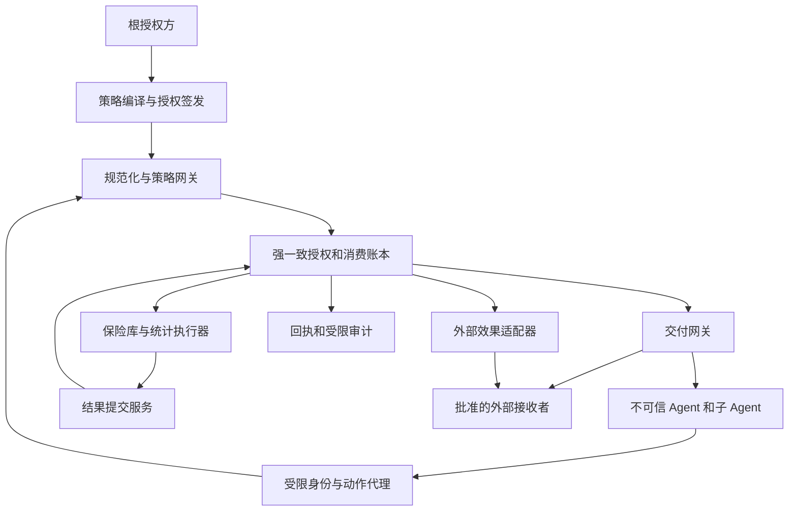
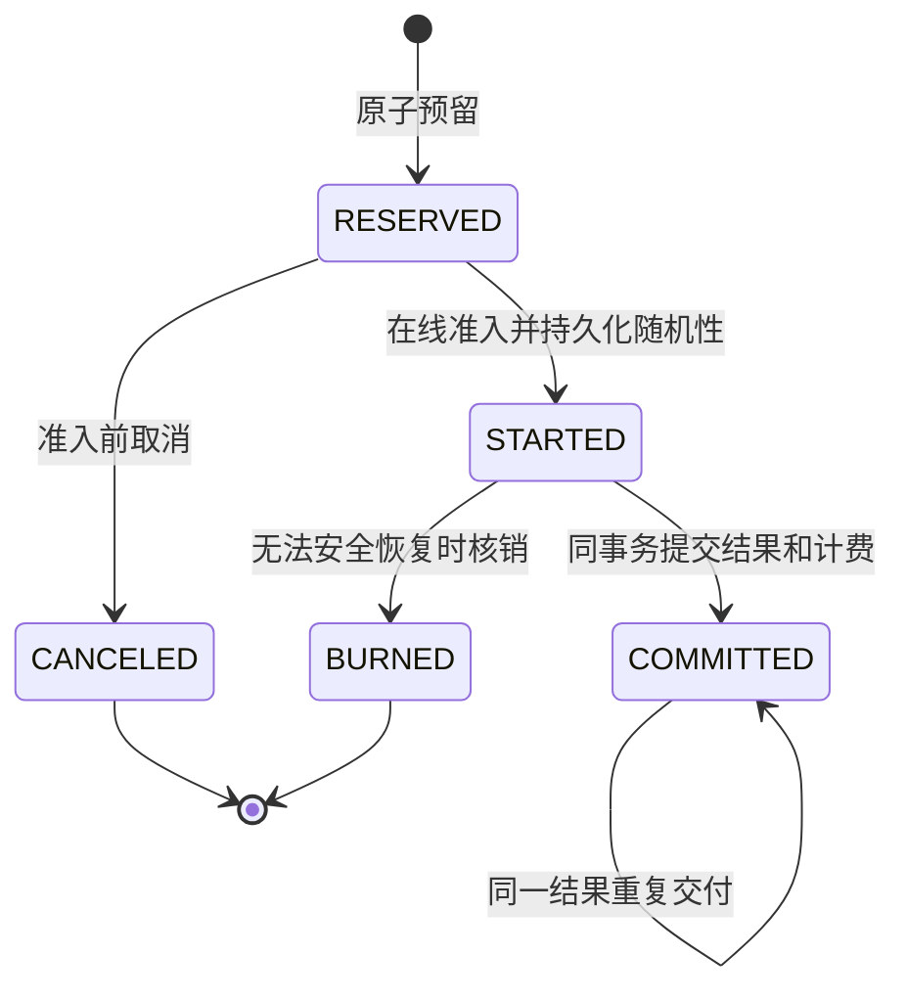
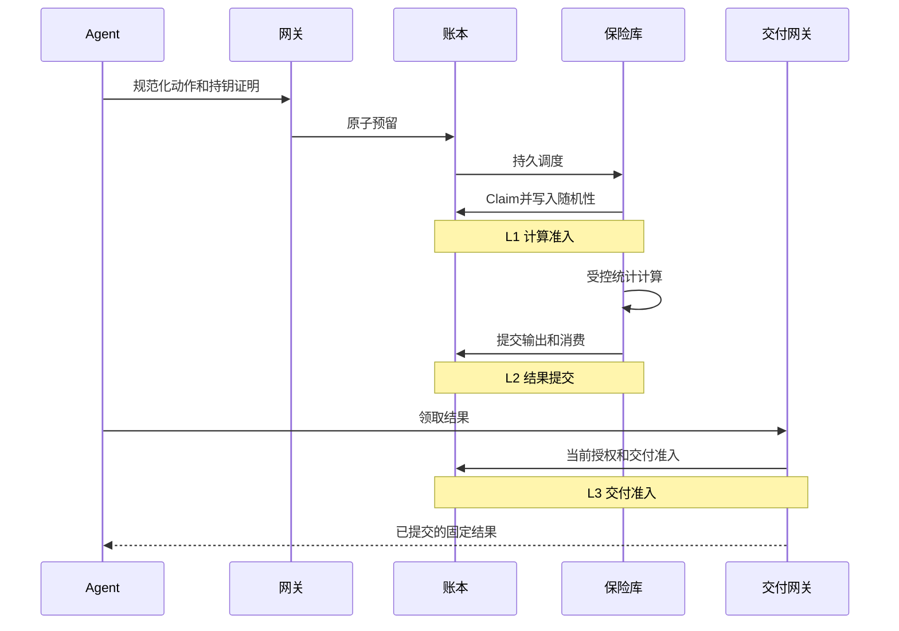
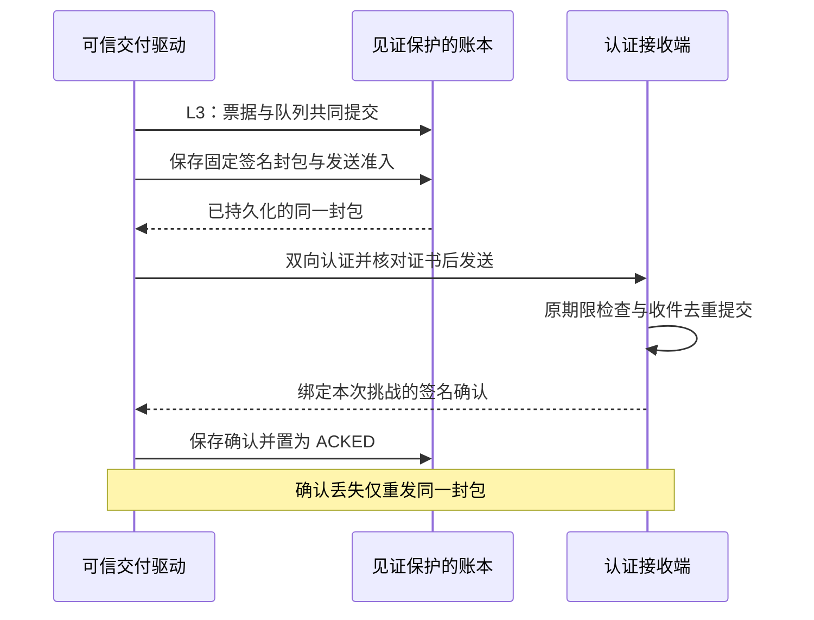
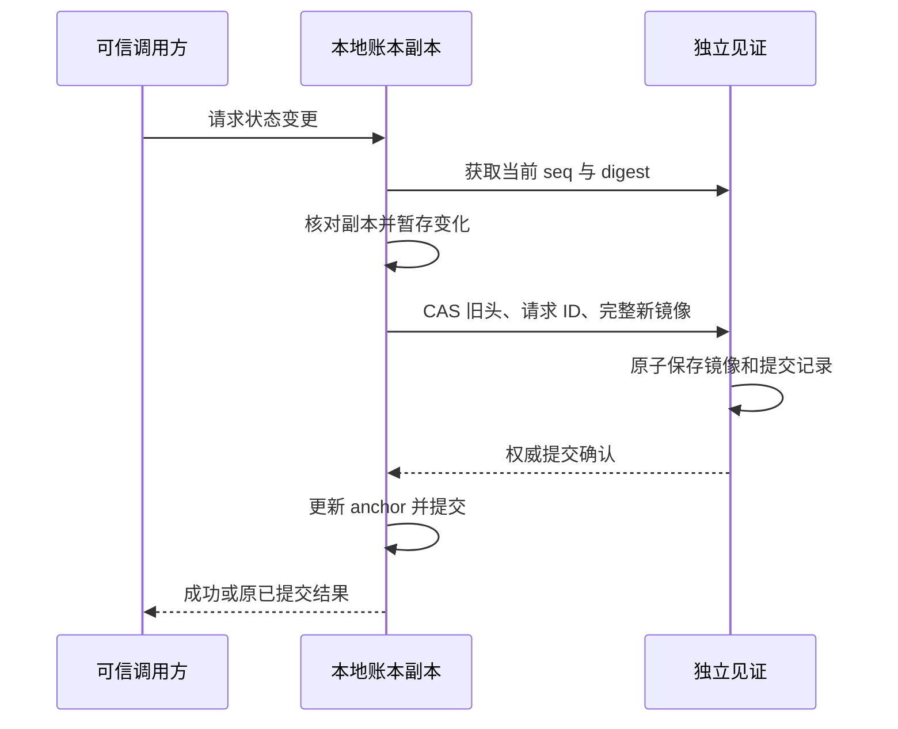

本设计延续原方案“受约束的委托、可验证的行动、可计量的信息释放”，将其收敛为一个可实施的首版协议和两个独立扩展。核心决策是：**不可信 Agent 只能提出动作；可信服务必须把精确动作、授权来源、预算占用、唯一输出和交付资格共同绑定。**

首版采用单一管理域、强一致账本、受控统计计算和在线出口。动态任务可以并发；同一保护域的披露按确定序号交付。秘密使用、精确披露和差分隐私统计采用不同协议类型。零知识授权、跨组织消费和降低基础设施信任不进入首版的默认安全承诺。

设计状态为详细规格草案，基准日期为 2026 年 10 月 25 日。协议构造、部署参数和实验门槛是本设计的选择；形式化命题仍需证明。有限模型、数据库原型、签名委托、敏感字段加密、见证恢复与本机认证连接分别报告证据，不能相互替代或合并宣称完整安全验证。

# 一 设计范围与原方案的进一步收敛

| 议题 | 本版决策 | 理由 |
|---|---|---|
| 核心安全单位 | 带稳定 operation_id 的一次动作实例 | 网络请求次数与真实披露次数不同 |
| 预算归属 | 数据控制域账户加授权范围内的额度约束 | 新建 Agent、任务和数据副本不能产生新预算 |
| 权限委托 | 单动作使用一条根到叶的委托链 | 避免不同父链的属性被拼成不存在的授权 |
| 并发 | 并发提案和计算，账本事务线性化，保护域内顺序交付 | 先得到可证明的组合，再优化调度 |
| 数据与噪声 | 私有输入、随机性、候选输出留在可信边界 | 防止模型通过参数、日志和错误编码原始秘密 |
| 开始计算后的取消 | 不因超时或撤销退还隐私额度 | 防止不确定披露和选择性重采样 |
| 撤销 | 分别阻断新的计算准入与新的交付准入 | 计算完成不代表仍有权领取结果 |
| 精确一次 | 保证唯一消费与唯一已提交输出 | 外部现实效果唯一性另依赖提供方契约 |
| 首版统计功能 | 用户级计数与固定桶直方图 | 能明确贡献边界和离散噪声机制 |
| 密码增强 | 后续先隐藏授权属性，再考虑证明状态消费 | 不把 ZK 当作防双花或真实执行的替代品 |

完整用户场景是：机构委派分析 Agent 和写作 Agent 分析敏感客户数据；分析 Agent 只能查询批准的统计机制；写作模型只收到许可的统计结果。跨任务、跨快照、跨接收者的查询共同消耗同一保护域预算。示例中的客户数据不涉及任何真实个人。

原始设计入口：[设计Agent密码学系统](chatgpt-conversation://6adce06c-7384-83ea-9386-6854c1e4a2c5)。

# 二 研究定位与必须继承的基础

本设计的研究候选问题是：**能否把并发、撤销、崩溃恢复中的真实释放轨迹，严格映射到受隐私过滤器约束的交互机制，同时维持授权与输出绑定？** “有委托令牌”“有预算账本”“采用差分隐私”本身均不作为原创贡献。

| 基础或近邻 | 已有工作可支持的判断 | 本设计应增加的论证 |
|---|---|---|
| AgentCrypt v3 | 确定性封装、输入策略交集和受控函数释放已有直接设计 | 消费、随机化、重试和可观察事件如何共同组合 |
| AID-Guard v1 | 提交时绑定、结果不确定时保留预约和带屏障的无效果恢复已有设计 | 统计随机性、唯一披露与隐私账户的衔接 |
| Fault-Tolerant Budget Conservation v1 | 额度所有权、故障隔离和晚到效果不能只靠超时退款处理 | 将资源消费语义连接到敏感输出和隐私过滤器 |
| Cohere | 多应用共享隐私资源及分配已有系统工作 | Agent 委托与消费实例如何建立可追踪关系 |
| DPolicy | 不同披露的保护范围、语义和组合不能仅用一个 epsilon 数字概括 | 将数据血缘、授权范围和恢复行为一起约束 |
| 固定阶数 RDP 过滤器 | 自适应组合有现成定理 | 实际执行轨迹满足定理的前提 |
| 并发交互 DP 组合 | 并发本身并非未解决的新问题 | 证明请求、错误、顺序和审计都在建模视图中 |

对应原始来源：[AgentCrypt](https://arxiv.org/html/2512.08104v3)、[AID-Guard](https://arxiv.org/html/2608.21159v1)、[预算守恒论文](https://arxiv.org/html/2610.00349v1)、[Cohere](https://arxiv.org/abs/2301.08517)、[DPolicy](https://arxiv.org/html/2505.06747v1)、[Rényi 过滤器](https://arxiv.org/abs/2008.11193)、[并发交互隐私组合](https://arxiv.org/html/2309.05901v2)。表中没有把论文的原型结果当作本系统的实测结果。

认证接入可以复用 OAuth；DPoP 仅凭自身不覆盖一般正文与头部完整性。应用动作仍需完整签名，HTTP 互操作层可选择覆盖明确组件的 HTTP Message Signatures。[RFC 9449 第 11.7 节](https://www.rfc-editor.org/rfc/rfc9449#section-11.7)、[RFC 9421](https://www.rfc-editor.org/rfc/rfc9421)。

# 三 安全目标和信任边界

## 攻击者能力

攻击者可控制全部 Agent 程序及其提示，复制可见令牌，伪造参数，串谋共享所得信息，创建任务和子 Agent，并发重放、延迟消息、制造回复丢失和触发服务重启。其权限受根授权的边界限制，不能修改可信运行时、读取保险库私钥或直接改写权威账本。

授权不能阻止联盟分享其已合法获知的明文。目标是联盟无法新增超出有效授权的访问机会，不能使共享预算增殖。不同授权允许的不同数据不能被任意拼接成一个新的联合查询权限。

## 可信组件

| 组件 | 承担的保证 | 失效后首先丢失的性质 |
|---|---|---|
| 根授权方 | 授予正确的结构化权限 | 授权与用户意图一致性 |
| 身份和密钥代理 | 绑定实例身份并限制签名用途 | 请求者身份及授权来源 |
| 策略解释器和规范化器 | 精确解释请求和约束 | 动作绑定及权限不放大 |
| 账本 | 原子消费、撤销、持久化、防逻辑回滚 | 预算守恒与恢复安全 |
| 数据目录与保险库 | 正确数据血缘、贡献限制、机制、随机性 | 数据保护域和 DP 保证 |
| 出口与适配器 | 所有效果和披露经过检查 | 端到端中介与效果对应 |
| 独立见证（见证配置） | 线性化 CAS、确认状态不回滚、完整恢复镜像可用 | 本地副本回滚隔离与恢复安全 |
| 运维与备份恢复流程 | 不用旧状态恢复可用额度 | 防止重复消费 |

首版信任这些组件及管理者，不宣称抵抗恶意云管理员。TEE、MPC 或阈值组件的接入必须另行定义攻击者与失效模式。

## 安全目标

- **授权一致性**：每次计算准入都有有效根授权、完整委托链及精确动作。

- **消费覆盖**：每个可能产生新披露的动作始终有对应的占额或不可逆核销。

- **输出一致性**：同一操作只能提交一个规范化输出；重试不能生成新统计样本。

- **交付一致性**：交付对象、接收者和版本与已提交记录相符。

- **撤销一致性**：撤销在线性化后阻断新的准入；已获交付准入的发送可能继续。

- **可组合隐私**：在明确的邻接关系、机制和观察视图下，累计统计披露满足所声明预算。

- **可审计性**：验证者能检查记录之间的一致性；记录并不自动证明现实世界事实。

拒绝服务、被合法接收者复制的明文、物理计时与微架构侧信道不属于首版密码保证。应用层错误、顺序和是否终止仍需建模，不能笼统归入“侧信道”而跳过。

# 四 架构与所有出口



首版建议将账本、提交服务和交付网关放在同一安全管理域。数据库保存小型加密输出及事务记录，避免把对象存储和账本的分布式提交问题提前引入原型。

Agent 容器没有保险库文件挂载、云凭证、数据库连接、直接互联网出口或共享宿主目录。只可访问身份代理与动作网关。外部 LLM、邮件、文件下载、长期记忆、任务间消息、遥测均登记为出口。

**只做网络白名单不足以阻止泄露。** 如果外部写作模型可接收自由文本，该文本只能来源于公共输入及该接收者获准看到的结果。凡进入同一不可信 Agent 上下文的受限结果，后续输出默认继承其接收者限制的交集；模型不能自己声明“已经去掉敏感内容”。DP 允许后处理，不自动取消接收者约束。

生产运行日志只含不透明操作 ID、公开错误码和聚合指标。请求正文、原始查询结果、随机种子、秘密派生标识不进入普通遥测。调试通道也是一个需要权限的出口。

# 五 身份体系和密码对象

## 密钥分工

| 密钥 | 持有位置 | 可以签署或处理的对象 |
|---|---|---|
| 根授权签名密钥 | 根授权服务的密钥保管组件 | Grant 和受控策略版本 |
| 实例密钥 | 工作负载身份代理 | 本实例的 ActionProof 与受限 Delegation |
| 执行许可密钥 | 账本许可服务 | Permit |
| 执行回执密钥 | 提交与回执服务 | Receipt |
| 存储加密密钥 | 保险库密钥保管组件 | 快照、随机性、私有中间状态及结果的加密与用途隔离 |
| 接收者加密密钥 | 接收者登记的独立密钥 | 交付结果的解密 |

签名代理没有任意字节签名接口。它根据经过认证的实例连接补入 tenant、actor_id 和密钥引用，校验可签对象类型。能力句柄必须绑定工作负载会话；复制一个字符串不应转移全部能力。

实例身份与公钥分开：换钥可以继承同一主体的资格，但不能创造新账户或恢复已撤销的授权。旧凭证是否继续有效由密钥登记与撤销状态决定，不能仅因证书时间尚有效而放行。

## 密码套件和编码配置

首版配置选择 Ed25519 签名（COSE 算法明确固定为 -19）、SHA-256 公开对象摘要、确定性 CBOR 编码与 COSE_Sign1。固定计数的存储候选配置已使用库提供的 AES-256-GCM-SIV，随机 nonce 每次新生成；生产密钥保管与轮换仍待实现。低熵结果使用独立子密钥的 HMAC 绑定，不保留裸结果摘要。接收者传输加密可使用 HPKE 的 X25519、HKDF-SHA256、ChaCha20-Poly1305 组合，同时验证服务签名；该传输配置尚未接通。 新增固定计数推送使用本机双向 TLS 与双方应用签名；不等同于上述 HPKE 中继端到端加密。

这些是工程选择，未定义新的密码原语。格式基础参见 [CBOR RFC 8949](https://www.rfc-editor.org/rfc/rfc8949)、[COSE RFC 9052](https://www.rfc-editor.org/rfc/rfc9052)、[HPKE RFC 9180](https://www.rfc-editor.org/rfc/rfc9180)。

应用配置还必须强制：

1. 带协议名、对象类型、格式版本和算法套件的签名域分离。

2. COSE 的算法标识和密钥标识放入受保护头；接收者按注册表确定密钥角色。

3. CBOR 固定使用 RFC 8949 §4.2.1 core deterministic encoding：最短整数、确定长度、按编码后键字节的字典序排序。不能与 §4.2.3 的长度优先排序混用。拒绝重复键、未知字段和非规范编码。

4. 钱、调用次数和 RDP 计费均使用整数单位。禁止 NaN、浮点金额、隐式类型转换。

5. 身份和资源 ID 使用不透明字节或受限 ASCII。自由文本不参与权限匹配。

6. 默认参数在签名前展开；枚举、单位、排序、空集合语义和版本全部显式。

7. SHA-256 摘要只作为受控环境中的对象绑定。敏感低熵内容不直接以裸摘要公开。

推荐的签名输入语义为：

```text
COSE_Sign1(
  tag = 18,
  protected = {1: -19, 4: kid},
  unprotected = {},
  external_aad = Encode([
    "agent-action-system", profile_version, object_type,
    "Ed25519-SHA256-CBOR-v1"
  ]),
  payload = DeterministicCBOR(object)
)
```

采用明确的 Ed25519 算法标识 -19，依据 [RFC 9864 §2.2](https://www.rfc-editor.org/rfc/rfc9864#section-2.2)；不再把多态 EdDSA 标识 -8 当作本配置的可选替代。这里的 SHA-256 指对象摘要，Ed25519 原语仍由库按标准执行。签名输入使用 [COSE Sig_structure](https://www.rfc-editor.org/rfc/rfc9052#section-4.4)；编码细节遵循 [CBOR 核心确定性规则](https://www.rfc-editor.org/rfc/rfc8949#section-4.2.1)。

服务应限制链长、对象大小、数组长度和解析深度，例如首版链长不超过 8、动作不超过 64 KiB。数值是初始配置，不是性能实测结论。

# 六 数据契约

以下是完整协议的语义字段列表；全对象族的 CDDL、拒绝规则和正反测试向量仍须逐项冻结。当前 count-direct-v1 与 count-delegated-v1 已实现固定计数的直接授权、签名委托链和严格编码，并提供受限 CDDL 与向量；这不替代完整通用 Action、Grant、Delegation、Permit 与 Receipt。示例字段名不代表已经存在的标准。

## Grant 与 Delegation

```text
Grant {
  profile_version, grant_id, tenant_id, issuer_id, subject_id,
  subject_key_ref, policy_id, policy_hash, interpreter_digest,
  resource_scope, operation_scope, recipient_scope, mechanism_scope,
  account_bindings, valid_from, expires_at, max_depth,
  revocation_domain, issued_epoch
}

Delegation {
  profile_version, delegation_id, root_grant_id,
  parent_credential_digest, issuer_id, issuer_key_ref,
  subject_id, subject_key_ref, child_policy, depth,
  not_before, expires_at, account_bindings
}
```

每跳签名者必须等于上一跳 subject，深度必须加一，子策略必须衰减，账户绑定不能换成新预算。链校验也检查根与所有祖先的撤销。签发时的 epoch 不替代当前状态查询。

## Action 与 ActionProof

```text
Action {
  profile_version, tenant_id, task_id, operation_id,
  root_grant_id, leaf_credential_digest, actor_id, actor_key_ref,
  mode, executor_id, adapter_digest, tool_schema_digest,
  resource_refs: [{resource_id, snapshot_id, manifest_digest}],
  canonical_arguments, recipient_id, recipient_key_version,
  output_schema_id, output_policy_hash,
  mechanism_id, mechanism_digest, privacy_domain_id,
  account_ids, maximum_charges,
  policy_hash, interpreter_digest, not_before, deadline
}

ActionProof {
  action_digest, leaf_credential_digest, audience,
  server_challenge, challenge_expiry, proof_id
}
```

ActionProof 由叶端实例密钥签署。挑战和请求签名用于证明本次访问者身份；重试可以换 proof_id 和挑战，但 operation_id 与 Action 字节保持不变。账本主键为 tenant_id 加 operation_id；同 ID 不同动作永久冲突。

接收者更换、快照更换、机制更换和费用上限更换均是新动作。不能通过更新数据库中的“最新默认配置”隐式改变旧动作。

## Permit 和 ReleaseRecord

```text
Permit {
  permit_id, operation_id, action_digest,
  executor_id, fence_generation, admission_seq,
  policy_hash, registry_versions, reserved_costs,
  issued_at, latest_start_time
}

ReleaseRecord {
  operation_id, action_digest, mechanism_digest,
  snapshot_manifest_digest, privacy_domain_id,
  encrypted_output, storage_key_ref,
  output_binding, charged_costs, commit_seq,
  original_recipient_id, output_policy_hash
}
```

Permit 是绑定精确动作的调度凭证；首版执行器仍必须在线 Claim，不能拿一份离线签名跳过撤销与单次消费。

output_binding 在可信域内使用规范化输出摘要。对审计者披露时使用带秘密随机开口的承诺或加密记录，避免枚举少量候选输出。随机种子与承诺开口不外发到普通审计。

## Receipt

```text
Receipt {
  receipt_id, operation_id, action_binding,
  authorization_record_ref, admission_seq, public_release_seq,
  charged_costs, output_binding, executor_id,
  status, public_audit_checkpoint, previous_receipt_ref
}
```

首版区分 COMPUTATION_COMMITTED、DELIVERY_ADMITTED、DELIVERY_ACKNOWLEDGED；没有接收方签名确认时，不写“已被接收”。回执签名表明服务作出相应声明，实际执行仍依赖可信组件或外部效果证据。

# 七 策略语言与权限衰减

首版策略语言只允许有限集合、整数闭区间、资源快照引用、公开参数谓词和有限枚举。策略是合取，没有任意代码执行、网络查找、自然语言谓词或可改变语义的自定义函数。

| 约束 | 子策略合法条件 |
|---|---|
| 操作与资源 | 子集合包含于父集合 |
| 接收者 | 子接收者集合包含于父集合 |
| 机制 | 子机制集合及版本包含于父集合 |
| 参数范围 | 子区间包含于父区间 |
| 时间 | 子时间窗口包含于父时间窗口 |
| 深度 | 子深度小于等于根上限，且严格递增 |
| 预算账户 | 引用原账户或受控子分配，不得新增等额账户 |
| 输出策略 | 保留父限制，可以增加限制 |
| 精确披露 | 只有根明确授予的字段和接收者可用 |

有效策略是所有祖先约束的交集。空集合意味着拒绝，不解释为“无限制”。不支持的策略形式直接拒绝，不能退回模型解释。

例如根允许 count、histogram，资源为 snapshot_A，接收者为 internal_writer，深度上限为 3。子 Agent 只能进一步缩成 count；不能改用外部邮箱，不能把 snapshot_A 替换为“同一文件的最新版本”，也不能把 privacy_domain_id 改成新任务名。

多输入查询必须由同一有效授权覆盖全部输入，并满足全部输入保护域的规则。首版跨域查询不开放；扩展版需要在一个原子事务中预留所有关联隐私账户，按每个保护单位分别计费。

委托图允许多个任务引用同一叶凭证，但这种合流不复制额度。子任务“预算上限”只是附加限额，所有消费同时检查共享全局账户。父、子、全局三个上限是三个独立约束，不将它们相加当成新的总预算。

如果根授权希望把额度完全转给子 Agent，必须显式执行账户转移事务并减少父可用额度。一般委托仅衰减权限，不自动删除父权限。

# 八 统计释放状态机

为避免混淆，统计释放与支付等外部效果使用不同状态机。以下状态机适用于受控保险库中的统计计算。



| 状态 | 允许做什么 | 隐私额度 |
|---|---|---|
| RESERVED | 尚未读取私有数据，可取消 | reserved |
| STARTED | 可信计算；只允许用同一持久化随机性恢复 | reserved，禁止退款 |
| COMMITTED | 按交付权限领取已保存输出 | spent |
| CANCELED | 永不重新打开，同 ID 不能复活 | 返回 free |
| BURNED | 操作终止，无输出可领取，同 ID 不能复活 | spent |

INDETERMINATE 作为运行健康状态记录在内部，不构成退款状态；对于统计操作，它仍保留 STARTED 的额度覆盖。若最终无法确认或恢复，则核销到 BURNED。

重要变化是：**STARTED 后，即使没有已知输出，首版也不退隐私额度。** 这比“证明输出尚未被交付就退款”更保守，但可避免内部输出、取消与重新选样之间复杂的选择偏差。未交付不等于未计算；消耗预算而无输出是一种可能的可用性损失。

每个账户分别满足：

```math
B_a=F_a+R_a+S_a,\qquad F_a,R_a,S_a\geq 0.
```

每个 RESERVED 或 STARTED 操作在相关账户中有足额 reservation；COMMITTED 或 BURNED 具有不可逆 charge。spent 包含未交付但已核销的额度，不应被解释成“实际观察到的隐私损失”。

交付状态是独立的附表，可多次记录 delivery admission。它不能把 COMMITTED 改回 STARTED，也不能退款。

# 九 协议的三个线性化点

下述逻辑状态变更需要在权威历史中提交。普通数据库原型以本地事务为提交边界；新增见证配置以独立见证接受完整后状态的 CAS 为权威提交点，本地事务随后落地。只有两者完成后才向调用方返回成功或结果；见证已接受而本地未提交时，不能视为未准入或退款，须恢复见证状态。见第十六节恢复协议。

## 创建与预留

Agent 先调用 prepare 获取规范化动作，再用叶端 ActionProof 提交 execute。prepare 只访问公开登记信息，不读私有数据，不占用预算，也不承诺后续一定获准。

execute 在事务中执行：

```text
verify ActionProof and exact canonical bytes
load all required accounts in stable account_id order
load root and ancestor revocation records with compatible locks

if (tenant_id, operation_id) already exists:
    require stored_action_digest == submitted_action_digest
    require caller can inspect this operation
    return existing opaque handle

verify policy, versions, recipient, expiry and snapshot references
calculate costs from trusted mechanism registry
require server_costs <= action.maximum_charges
require every account.free >= server_costs[account]

insert immutable operation(state=RESERVED, admission_seq=next_public_queue_seq)
move each account.free -> account.reserved
insert durable dispatch outbox
commit
```

重复请求走已有操作，不重新占额。冲突时拒绝且保留旧对象；客户端不能通过删除句柄清除墓碑。

## L1 计算准入

执行器取得 outbox 项后，向账本调用 Claim。事务锁定该操作及相关撤销记录，检查 RESERVED、截止时间、执行器身份、策略与注册表版本、资源快照可用性，并写入 fence_generation 与 STARTED；admission_seq 已在预留时按公开队列顺序固定。

随机种子在读取任何私有数据前生成并加密持久化，只有事务选中的种子有效。一个操作可因事务重试产生被丢弃的候选种子，但不能先读取数据或观察结果再挑选种子。非成功提交的候选不得进入计算。

Claim 与撤销在相同权威顺序中线性化。撤销先提交则 Claim 失败；Claim 先提交则允许内部计算继续。采用锁或可证明等效的条件更新，不能只依赖某个无锁缓存读。

STARTED 不需要靠“把消息只发一次”维持安全。重复调度返回同一执行身份与已登记随机性。恢复执行器可以获得更高 fencing generation，但输入、机制版本与随机带不变。

## L2 结果提交

执行器在可信边界中计算固定格式输出；没有 stdout、流式 token、外部 trace 或直接网络交付。

提交事务执行：

```text
require operation.state == STARTED
require authenticated executor and current fence_generation
require exact action_digest, snapshot, mechanism and output schema
require output <= configured maximum size
store encrypted canonical output and its binding
move reserved cost -> spent cost in all accounts
set operation.state = COMMITTED and allocate commit_seq
insert receipt-generation outbox
commit durably
```

结果小于 64 KiB 时首版将加密结果与消费记录放在同一数据库事务。大结果暂不支持。后续若使用对象存储，必须先写不可变的保险库密文，再提交其确切版本引用；未提交对象不得有对外可读权限或预签名链接。

如果 COMMITTED 已存在，提交重试只能返回现有记录。不同输出摘要属于执行完整性告警，不能覆盖原结果。签名回执由已提交记录重建，签名失败不会重新执行计算或退还隐私额度。

## L3 交付准入

只有交付网关能解密已提交结果。每次新的 fetch 必须检查主体身份、接收者、原授权链、有效期和输出策略，再交由公开发布控制器决定何时对外可见。不能因为内部计算尚未完成而返回 PENDING，也不能把完成后返回结果、未完成返回状态码作为安全的统一接口；这种差异会把私有计算时长变成应用层比特。L3 准入仍须绑定已提交结果，但内部 NOT_COMMITTED 等状态仅供可信服务使用。

交付准入先于撤销时，本次发送可以继续；撤销先于准入时返回拒绝。这个承诺针对准入顺序，不能解释为撤销提交后绝不会有字节到达网络另一端。

HTTP 回复丢失后，客户端用新的持钥证明请求相同 operation_id；网关必须为这个新公开请求重新检查领取权限。历史 delivery_id 仅供可信网关恢复原已准入发送，不能作为客户端绕过当前撤销的可重放能力。生产票据必须绑定网关、接收者、传输会话和有限有效期。通过检查后发送保存的同一明文结果；传输重新加密可以产生不同密文，但不改变统计样本，不额外扣隐私预算，其他传输费用单独计费。

交付票据实例化为 tenant、operation_id、output_binding、recipient、gateway、session、issued_at 和 expires_at。原型将票据有效期限制为至多 60 秒，并取根授权到期时间的较早者；60 秒是实验配置而非通用推荐。相同票据重试不延长有效期。恢复只能由同一网关和会话执行，且仍受原截止时间约束；新公开请求即使携带旧票据 ID，也重新检查当前撤销和到期状态。

有效期在可信服务事务中采样的时钟上检查，不保证字节在某个真实时间之前到达。handoff_admitted 记录的是传输交接准入，不能用于声称接收者已经收到结果。原型持久记录时钟下界；过期请求被拒绝时仍保存观察时刻，避免拒绝事务回滚后把已过期票据重新视为有效。该措施不抵抗账本快照回滚或恶意管理员。 新增推送适配器在接收端首次收件事务中按采样时钟再次检查原期限，另以已提交收件记录生成签名确认；该确认仍依赖接收端诚实与持久化假设。 accepted_at 是事务内采样时间，不是实际提交或网络到达的墙钟期限。

签名有效的历史回执不授予永久领取权。结果过期或丢失时返回 RESULT_UNAVAILABLE；不能以同一 ID 免费重新计算。

按顺序分配 publication 序号或交付准入，不自动保证多个网络连接上的实际观察顺序。新增推送原型接通固定路由 FIFO 与接收端去重，但仍需完整公开顺序协议，明确首个可观察事件、在途发送、确认丢失、过期缺口、跨接收者串谋及客户端重排。没有开放可绕过顺序控制器的公共 fetch；在完整观察协议完成前，不能以事务和认证网络测试通过来宣称应用层视图满足 DP。



## 固定计数的认证推送与持久确认

新增 DeliveryLedger 在原计数和见证规则上建立 mtls-count-delivery-outbox-v1 配置。可信驱动者只推送已获 RELEASE 资格、已通过 L3 的原结果，没有对不可信 Agent 开放就绪状态查询。可信管理方固定租户、接收者、网关和逻辑会话，并登记双方 TLS 证书指纹及应用签名公钥/kid。会话可以跨网络重连恢复，不是 TLS 会话号；路由登记后不能换绑身份。

L3 票据与 QUEUED 发送记录在同一个见证保护事务中创建。发送准备重新检查原期限、当前路由、队首未确认序号、原结果绑定及网关签名密钥，再将固定 CountDelivery 签名封包加密保存为 READY。该封包绑定部署、租户、双方身份与证书、逻辑会话、交付 ID、操作 ID、序号、原有效期和八字节计数结果。发送方必须通过双向 TLS、主机名及精确接收者证书指纹检查，才发送任何结果字节；接收端也检查客户端证书与固定网关签名。

接收端用独立密钥保护收件库，原子检查原有效期、时钟下界、下一序号和重复记录，先保存再签署 CountDeliveryAck。同一交付 ID 只有完全相同的签名封包可以重试，不能替换结果；并发重发只产生一条收件记录。确认绑定本次新的随机挑战、请求摘要、原封包摘要、票据、接收者证书和首次 accepted_at。发送方验证后，将确认与对应请求证据加密保存为 ACKED；这些记录均纳入见证恢复镜像。



| 断点或状态 | 恢复规则 | 不代表什么 |
|---|---|---|
| READY 后尚未发送 | 原期限内重发同一封包 | 尚未获得接收确认 |
| 接收端提交后确认丢失 | 精确重试返回首次接收事实 | 不能认定未披露或重新抽样 |
| 确认收到后本地提交失败 | 重试原封包，或恢复见证中的 ACKED | 网络成功不等于本地记账完成 |
| ACKED 后再次驱动 | 返回内部已确认状态，不再发送 | 不重新授予领取权限 |
| 原票据过期且结果未知 | 停止结果重传；终止扩展请求原子确认或关闭 | 不退款、不续期、不自动替代 |
| 队首过期 | 取得并持久保存有效终态后，终止扩展可继续推进 | 不能仅凭超时或查不到记录跳过 |

根或委托撤销阻止新 L3，原已准入票据仍遵循原有限期恢复规则。路由撤销另阻止后续准备发送，不能召回已在途的数据。接收端首次收件事务按采样时钟检查期限，过期拒绝仍保存时钟下界；迟到的合法历史确认可以归档，却不能授权新的结果传输。两个签名对象使用独立签名域；封包及确认在 SQL 写入前经 AEAD 保护。字段和约束见 prototype/count_delivery_v1.cddl 与 prototype/delivery_transport_contract.json，CDDL 和跨实现互通仍待独立验证。

确认仅表示配置中的接收者声明已保存，不证明恶意接收者诚实、用户已阅读或后续业务副作用只发生一次。接收去重依赖收件记录持久保留且不回滚；下述 TLSWitnessedMixedRecipientInbox 已验证有条件的接收端本地回滚隔离和精确恢复；生产权威自身非回滚与独立故障域仍未建立。下述终止扩展已补齐固定路由、L3 后的过期确认与关闭，仍缺 L3 前未交付事件、跨路由发布、去重清理规则与完整网络观察证明。当前本机 TLSv1.2、无界总工作线程及全量见证持锁结构也不构成生产验收。

## 过期任务的无结果终止协议

TerminalDeliveryLedger 使用独立存储配置 mtls-count-delivery-terminal-v1，扩展固定路由的已准入票据。票据过期后，可信网关为最早未解决序号准备 CountDeliveryTerminal 签名控制对象，绑定原部署、路由、双方证书、交付 ID、操作、序号及原时间窗；曾准备过封包时附完整签名封包的 SHA-256，否则为空。控制对象不携带计数或原结果封包，先加密落盘并通过见证提交，再通过原认证通道发送。新旧配置互相拒绝，暂不提供旧库迁移。

接收端在与正常收件相同的写事务内核对路由、原期限与时钟下界。已经保存原封包时，只有摘要及全部票据字段匹配才返回 ACCEPTED；已有关闭标记时返回同一 CLOSED；两者均不存在时，只能为当前下一序号持久保存关闭标记后返回 CLOSED。没有可用于推进队列的 ABSENT 或“暂时查不到”结果。关闭标记同时阻止原交付 ID 和同一序号被晚到或重签的结果占用。

| 事务先后 | 接收端结果 | 发送方依据 |
|---|---|---|
| 有效期内准入的收件事务先取得写锁 | 终止事务等待，随后返回原 ACCEPTED | 原封包及原 accepted_at |
| 过期终止事务先提交关闭 | 后到结果被持久标记拒绝 | CLOSED 及首次 closed_at |
| 原结果已保存，但普通确认丢失 | 过期后只返回原接收事实 | 不重传计数结果 |
| 关闭已提交，但终止确认丢失 | 同一控制对象返回原关闭事实 | 不另建标记、不改变首次时间 |
| 未收到有效终态 | 保留未解决状态 | 不能跳号、退款或自动续期 |

时间检查采用事务内采样值：较早收件事务可以在墙钟越过原期限后完成提交，终止事务必须等它完成并报告 ACCEPTED；不能把 accepted_at 当作磁盘提交截止时间。若关闭先提交，后续结果写入会被关闭标记隔离。共同事务、持久标记和单调时钟下界一起构成这次终止协议的条件性安全论证；仅做一次“是否存在”查询不具备同样保证。

CountDeliveryTerminalAck 使用独立签名域，绑定本次随机挑战、请求摘要、控制对象摘要、原封包摘要、接收者身份，以及 ACCEPTED/CLOSED 与首次事件时间。发送方验证后将请求和确认加密保存到见证保护的终止表，再把该序号从待处理队首移除。原 outbox 保留发送证据；有效 ACKED/CLOSED 状态由终止表派生，不能只读取旧 outbox.state。相反的签名终态、改变首次事件时间或在 CLOSED 后出现矛盾普通确认都被拒绝。

根或委托撤销不妨碍核对原已准入票据的终态，因为不重新释放结果；当前传输路由撤销或证书无效仍会阻止请求，不通过旧身份降级连接。关闭不退款、不重新抽样、不新建 L3、不延长原有效期。见证已接受终态而本地提交丢失时，恢复原确认即可继续；原封包与原消费保持不变。

协议资产为 prototype/count_delivery_terminal_v1.cddl 与 prototype/delivery_terminal_contract.json。该扩展只解决 L3 后固定路由的过期终止，该计数基础配置未解决 L3 前的 WITHHELD/取消、跨路由发布或生产接收端灾难恢复；混合接收端另有下述见证恢复扩展。它还暴露路由、序号、时间、是否准备过封包以及已接收/已关闭等元数据，只能供可信驱动者使用；不携带结果不等于零信息，也不构成完整网络观察 DP 证明。

# 十 外部效果和故障恢复

秘密使用的典型动作是让适配器用机构 API 凭证调用某个明确接口。凭证不进入模型；目标 host、路径模板、方法、参数和允许响应均受策略控制。任意 URL 代理或任意 HTTP 头透传会破坏此保证。

支付、发邮件、提交外部任务等采用 RESERVED、ADMITTED、INDETERMINATE、SETTLED、NO_EFFECT 状态。它们不能简单复用统计计算的“本地结果提交等于完成”。

| 提供方能力 | 可以承诺 | 失败恢复 |
|---|---|---|
| 效果与许可共事务 | 事务边界内一次效果 | 按事务状态查询 |
| 持久幂等键、参数绑定、终态查询、可靠屏障 | 契约范围内最多一次效果 | 查询、同键重试或带屏障的无效果确认 |
| 仅有短期幂等缓存 | 缓存有效期内的有限去重 | 超过保留窗口后不自动重发 |
| 无幂等和终态查询 | 只能确保本系统不自动重复准入 | 超时保持 INDETERMINATE，禁止自动替代调用 |

NO_EFFECT 证据必须绑定提供方、操作、参数摘要、幂等键、世代号与取消屏障。单纯“查不到记录”或“请求超时”不够。外部退款也不代表原效果没有发生，原效果与补偿应分别记账。这些原则继承 [AID-Guard 的恢复设计](https://arxiv.org/html/2608.21159v1) 与 [预算守恒工作的故障模型](https://arxiv.org/html/2610.00349v1)。

统计路径的故障表如下：

| 故障位置 | 恢复行为 | 禁止行为 |
|---|---|---|
| 预留事务前 | 正常重新提交 | 猜测已占额 |
| RESERVED 后调度前 | 重放 outbox，或准入前取消 | 发未登记许可 |
| STARTED 后计算前 | 用持久化随机性恢复 | 超时退款 |
| 计算后提交前 | 同随机带重算或核销 | 新抽样后挑选较好结果 |
| COMMITTED 后回复前 | 读取相同结果 | 重新执行机制 |
| 交付后确认丢失 | 再次认证，重传相同结果 | 将未确认解释为未披露 |
| 旧执行器晚到 | 世代号不匹配则拒绝提交 | 允许旧 worker 覆盖结果 |
| 主库故障 | 只切到拥有确认写入的权威副本 | 用落后副本恢复免费额度 |
| 密文损坏或种子丢失 | 保留消费，停止该操作 | 从同一操作重新抽样 |
| 旧备份恢复 | 隔离只读，核对外部检查点并重建 | 直接按旧余额接收写入 |

预算安全依赖不回滚的持久历史。哈希链只能帮助发现部分篡改，无法单独阻止整个历史被回滚。生产恢复应将已对外生效的检查点保存在独立故障域；无法重建这些检查点对应的消费时必须冻结账户。独立见证提高回滚可检测性，不把首版升级为抵抗所有管理员串谋的系统。 已新增完整状态见证的参考协议与本地恢复测试：仅当独立见证保持权威历史时，旧本地副本被隔离并恢复同一状态；参考见证本身仍是 SQLite 模拟器，未建立生产不可回滚基础设施。

# 十一 数据保护域与具体统计机制

## 保护域身份

保护域由可信数据目录创建，绑定 controller_id、population_id、privacy_unit、adjacency_version 和 lineage_id。Agent 只能引用现有保护域，不能自行声明“这是独立数据”。

同一用户在跨表、快照和副本中的记录使用同一稳定内部身份。数据副本继承保护域；新的快照通常继续消耗既有累计预算。按天重新发放预算意味着新的累计隐私承诺，不能称为旧预算自动恢复。

首版采用用户级增删邻接：相邻数据库只相差一个用户在该保护域内的全部记录。可跨快照理解为删除同一用户的全部历史贡献。不同时间版本不能因文件哈希不同而视为独立群体。

外部可见的 snapshot_id 和 manifest_ref 是随机不透明标识；实际内容校验和留在加密目录。公开原始文件哈希、精确行数或由数据内容确定的名称可能破坏统计隐私，不能自动列为“公共元数据”。公开容量上界和固定字段结构由部署配置预先确定。

首版不提供基于数据推断的“群体不相交”优化。只有数据控制者能够提供已验证的独立性条件，扩展版才考虑并行组合。不同 tenant 若共享保护人群，也不能各自获得互不计入的预算；这种部署要么共享控制域，要么明确排除联合隐私保证。

## 用户贡献预处理与快照来源

新参考配置 `ContributionLedger` 在数据导入前固定 N 个稳定用户标识，名单与本次是否参与统计无关，用户无记录时也保留其槽位。名单以固定长度密文存储；身份标识不进入签名动作、公开回执或未加密内容摘要。原始记录先由可信分类器转换为既定目录编号，0 表示不满足条件。真实身份解析和原始数据分类器仍是上游信任条件。

对同一用户的任意多条记录，选取最小正桶编号，等价于按预先固定的目录优先级保留一个类别；无合格记录时填零。重复记录和记录顺序不改变结果。计数槽取分类槽是否非零，两类快照由同一次编译生成。这一规则统计的是“按目录优先级归类的合格用户”，不能解释成每条记录的频数或多标签人数。

增删邻接必须保持名单、目录和规则不变，只增删某一用户的全部记录。其他用户的记录集合与固定槽位不变，故其类别不变；被删除用户最多使一个槽从某个桶变为零。因此计数敏感度至多 1，整张直方图的 L1 敏感度至多 1。替换已有用户的记录可能从一个桶移到另一个桶，L1 距离可达 2。分别发布加噪计数和加噪直方图仍按两次机制计费，不能把两者合并按一次成本释放。

导入事务同时写入加密计数快照、加密直方图快照、目录关联和不可变批次来源；整状态见证先于本地提交。新配置禁用直接槽位导入。签名准入检查域、快照、目录及已有批次来源，仅查询元数据，不在 L1 前解密名单或快照。回复不确定时先恢复权威镜像再做可信审计；重复批次不会隐式覆盖、重新分类或更换快照。

| 约束 | 参考实现承担的部分 | 仍需外部保证的部分 |
|---|---|---|
| 一人一个槽 | 固定名单内标识唯一、顺序稳定 | 同一个真实用户不能拥有多个标识，跨表身份解析正确 |
| 同域累计预算 | 新快照复用旧账户，同租户内同一 lineage 不可绑定新域 | 管理员不得用新 lineage 或另一部署为同一群体重新发预算 |
| 不可变来源 | 动作引用快照，快照关联成对批次及固定规则，见证保存完整状态 | 尚无可独立验证的导入证明；可信管理员及进程隔离 |
| 私有输入与观察 | 名单和快照认证加密，回执无私有计数或内容摘要 | 导入错误、耗时、成功与否和可用性不能成为公开数据相关信号 |

`contribution_ingestion_test_results.json` 的 19 项测试通过：512 个用户桶子集组合中的 1,536 次删除用户检查，重复及顺序不变性、两个并发写入争用同一批次、签名计数与直方图共享域及祖先预算、来源缺失拒绝、恢复审计和六个实际进程退出点。65535 槽、64 桶仅为编译器边界测试。负例明确覆盖替换邻接、同一人多标识和联合输出成本。

贡献导入已通过新的 `ContributionRetentionSender` 和 `TLSContributionRetentionSender` 配置接入 retention-v2 认证网络演示。配置仍面向合成数据，没有公开导入端点。统一错误字符串不保证观察隐私，固定名单也不自动提供真实身份保证；完整端到端用户级隐私仍需真实身份、原始记录分类、全局血缘和公开观察协议共同成立。

## 机制登记

每个机制登记项包含：

```text
mechanism_id, immutable_binary_digest, output_schema
privacy_unit, adjacency_version, supported_domain_ids
input_preprocessing, contribution_bounds, sensitivity
randomness_interface, finite_precision_profile
cost_function_id, cost_function_digest, valid_parameter_domain
approved_output_recipients, runtime_and_dependency_digests
accountant_profile, observation_profile, public_input_capacity
public_work_bound, output_width, failure_contract_digest
```

机制成本由注册表计算。LLM 提供的 epsilon、敏感度或“已匿名化”说明不具有权威性。机制升级产生新版本，旧操作必须仍可用旧版本恢复，否则核销且不重新采样。

## 理想无限支撑机制的精确数学定义

为使首版容易验证，先使用固定参数的离散计数机制，而不是接受任意 SQL 和任意噪声倍率。

**用户计数**：对于公开的受限谓词 p，令 f(D) 为满足 p 的用户数。每个用户最多贡献 1，因此增删用户邻接下敏感度为 1。谓词必须由登记模板生成，不能调用私有存在性检查来决定是否受理。

**固定桶直方图**：桶集合公开且预先固定；每个用户按确定规则进入一个桶。增删用户时输出向量的 L1 敏感度为 1。若改为“替换一个用户”，敏感度可能为 2；不能沿用原成本。

采用双边几何噪声，固定 q=1/2：

```math
\Pr[Z=z]=\frac{1-q}{1+q}q^{|z|},\quad
Y=f(D)+Z,\quad \varepsilon_0=\ln 2.
```

对相邻计数，概率比最多为 2；对上述直方图，各桶独立加噪后联合概率比最多为 2。因此理想随机模型中，每次机制满足 ln 2 的纯 DP，也可用任意固定阶数的 RDP 上界 ln 2。这是标准离散机制的实例化，不是新机制。

可以通过两个独立几何随机变量之差实现该分布。生产实现必须审查采样、随机带恢复和整数边界；不能以固定次数截断噪声采样后仍声称分布不变。输出可以在完成噪声采样后，按公开边界饱和为固定宽度整数，这是后处理。

有限精度不是代码细节。OpenDP 的文档说明了离散采样与浮点粒度之间的处理；首版应固定经过审查的库版本和机制实现，不把理想数学公式直接当成运行代码的保证。[OpenDP 加性噪声机制](https://docs.opendp.org/en/stable/api/user-guide/measurements/additive-noise-mechanisms.html)。

高斯计数、均值、分位数、训练模型和自由文本生成均作为后续机制。特别是均值的分母、跨表连接的贡献倍增、私有桶发现都需要新的敏感度与输出分析。

## 固定工作量计数候选配置

无限支撑的理想几何噪声与有界采样不是同一个机制。新增 `bounded_geometric_count_v1_candidate` 作为独立候选：公开容量 N 的可信快照中，每个用户最多贡献一个 0/1 值，空位补零；N 不能由本次私有行数公开推导。固定扫描 N 个槽位，两个独立采样器各读取 K 个均匀比特，计算从起始位置连续出现的 1 的个数，最多为 K。即使遇到第一个零，也继续处理剩余比特。令两个计数为 G₁、G₂，发布 clamp(f(D)+G₁−G₂,0,N)。

```math
\Pr[G=g]=2^{-(g+1)}\ (0\le g<K),\qquad
\Pr[G=K]=2^{-K}.
\quad Z=G_1-G_2.
```

这一分布可精确计算：p(0)=1/3+(2/3)4⁻ᴷ；对 1≤|z|≤K，p(z)=2⁻|z|/3+2^(|z|−2K)/6，支撑外概率为零。相邻位移的共同支撑内概率比不超过 2；不重叠的一端只剩质量 p(K)=2⁻⁽ᴷ⁺¹⁾。因此两个方向的 hockey-stick divergence 均为 2⁻⁽ᴷ⁺¹⁾，得到未裁剪计数的精确界 (ln 2,2⁻⁽ᴷ⁺¹⁾)；裁剪是后处理，只会保持或改善此界。这是本设计的推导与核验，尚不声称新颖性。

K=40 时，每次使用 80 个理想随机比特，δ=2⁻⁴¹≈4.55×10⁻¹³。参考计数内核在所定义的抽象机器上恰好执行 N+2K+1 个逻辑步骤。Python 中的整数、分支、内存访问、输入校验和 min/max 不是经过审查的恒时实现；可信快照的贡献去重、填充与采样种子的保护也未由该内核实现。

**此配置必须使用独立的近似 DP 记账规则。** 有限噪声支撑会出现 P(y)>0 而 Q(y)=0：例如 K=2、N=5，相邻真实计数 2 和 3 在输出零事件上分别有概率 1/8 和 0，因此任意 α>1 的该方向 Rényi 散度无限。不得继续收取 rho=0.7 并宣称有限普通 RDP。

候选账户使用 ε 的百万分之一和 δ 的 2⁻⁶⁴ 为整数单位；固定 K=40 时每次成本为 (700000,8388608)。两维均检查 spent+reserved+new≤cap；STARTED 后保留全部两维占用，提交或核销都转为消费，重试不产生新随机带。对固定注册成本和公开次数上限 m，基本组合给出 (m·ln 2,m·2⁻⁴¹) 的上界，账本可保守报告 (0.7m,m·2⁻⁴¹)。该候选记账契约现已接入仅含合成数据的 SQLite 计数原型，验证了双维原子占用、结算和恢复；现已进一步接入持久逻辑调度及内部发布资格；尚未完成生产机制审查和对外网络观察协议。

一个保护域必须绑定一个明确的 accountant_profile；不能把 RDP 与近似 DP 两套账户当作互不计入的免费额度。首个候选部署应只启用一种配置。跨配置切换、已有 RDP 历史转换与混合机制组合，须先固定转换策略并保留全部历史消费，当前禁止直接迁移。固定桶直方图现已完成独立有限比特内核、精确联合分布检查，以及新配置中的共享账户和持久调度集成。MixedDelegatedLedger 已接入签名委托及祖先累计限制，EncryptedMixedLedger 已接入固定公开宽度的加密状态。WitnessedMixedLedger 与 TLSWitnessedMixedLedger 已接入整状态见证和本机认证恢复，保护以见证不回滚为前提。MixedDeliveryLedger 已接入完整向量认证交付。MixedTerminalDeliveryLedger 已接入不携带结果的混合过期终止。TLSWitnessedMixedRecipientInbox 已接入独立接收端权威约束的本地回滚隔离与精确恢复。下述 v2 接收配置已实现窗口限制和原子前缀清理；保守的当前镜像字节准入亦已接入。生产见证非回滚验证、跨主机容灾、总资源边界与完整混合机制纵向验收仍未完成。

### 固定桶直方图：有限比特候选与完整向量成本

新增 histogram_kernel.py、histogram_model.py 和 histogram_contract.json。输入为公开容量 N 的分类快照，恰有 N 个槽，0 表示空槽，1…B 表示公开有序目录中的桶；1≤B≤64，1≤N≤65535。每个用户只贡献一个槽、只进入一个桶，固定名单去重和稳定分类已在独立 ContributionLedger 参考配置中实现；真实身份解析、上游原始记录分类与全局血缘仍由可信处理保证。分类只能依赖该用户记录及公开目录，新增用户不能改变其他用户所属桶；不能由私有排名或分位数临时生成桶目录。

在增删一个用户的邻接下，仅有一个桶计数变化 1。公开互斥桶的这一敏感度性质参见 [Dwork–Roth，Example 3.2（印刷页 33）](https://www.cis.upenn.edu/~aaroth/Papers/privacybook.pdf#page=37)。以下有限截断几何机制及 δ 的推导属于本设计，不能视为该文献直接证明了本实现。

各桶使用互不重叠的独立随机位，分别构造前述截断几何差，再逐桶裁剪至 [0,N]。令相邻输入仅改变第 j 桶，其他桶联合分布为相同的 R；独立性给出完整输出向量的分解：

```math
P(y)=p_j(y_j)R(y_{-j}),\qquad Q(y)=q_j(y_j)R(y_{-j}),\qquad
H_2(P,Q)=\sum_{y_j}(p_j(y_j)-2q_j(y_j))_+=H_2(p_j,q_j).
```

原因是 R 非负且总和为 1，正部运算可提出该因子。对两个邻接方向分别应用计数机制的有限几何界，并使用裁剪的后处理性质，得到：

```math
H_2(P,Q)\le 2^{-(K+1)},\qquad
M_{\mathrm{hist}}\text{ satisfies }(\ln 2,2^{-(K+1)})\text{-DP}.
```

因此 K=40 时，整张直方图按一次 (ln 2,2^-41) 机制计费，不乘桶数 B。新的合成明文 HistogramLedger 已采用与计数相同的保守整数成本 E=700000、D=8388608；同一域先查询一次计数、再查询一次直方图，会在同一对账户上累计两次成本，新增桶目录不重置历史。新的 MixedDelegatedLedger 已让两类操作同时计入每一级签名祖先凭证的双维累计限制；兄弟叶凭证不会复制共享父级额度。此实现仅用于新建测试数据库，不会自动迁移旧计数账户。有限支持仍使普通 RDP 在某些邻接输入上为无穷，不能转入有限 RDP 账户。

| 项目 | 独立内核的固定契约 |
|---|---|
| 随机带 | 2KB 位；K=40 时恰为 10B 字节，最多 640 字节 |
| 工作量 | B(N+2K+1)；K=40 时 B(N+81)，新的明文持久调度已另加一个 L1 槽 |
| 访问顺序 | 每桶扫描所有 N 槽，再读取 2K 位，最后裁剪并存储，完全由公开程序计数决定 |
| 输出 | 完成全部桶后才暴露完整结果，按公开目录顺序编码为 8B 字节 |
| 中间状态 | 累计计数、几何状态、部分输出属于可信执行内部状态，不允许向 Agent 提前返回 |
| 重试 | 必须复用同一整段随机带与同一结果，不允许逐桶重抽 |
| 输出总和 | 独立裁剪后可能超过 N；不得暗中使用私有真实总量重新归一化 |

原计数实现固定 32 字节种子，不能直接提供 B>3 时所需的 10B 字节理想随机带。若改用伪随机扩展，需要另行声明和论证计算差分隐私；当前独立内核一次请求完整随机带，理想独立位假设及真实随机源审查仍是边界。固定逻辑步骤也不构成物理恒时保证，Python 私有字段命名不构成进程隔离。

| 集成位置 | 当前证据及剩余验收条件 |
|---|---|
| 保护域与机制目录 | 新明文配置已让计数和直方图共用同一对账户；新增目录不清空历史；旧数据库迁移未实现 |
| 动作及委托 | 签名动作已绑定机制、目录顺序摘要、B、N、K 和编码；子授权按目录 ID/摘要对收窄，所有祖先累计限制生效；ContributionLedger 及其 retention-v2 组合配置已将快照关联不可变批次及固定贡献规则，真实身份/全局血缘与独立互通待验证 |
| L1 与持久调度 | 已持久化完整随机带后再读取私有数据，重启保留完整向量状态，总步骤 1+B(N+81) |
| StateVault 与 L2 | EncryptedMixedLedger 已在 SQL 写入前认证加密随机带、快照、私有状态及整向量结果，绑定机制和公开形状；结果和全部费用仍原子提交 |
| 交付与过期终止 | MixedDeliveryLedger 已支持完整向量签名、mTLS 交付、加密发件/收件记录与去重确认；MixedTerminalDeliveryLedger 已接入不携带结果的终止确认和 ACCEPTED/CLOSED 屏障，接收端本地回滚隔离与精确恢复已由独立接收端见证配置验证，生产权威非回滚仍为假设 |
| 见证与恢复 | 混合目录、完整随机带、向量状态和累计账户已纳入整状态见证，认证回环恢复通过；防本地回滚依赖独立见证不回滚，生产故障域未验证 |
| 混合机制验证 | 同域预算、签名兄弟委托竞争、取消、撤销及进程退出已验证；签名与加密混合执行已验证；认证见证恢复已验证；B=4、N=3 直方图与计数的认证交付组合已验证；混合过期终止、撤销、丢失回复与恢复已有组合测试；P2 最小参考场景已通过；贡献裁剪已接入认证网络场景，组合恢复同时检查快照来源与交付凭据；完整 P2、强基线及生产部署仍未验收 |

接口约束已写入 histogram_contract.json，新增实现及边界见 prototype/histogram_ledger_contract.json。签名扩展见 prototype/mixed_delegated_contract.json。当前成果包括内核数学验证、合成明文混合账本及签名委托；完整密码学路径尚未完成。 加密扩展及字段契约见 prototype/encrypted_mixed_contract.json；字段保护仍不提供整库抗回滚。 混合见证扩展见 prototype/witnessed_mixed_contract.json：提供有条件的本地回滚隔离与精确恢复，生产见证非回滚性仍为外部假设。 完整向量交付格式与契约见 prototype/mixed_delivery_v1.cddl 和 prototype/mixed_delivery_contract.json；独立互通未验证。

## 固定阶数账户

此账户配置只适用于具有相应有限 RDP 上界的机制，包括上文理想无限支撑几何机制；不适用于新增有限比特候选。初始参数 alpha=16，RDP 成本以百万分之一为整数单位向上取整。理想几何机制每次保守记账 700000 单位，即 0.7，超过 ln 2。成本只能向上舍入。

准入检查同时覆盖所有已消费和可能消费的额度：

```math
S_{\alpha}+R_{\alpha}+\widehat\rho_{\mathrm{new}}\leq B_{\alpha}.
```

固定阶数 RDP 的自适应过滤器及并发交互版本已有理论结果。本系统需要证明其请求和观察过程符合这些定理，而不能仅凭求和形式直接宣布端到端 DP。[Rényi 过滤器](https://arxiv.org/abs/2008.11193)、[并发版本第 4.1 节](https://arxiv.org/html/2309.05901v2)。

示例预算 B=1.4 允许两个上述统计实例同时准入。两个结果提交后，第三个查询被拒绝；同一结果重传不再扣隐私预算。若第一个 STARTED 后被核销，第二个仍只剩一个实例额度。

对一般固定阶数 RDP，可报告：

```math
\varepsilon=B_{\alpha}+\frac{\log(1/\delta)}{\alpha-1}.
```

alpha=16、B=1.4、delta=10⁻⁶ 时，该上界约为 2.321034。对本例两个纯 DP 机制，还能单独报告更紧的纯 DP 上界 2 ln 2≈1.386294；不要把较松的 RDP 转换结果伪装为最优界。[RDP 基础](https://arxiv.org/abs/1702.07476)。

这些数值只用于核对记账逻辑，不代表适用于任何特定机构的隐私风险容忍度。

## 随机性与崩溃后的同一结果

每个操作的秘密随机性独立产生，绑定 operation_id、机制版本和不可变快照。恢复只能重放同一随机带；不能基于 query_hash 在不同操作之间复用噪声，否则查询差分可能抵消噪声。

理想安全命题使用独立随机带。工程若用秘密种子和 CSPRNG 展开，应把由此得到的计算型隐私与理想统计型隐私区分，明确伪随机假设和可忽略差异。密钥、种子或噪声一旦向接收者泄露，已有统计保证可能失效。

首版允许同一操作的可信 worker 在崩溃后确定性重算，但必须固定运行版本，禁用导致结果差异的非确定执行。若重算与已提交摘要不符，隔离该执行器，不选择其中一个看起来更合理的结果。

# 十二 应用层视图与隐私定理的前提

隐私账户只能保护被它覆盖的统计路径。精确披露某人的姓名后，不能继续宣称包括该姓名的整个交互仍满足同一个用户级 DP 保证。

对某个攻击者联盟，应用层视图包含其请求、受理与拒绝、可见错误、输出、公开审计字段、应用事件顺序和终止。其他接收者的输出在最保守的串谋模型中也计入联合预算。

## 可见事件规则

1. 请求参数、机制选择与成本只依赖公开输入、攻击者自己的状态及已允许披露的历史。

2. 拒绝原因可以来自公开策略、到期、预算和身份，但不能来自“数据库中是否存在目标用户”。

3. 固定桶输出所有预设桶，空桶也加噪，不能仅列出非空桶。

4. 对外不显示内部 STARTED、计算完成百分比、私有行数或数据相关错误栈。

5. 同一保护域的最终结果或取消事件按预留时确定的公共准入序号交付。后续完成的结果等待前序槽位；Claim 的调度优先级不根据私有数据或未披露结果改变。

6. 数据相关的异常必须在机制层消除或作为机制的一部分证明隐私；统一错误文案不能修复数据相关的成功或失败比特。

7. 物理 commit_seq、数据库日志位置、内部完成顺序和按完成时刻产生的检查点仅供可信运维使用。对外回执使用按公开队列发布的 public_release_seq；公开审计检查点由公开事件和获准输出构造。不能把内部提交顺序通过回执重新泄露。

8. 撤销管理和数据目录变化必须依据公共控制输入或已释放历史；若管理者查看私有数据后决定公开撤销哪个请求，该行为也不在本节定理的前提内。

顺序交付会造成队头阻塞，而且仅固定结果 A、B 的相对顺序不足以证明隐私：状态查询、控制确认、取消、撤销、到期和恢复通知与结果之间的交错都属于应用层视图。完整发布控制器必须证明这些事件的内容与顺序只取决于公共输入和允许披露的历史。当前原型已实现持久逻辑控制器，但未覆盖外部网络与真实时间，因此仍不能宣布端到端 DP。

**固定顺序仍不足以消除全部泄露。** 如果某个私有输入导致计算永远不完成，是否终止本身仍会泄露。首版定理必须假设支持域内机制为全定义、可终止，故障与取消选择不依赖尚未释放的私有信息。可信组件中的数据相关超时和错误不能被攻击者用来筛选样本。

物理时间和包长侧信道被排除；这是观察模型的边界，而不是允许在应用层返回私有条件错误的理由。生产若需要包含计时的保证，必须另加固定时隙、填充、资源隔离与终止分析。

对于基础设施故障，外部可以看到一个由公共故障过程决定的不可用状态。若无法证明故障发生与私有数据无关，则应缩小该路径的 DP 声明或将失败事件纳入机制分析，不能用“没有返回结果所以没有损失”补救。

## 保留控制响应的公开工作量调度候选

已有研究将输出与运行时间的联合分布纳入 DP；不能仅证明输出分布或单独的运行时间边缘分布。[Ratliff–Vadhan，CCS 2024，联合输出与时间隐私](https://arxiv.org/html/2409.05623v2#S4.SS2)。无界输出的纯 DP 采样存在时间不可观察性的理论限制，不能假设任意几何采样都能无代价改成固定工作量。[Ben Dov 等，FORC 2023](https://drops.dagstuhl.de/entities/document/10.4230/LIPIcs.FORC.2023.11)。

机制注册表新增 `observation_profile`：`output_only` 只能描述输出，不能自动接入完整轨迹声明；`fixed_logical_work` 必须提供公开输入容量、每阶段工作上限、输出宽度及全部失败语义；其他 `joint_trace` 配置须提供独立的联合轨迹隐私证明和成本。本轮落实的是固定工作量计数的逻辑参考配置。

候选发布控制器按以下规则运行：

1. 调度输入只能来自公共请求、公共资源分配和已经发布的结果。可信内核不向调度器提供私有行数、噪声大小或提前完成信号。每个工作片具有公开确定的逻辑步骤数，使用公开轮转规则选择任务。

2. 每个逻辑时隙先处理公共控制输入，再推进公开选中的任务，最后按准入序号发布可发布结果。控制确认不等待整个计算批次；撤销立即改变后续 L3 准入资格。已被 L3 接纳的有限期票据继续遵守前述规则，不能由本模型擅自撤回或延期。

3. 取消和撤销不退还 STARTED 的预算。参考模型继续消耗原定逻辑槽位，期满发布 WITHHELD 占位事件；它只依赖公开授权和取消状态。后续生产优化若回收计算槽位，必须证明不会引入私有数据依赖。

4. 已发布输出可以驱动下一次查询或取消。此时不同数据的控制轨迹可以不同，不能要求“抹掉结果后元数据完全相同”；必须比较包含结果和全部自适应事件的联合分布。

5. 故障暂停只能由已建模的公共过程触发。实际 CPU、磁盘、数据库提交或网络若出现私有条件延迟或失败，不得直接把它翻译成公开就绪状态。本参考模型假设结果产生即满足 L2；真实 L2 延迟和失败如何进入联合轨迹仍须接入验证。

6. 持久调度状态应包含公开队列序号、机制工作配置摘要、任务逻辑位置、待发布占位和控制事件序号；恢复不得根据候选结果重新排列队列。随机带仍归原 operation_id。真实票据的可信时间有效期另行检查，逻辑时隙不替代物理到期时间。

在公开工作量与故障假设成立时，调度器可以由公开输入和已获准输出驱动，因而有条件地成为已计费机制转录的后处理。这给出了保留并发及及时控制响应的构造方向，替代前述玩具批次屏障的可用性限制。现已增加 SQLite 持久控制器，将逻辑步骤、L2 结果消费和有序发布资格同事务保存；尚无机器级时间保证、对外网络顺序协议或完整实现精化证明。

持久调度现将 L1 单列为一个公开步骤：pc=0 的事务只生成并持久化种子与 STARTED，不读取私有快照或噪声位；后续事务从 pc=1 执行内核。K=40 时，内核仍为 N+81 步，总调度工作量改为 N+82。取消任务保留相同公开长度。原精确概率模型描述内核及其抽象调度，尚未证明该持久准入步骤、外部见证或网络故障的完整观察精化。

## 完整公开记录与网关对应条件

新增 public_transcript_model.py 描述从登记请求到最终事件的完整逻辑记录：动态计数或直方图查询、即时控制确认、轮询、公开发布决定、两个接收路由的发送及接收、丢包、重复封包、首次接受时间、过期终止和有限窗口结束状态。正常模拟器只能接收公开配置和绑定动作的完整机制结果，不能读取原始槽位、私有计数或计算就绪状态。第二次查询可以根据已经收到的第一次结果选择机制，仍按相同固定成本计费。

候选配置保留全局最终顺序。后续票据等待前序最终确认，WITHHELD 也按任务准入序号进入应用最终事件流；控制命令仍在公开时隙得到确认，不等待整个计算批次。慢接收者会阻塞后续最终事件，已准入票据可能在排队时过期，不能自动延期或退款。仅按路由排序的配置作为较弱对照，不替代原方案要求。隐私比较仍包含缓冲前的全部原始传输事件，不能通过只展示排序后的应用记录来隐藏观察。

| 对外入口或事件 | 允许的响应 | 禁止据此披露的内容 |
|---|---|---|
| 登记请求 | 公开登记序号，或基于公开授权和预算的拒绝 | 目标用户是否存在、原始行数 |
| 轮询 | 已登记及既有公开事件，未发布时固定表示 UNPUBLISHED | READY/PENDING 差异、私有进度、部分向量 |
| 控制确认 | 命令已应用，不承诺此前没有效果 | 私有完成状态、隐藏采样是否成功 |
| 发布决定 | 公开取消或授权条件产生 WITHHELD，否则与 L3/outbox 一致的 ADMITTED | 私有异常决定的成功失败比特 |
| 重试与到期 | 原封包、原首次事实；到期只发无结果终止控制 | 新噪声、续期、无回复即退款 |
| 永久丢包 | 保留 ACTIVE 未决状态 | 把超时直接当作 CLOSED 或成功 |

条件化论证要求整个观察记录可由公开输入、公共故障过程及已计费机制转录模拟；调度、状态和恢复不能再访问私有条件。两个条件机制的基本自适应组合给出累计参数之和，依据 [Dwork–Roth 附录 B.1 定理 B.1](https://www.cis.upenn.edu/~aaroth/Papers/privacybook.pdf#page=271)。该定理支持组合步骤，不证明本系统的模拟前提。固定 K=40、最多两次机制调用时，未作整数保守取整的条件目标为 (2 ln 2, 2^-40)；现有部署尚未取得这一完整观察保证。

K=1 的精确验证覆盖 240 个严格顺序配置和 240 个较弱对照配置、9 个数据输入及 24 个有向增删邻接，共 11,520 次完整轨迹分布比较、43,560 条执行路径。乘数 4、δ=1/2 的玩具界全部满足，最大观察损失为 7/16。17 项独立语义测试通过，另检查 K=2 的局部自适应/网络情形，以及 K=40 对应的公开工作量。有限窗口末尾的 ACTIVE 不作为终止证明。

四个负面对照让批准统计输出始终为零，却分别通过私有就绪、跳过空记录、数据相关失败和数据相关丢包使相邻输入的完整记录可被完全区分。因此“错误文案相同”“没有返回统计结果”或“把故障称为外部事件”均不能补上隐私证明。

public_transcript_contract.json 跟踪七项实现条件：认证公开请求/控制日志；每个槽位的 WITHHELD 或 L3/outbox 原子决定；跨路由全局最终水位；全部错误、轮询、超时和恢复响应映射；公开状态精确恢复；逻辑时隙与真实运行观察的对应；任意自适应并发的独立证明。OBS-1/2/3/5 现已有下述原型实现和相应验证；OBS-4 仅完成部分明确响应映射，OBS-6/7 仍开放。公开网关已在本机认证网络运行，但完整公开观察隐私及密码学对应证明尚未建立。

## 原子发布与交付准入的实现验证

atomic_publication.py 新增 AtomicPublicationSender 及认证见证配置。首次登记操作前，可信管理员将授权根的保护域、接收者绑定到不可变路由和票据有效期。每个发布槽在同一调度事务内保存 WITHHELD，或保存 ADMITTED、原 L3 票据、稳定请求映射与发件记录；若该槽也完成计算，完整结果与全部费用同时提交。整组状态先获见证接受，再在本地提交，消除原有发布资格与独立交付准入之间的提交空隙。

新配置禁止独立 admit_v2 调用；共享内部准入核心只能在具有事务时钟和见证基准的守卫事务中运行。L1 前取消仍退款，L1 后取消或撤销仍不退款。发布前路由已撤销时保存 WITHHELD，不创建票据。未知存储或内部错误回滚业务事务，不改写为正常 WITHHELD；这些失败对外如何呈现仍属于 OBS-4。恢复审计同时核对贡献来源、交付凭据和每个发布决定的覆盖关系，禁止恢复过程重新采样、发布或领取。

新增 16 项测试通过，包含八个 ADMITTED 和两个 WITHHELD 的实际进程退出点、见证确认丢失后的精确恢复、计数与直方图同次最终发布、取消/过期/撤销以及决定与票据覆盖审计。独立本机认证见证测试完成提交与新副本恢复，记录 205 次请求、TLSv1.2；实际退出点使用本地参考见证，并非跨主机故障试验。共享准入核心修改所影响的发送端、接收端、归档、P2、贡献交付五组测试重新通过，分别为 25、28、19、8、10 项，不能相加当作独立故障覆盖。

pub_decisions 是内部持久决定，尚不是公开签名事件流。单独的 AtomicPublicationSender 不提供跨路由最终顺序；下述 OrderedPublicationSender 扩展已实现内部最终前缀与发送准备限制。原子发布组件的契约和证据见 prototype/atomic_publication_contract.json 与 prototype/atomic_publication_test_results.json。

## 跨路由全局最终前缀与恢复

ordered_publication.py 新增 OrderedPublicationSender 及认证见证版本。final_events 按租户、保护域和原操作序号保存 WITHHELD、ACCEPTED 或 CLOSED。最大连续终结前缀定义最终水位 F；事件必须逐项对应原发布决定和有效接收凭据。新结果或首次终止报文只有在其决定序号等于 F+1 时才能准备，检查在守卫事务内、私有结果读取之前执行，同时保留原路由内顺序。两条路由属于同一保护域时，后者不能因拥有独立连接而提前交付。

接收确认、原签名凭据、路由确认前缀、全局最终事件及后续连续 WITHHELD 的推进在同一见证事务中提交。前导 WITHHELD 在原发布事务内终结；排在未确认交付后的 WITHHELD 必须等待。确认丢失、超时和撤销都不会虚构 CLOSED 或解除后序阻塞。后序票据可能在等待中到期，轮到自己时只能走原有终止确认，不续期、不退款。公开控制仍可执行；使用不同合成人群的不相交保护域已验证可独立推进。

19 项测试全部通过，包含 9 个实际进程退出点：六个确认与连续 WITHHELD 推进中断点，以及三个前导 WITHHELD 发布中断点。覆盖并发确认与另一连接准备、确认丢失、过期后的 ACCEPTED/CLOSED 分流、恢复时拒绝缺失或伪造最终前缀，以及故意绕过顺序方法的负对照。认证网络场景使用两个不同接收服务和三个见证服务，真实丢失第一条 ACK 后验证第二路由仍被阻塞，再依次交付直方图与计数并恢复新发送副本。记录发送见证 902 次、两个接收见证分别 5/3 次、交付分别 2/1 次请求，观察 TLSv1.2。进程退出测试使用本地参考见证；网络测试共享主机与 CA，不是独立故障域验证。

这里保证新结果准备与规范最终事件的顺序，不承诺已经发送的重复包具有网络总到达顺序。单独的 OrderedPublicationSender 保留内部最终记录；下述网关扩展进一步提供认证查询、签名最终分页和精确响应重试。任意 Python、SQL 或显式基类调用仍在可信边界内，完整响应映射仍待完成。新增表保留完整历史，不提供总存储容量界。顺序组件契约与证据见 prototype/ordered_publication_contract.json、prototype/ordered_publication_test_results.json。

## 认证公开网关与原响应精确恢复

public_gateway.py 与 public_gateway_transport.py 新增 PublicGatewayLedger、认证见证配置及实际本机双向 TLS 服务。公开请求使用独立签名域，绑定部署、租户、保护域、调用者、密钥、稳定请求编号、方法参数和最长 60 秒的创建窗口。可信管理员固定证书和方法权限；响应使用不同签名域，绑定完整请求摘要、部署及日志序号。客户端在发送应用数据前核对服务器证书，收到响应后以预先固定的密钥验签。

| 方法 | 公开语义与权限边界 |
|---|---|
| CHALLENGE | 创建原有动作证明所需的持久挑战 |
| SUBMIT | 验证动作、委托链和挑战，原子登记操作与共享预算，返回 RECORDED；不进入 L1 |
| CONTROL | 取消、根撤销、暂停或恢复；核对对应权利与操作/根的所有者，不推进私有工作 |
| POLL | 仅查询原动作调用者自己的公开决定与最终状态，不读取结果、种子或计算进度 |
| FINAL | 显式保护域观察权限；返回最多 16 条连续最终事件及客户端游标，响应带签名 |

请求效果、证明使用、控制记录、原始签名响应和日志在同一见证事务内提交。相同租户、密钥和请求编号不能改绑方法、参数或保护域；精确重试返回原响应字节，不重执行或重消耗证明。已提交请求可在原创建窗口之后重试，但仍核对当前有效密钥、登记权限和实际证书；撤销会阻止缓存响应读取。同一最终分页请求保持原页面，即使后续最终水位已推进。每个保护域的请求日志序号与计算进度、最终事件序号分开。

控制即时写入公开记录：取消只读取必要的操作元数据，保留 L1 前退款、L1 后不退款的原规则；暂停状态持久保存，可信调度器只执行 noop 工作推进。恢复审计要求动作、挑战、已使用证明及每个非 noop 控制都有日志覆盖，并检查签名响应、暂停状态、已发布状态声明与连续最终页面。新副本处理请求后，旧副本会被权威状态拦截，不能直接返回旧缓存。

23 项测试通过，包含 64 个签名字节变异和九个实际进程中断点，其中六个围绕提交效果/日志/见证提交，三个围绕取消退款与控制日志。认证网络流程验证提交响应的真实连接丢失及无重复执行重试、计算前后相同轮询、取消、完整直方图结果交付和签名最终查询；记录公开请求 11 次、发送见证 916 次、接收见证 4 次、结果交付 1 次，另验证一次错误服务器证书固定值拒绝，观察 TLSv1.2。过程退出测试使用本地参考见证；网络服务共享主机与 CA，采用合成身份、数据和密钥。

公开输入语法与显式策略拒绝会回滚动作效果并保存通用 REJECTED；服务器签名前和客户端验签后均检查严格响应字段。未知内部或完整性错误仍会关闭连接，不能由此宣称完整错误观察隐私。完整外部响应/健康/超时/负载映射、物理侧信道、任意并发对应证明、独立 CDDL/COSE 互操作、生产身份与进程隔离仍待完成。网关候选规格、契约和证据见 prototype/public_gateway_v1.cddl、prototype/public_gateway_contract.json、prototype/public_gateway_test_results.json；实际运行比较和私有故障负对照见下节。

## 公开错误边界与实际运行记录比较

public_input.py 新增纯公开输入校验，覆盖五种方法及其动作、证明和委托链语法。仅这里的预期解析拒绝归入 GW_PAYLOAD；程序错误、存储完整性错误和私有执行失败不被包装成正常策略拒绝。同时修正原先漏列的真实公开策略错误码，包括根授权撤销、祖先密钥失效、动作冲突及公开目录/容量检查。严格响应校验在签名和日志写入前执行，客户端也检查同一字段集合，防止额外私有结果或进度字段直接输出。公开策略分类以目录、快照身份/可用性、授权和预算历史确实属于允许公开信息为前提。

新增 12 项测试通过，覆盖 24 种畸形负载、7 类公开策略变更、5 类不映射为策略拒绝的内部故障、拒绝响应精确恢复及额外字段拦截。既有网关 23 项回归测试重新通过，保留九个实际进程中断点与完整认证网络场景。这些证据不应相加作为独立故障覆盖数。

public_observation.py 使用真实账本、原子发布、交付和网关实现，运行八份固定三用户数据与正常、L1 前取消、L1 后取消、暂停四种公开计划，共 32 条记录、96 次有向相邻数据比较。匹配公开随机量，并选择合法 K40 随机带使所有成功计数获准输出均为 1，取消计划不输出结果。在这些明确条件下，完整签名应用请求/响应及交付/回执逐字节一致；正常和取消计划为 85 个逻辑步，暂停计划为 88 步。这是相同获准输出下的实际运行证据，不是全随机带、完整噪声分布、TLS 密文或物理时间的等价证明。

| 六次真实本机 TLS 请求中的对照 | 两份相邻数据的已获准输出 | 随后公开观察 |
|---|---|---|
| 正常处理 | 1 / 1 | POLL / POLL |
| 人为按私有存在位触发完整性错误 | 1 / 1 | POLL / 连接关闭 |
| 将同一私有分支伪装为通用策略拒绝 | 1 / 1 | POLL / REJECTED |

上述两个变体是故意注入的负对照，不是声称正常处理器存在这些分支。它们表明：删除异常详情、改用通用错误文字或关闭连接，都不能消除私有条件本身造成的观察差异。OBS-4 因而保持部分完成，OBS-6/7 仍开放。契约及完整记录摘要见 prototype/public_observation_contract.json、prototype/public_observation_test_results.json。下一步需要建立运行记录到公开模拟器的事件对应，明确故障/可用性假设，并用这些反例检验候选恢复规则；不能把内部失败直接宣称为安全的公开比特。

# 十三 数据库与接口规格

## 核心持久表

| 表 | 主键或唯一约束 | 关键内容 |
|---|---|---|
| principals | tenant_id, principal_id | 密钥角色、工作负载绑定与状态 |
| grants | tenant_id, grant_id | 不可变根授权与策略版本 |
| delegations | tenant_id, delegation_id | 父摘要、叶身份、衰减约束 |
| revocations | tenant_id, target_id | 权威撤销序号与原因类别 |
| privacy_domains | controller_id, domain_id | 保护单位、邻接、血缘 |
| accounts | account_id | limit、free、reserved、spent、version |
| operations | tenant_id, operation_id | 不可变动作、状态、世代号、随机性引用 |
| reservations | account_id, operation_id | 预留成本与结算状态 |
| releases | tenant_id, operation_id | 唯一输出、加密密文、消费与提交序号 |
| deliveries | delivery_id | 领取主体、授权快照、交付准入序号 |
| outbox | event_id | 幂等调度和回执生成任务 |
| checkpoints | checkpoint_seq | 历史承诺、外部见证引用 |
| tombstones | tenant_id, operation_id | 已删除输出对应的永久去重信息 |

账本更新必须在一个事务中同时修改账户与 reservation，采用稳定锁序，禁止先查余额再无条件扣款。唯一约束负责拦截同 ID 竞争；跨多个预算维度要么全部预留，要么全部失败。不得让外部网络调用占住账本事务锁。

原型可以单主部署；生产高可用必须验证确认写入不丢失的故障切换和 fencing。数据库产品名本身不能替代这些配置条件。

账本存储容量需计入永久去重信息。删除结果可以回收密文空间，不能删除消费、撤销和已使用 ID 的安全事实。长期压缩可用不可变代际集合保留去重能力，但需额外正确性设计。

## 面向 Agent 的接口

| 接口 | 输入 | 输出与语义 |
|---|---|---|
| POST /v1/actions/prepare | 动作提案、实例会话 | 规范化对象、摘要、费用上界；不读数据 |
| POST /v1/operations | Action、链、ActionProof | opaque_handle；原子预留 |
| GET /v1/operations/{id} | 当前持钥证明 | 仅公开可证明与私有进度无关的状态；不暴露计算就绪状态 |
| POST /v1/operations/{id}/fetch | 当前持钥证明 | 当前授权下登记领取；固定结果经过 L3 和完整发布协议 |
| POST /v1/operations/{id}/cancel | 当前持钥证明 | 内部按阶段退款或核销；公开回复经发布协议 |
| POST /v1/delegations | 父句柄、子主体、衰减策略 | 已签署且登记的子凭证 |
| POST /v1/revocations | 授权方身份、目标 | 权威撤销序号 |

Claim、Commit 和 NO_EFFECT 证明属于内部服务接口，Agent 无调用资格。GET 不能成为绕过 fetch 权限读取结果的通道；缓存也必须包含 tenant、主体、动作和当前领取资格。

错误集合必须按模式区分。统计隐私路径可公开由参数、身份、公共策略及公共账户状态决定的 INVALID_ENCODING、UNAUTHORIZED、ACTION_CONFLICT、VERSION_MISMATCH、BUDGET_EXHAUSTED 和 REVOKED；仍需验证它们与结果的交错。PENDING、NOT_COMMITTED、内部完成状态以及数据相关失败不能直接暴露给 Agent。INDETERMINATE 可用于外部效果模式的契约，但不能未经分析就进入 DP 视图。不同租户的“操作不存在”与“无权访问”采用相同外部表达。

## 防止解释差异

文件操作使用固定快照对象 ID，不用可变路径和符号链接。外部适配器禁止透明重定向到新域；DNS、TLS 身份、URL 路径和参数映射按登记契约验证。HTTP 正文最终字节由适配器从规范化 Action 构造，不允许模型追加未签署字段。

MCP、A2A 或普通 HTTP 只是接入方式。连接认证通过不意味着动作已授权；网关必须继续执行相同的对象绑定、预算与交付协议。

# 十四 形式化模型与待证明命题

## 系统状态和事件

定义全局状态 Sigma 包含身份注册、授权链、撤销序号、账户、操作、已提交输出、交付记录和可信随机性。状态迁移包括 Issue、Delegate、Reserve、Claim、Compute、Commit、Fetch、Revoke、Cancel、Burn、Crash 和 Recover。

Crash 只能丢失易失状态；已确认账本提交与持久随机性不回滚。若模型允许回滚，必须同时加入独立检查点和恢复冻结逻辑，不能继续沿用同一个定理。

外部事件是 Request、PublicReject、PublicPending、Release、PublicAudit 和 PublicTermination。内部候选输出、种子、私有错误和数据库行锁不直接属于攻击者视图。

## 不变量

```math
\begin{aligned}
I_1 &: \quad F_a+R_a+S_a=B_a\quad \forall a;\\
I_2 &: \quad \mathrm{MayRelease}(o)\Rightarrow
          \mathrm{Reserved}(o)\lor\mathrm{Charged}(o);\\
I_3 &: \quad \mathrm{Release}(o,y)\Rightarrow
          \mathrm{Committed}(o,y)\land\mathrm{DeliveryAdmitted}(o);\\
I_4 &: \quad \mathrm{Committed}(o,y)\land\mathrm{Committed}(o,y')
          \Rightarrow y=y';\\
I_5 &: \quad \mathrm{Claim}(o)\Rightarrow
          \mathrm{ValidAuthorityAtL1}(o);\\
I_6 &: \quad \mathrm{FetchAdmit}(o)\Rightarrow
          \mathrm{ValidRecipientAtL3}(o).
\end{aligned}
```

此外，所有存量操作与种子永久绑定 action_digest；撤销与 Claim、FetchAdmit 必须可线性化到同一权威历史。单纯签名不可伪造不能推出这些状态不变量。

## 命题 A 授权与消费覆盖

候选命题：在签名不可伪造、摘要抗碰撞、规范化与执行器正确、完整出口中介、账本线性化及持久假设下，攻击者无法使首次不同输出缺少对应合法准入、唯一已提交输出及覆盖它的消费。

证明分四步：

1. 从每个 Release 回溯到 L3 的交付记录和唯一 ReleaseRecord。

2. 从 ReleaseRecord 回溯到 L2 的原子消费，再回溯到 L1 的有效授权。

3. 用操作唯一约束与不可变动作，排除换参数、换接收者和跨租户拼接。

4. 用预算归纳不变量与 fencing，排除取消、崩溃和晚到提交绕过覆盖。

密码学归约处理伪造与碰撞；状态归纳处理并发与恢复；适配器语义另以契约验证。不能把三者压缩成一句“基于签名安全所以系统安全”。

## 命题 B 协议轨迹到隐私过滤器的精化

目标是构造一个抽象交互机制，使真实系统应用视图由它的转录及公共随机性后处理得到。

精化映射拟采用：

- RESERVED 对应尚未启动的预算检查。

- STARTED 对应一个已被过滤器接纳的机制实例，即使结果最终被隐藏。

- Compute 和同随机带恢复属于该实例的内部步骤。

- COMMITTED 对应固定输出的持久化。

- 重复 fetch 对应对相同输出的重复后处理。

- BURNED 对应消费了允许额度但隐藏输出的实例，不能回收后再次使用。

- 公共撤销、身份错误和预算拒绝对应公开状态转移。

- 崩溃只改变内部运行状态，不增添未计费的新机制实例。

之所以在抽象映射中从 STARTED 就计入成本，是为了让候选输出、取消和重试无法形成免费选择。实际账户在 STARTED 保留 reservation，与抽象“成本已承诺”对应，COMMITTED 或 BURNED 再转为 spent。

在每个实例具有条件 RDP 上界、过滤器有效、全部观察满足第十二节规则时，拟证明：

```math
D_\alpha\bigl(\mathrm{View}_{app}(D)\,\|\,
\mathrm{View}_{app}(D')\bigr)\leq B_\alpha
\qquad \text{for all adjacent }D,D'.
```

这仍是待证明结论。最关键的证明义务是：实际取消与故障选择不窥视未释放样本；公开错误、终止、状态查询和控制确认的交错没有隐藏的数据依赖；同一保护域涵盖全部相关快照和联盟接收者。仅将计算完成顺序改为结果发布顺序，尚不能建立这一精化映射。

首版顺序交付只解决结果之间的一部分调度问题。已有并发 RDP 过滤器可以处理满足其条件的交互机制，但外围就绪状态、控制响应与计时的重新编码仍需单独证明。下述观察模型的两个反例说明，不能把“不显示时间戳”解释成“应用层顺序与时间信息无关”。

对新增固定工作量近似 DP 配置，命题 B 必须改用 (ε,δ) 联合轨迹不等式，不能套用上方有限 RDP 公式。固定机制参数和公开最大准入数 m 时，在内核、贡献边界、调度后处理与固定结果恢复均满足契约的条件下，以基本组合的 (m ln 2,m·2⁻⁽ᴷ⁺¹⁾) 为证明目标。一般自适应机制成本、不同账户配置混用与持久故障恢复仍需独立证明；有限枚举并不完成这一端到端命题。

## 命题 C 隐私授权和审计的模拟性

该命题仅属于增强版。定义允许泄漏函数 L，列出协议版本、执行器、策略类别、规定的关联信息、重复消费标记、公开事件与输出长度。审计者视图应能由 L 与其获准输出模拟。

首版网关看到完整委托链，因此不满足“网关不知道上游身份”。首版审计仅通过访问控制与加密降低暴露；它不等于匿名授权或不可链接证明。

# 十五 隐藏授权的密码增强版

## 第一阶段只隐藏授权属性

先保持在线账本和明文预算账户，令外部执行器只验证授权属性的 ZK 证明。这样可以独立测量隐藏组织关系的收益，不同时解决隐私支付、隐藏账户和跨域共识。

公开输入包含协议版本、执行器、公认根公钥、受保护的动作承诺、撤销检查点、短期挑战和许可类别。见证包含授权链、隐藏属性、承诺开口和必要的非撤销证明。

关系至少验证链连续性、签名、权限衰减、动作满足策略、叶端持钥以及挑战绑定。证明只能授权已承诺的动作；执行器若需要动作明文，则通过加密传输接收并校验开口，不能仅拿承诺执行另一个对象。

难点之一是普通签名在电路中的代价。实现可以选择原生电路友好的凭证，或证明已有凭证的验证过程；两者改变兼容性、可信设置和性能，不预先声称某个方案一定更快。

## 第二阶段再隐藏消费状态

若要让预算数值或账户关系也隐藏，需要一种有在线唯一消费的隐藏额度状态。一个研究候选是带承诺的 note：

```text
note = (domain_binding, budget_class, value, owner_key, secret_nonce)
commitment = Commit(note; blinding)
nullifier = PRF(owner_secret, note_secret_nonce)
```

证明中检查旧 note 的成员资格、所有权、值的合法范围、输入输出守恒、动作计费正确和保护域一致。账本原子检查所有 nullifier 未出现，并登记消费和新 note 承诺。

nullifier 必须从被消费的唯一额度对象导出，不能只取 Agent 任意选择的 operation_id。否则更换 ID 就能重复花费同一隐藏余额。

ZK 证明在旧状态根上有效不代表它仍可消费。账本还必须在线确认可接受根、原子处理重复标记，并提供新鲜的状态转移回执。若公开 nullifier 被多个执行器看见，它至少会泄露重复尝试的关联；这应写进 L。

隐藏账户还不能让新建授权绕过保护域全局预算。签发隐藏额度的 authority 必须从同一保护域总额中扣减，且不可重复发行。

## 不纳入该证明的事项

授权证明不证明真实数据输入，也不证明执行器遵循输出关系。将输出正确性加入电路，需要额外绑定输入、计算和输出。

证明存在随机数 r 使 y=M(D;r)，不证明 r 按规定分布采样。首版继续信任保险库随机源；降低这一信任要单独采用经分析的联合采样、MPC 或可验证 DP 构造，处理选择性中止和种子保密。

TEE 扩展应把会话公钥、执行二进制、策略解释器、机制注册表和配置摘要绑定到证明，并保证新鲜度。TEE 不替代持久消费历史；FHE 不自动证明计算正确，MPC 也不能自动提供统一的撤销语义。上述后端都需要独立接口契约。

# 十六 部署和运营设计

首版分为控制面、数据面和审计面。控制面签发权限和维护账本；数据面只执行登记的统计机制和工具适配器；审计面读取经裁剪的记录，不能反向获得执行资格。

密钥轮换使用明确的 key version，保留验证历史回执的公钥。执行密钥泄露时，撤销相应主体、停止新准入、排查已准入操作；换钥不退款。种子或原始数据泄露要单独评估既有隐私承诺，不能用补签回执解决。

策略和机制升级采用新版本。不能在进行中的 operation 下热替换解释器或噪声库。紧急漏洞响应可以冻结领取和执行，但对 STARTED 操作的隐私额度仍保留或核销。

防止恶意占额需要独立资源控制：每主体待处理上限、准入速率、最大机制成本、公开公平队列和预约前身份检查。RESERVED 可以在确认未 Claim 后超时取消；STARTED 的安全性优先于释放额度。限流费用不能混进隐私预算公式。

生产监控分别记录：free、reserved、spent、BURNED 比例、最长预约年龄、INDETERMINATE 数量、恢复时间、授权拒绝原因、策略版本漂移和输出不一致告警。只有具备相应权限的管理员能查看保护域关联。

服务不可用时拒绝新的 Claim 和 FetchAdmit，不从只读副本进行离线放行。已完成 L3 的交付是否继续，按其已记录许可完成。跨地域分区若要继续工作，必须事先划分互不重叠的额度并接受撤销延迟；首版不提供该模式。

## 敏感状态的落盘保护

EncryptedLedger 在多跳签名计数流程上增加字段级保护。目标是减少数据库文件、日志及备份副本中的私有明文，同时在字段被调换或损坏时停止该操作。可信执行器仍能在内存中解密；账户、授权链、动作、队列、记录长度和访问模式继续可见。账本完整性与不可回滚仍是独立前提，加密不把数据库管理员或本地任意代码变成不可信角色。

| 私有状态 | 明文编码 | 密文长度 | 绑定身份 |
|---|---|---|---|
| 操作随机种子 | 32 字节 | 68 字节 | 租户、操作 ID、不可变内部动作摘要 |
| 计数结果 | 8 字节大端整数 | 44 字节 | 同上，另有字段类型隔离 |
| 固定容量快照 | N 个 0/1 字节 | N+36 字节 | 租户、域、快照 ID |
| 私有计算中间态 | count 的 4 字节加 alive0、alive1、g0、g1 各 1 字节 | 44 字节 | 租户、操作、动作摘要、域、队列序号、工作量、pc |

N 是公开容量，当前 1 至 65535。中间态旧明文列保持公开默认值，实际值只存加密字段。所有加密在 SQL 写入前完成；不能先写明文再清除，也不能从已有明文库的迁移成功推断旧页面和备份已经安全擦除。本原型仅支持新库，格式另存于 prototype/storage_contract.json。

当前选择库实现的 AES-256-GCM-SIV；nonce 为每次新生成的 12 字节随机值。它具有 nonce 误用抵抗，但重复 nonce 和相同输入仍会暴露相等性，不能视为主动复用的许可，也不防数据库回滚。原语依据 [RFC 8452](https://www.rfc-editor.org/rfc/rfc8452)，实现调用 [cryptography 49.0.0 AEAD](https://cryptography.io/en/49.0.0/hazmat/primitives/aead/#cryptography.hazmat.primitives.ciphers.aead.AESGCMSIV)，未自行实现 AES 或认证标签算法。

可信启动方从数据库外提供 32 字节高熵主密钥和固定的 16 字节公开部署 ID。使用 HKDF-SHA256，以部署 ID 为 salt，以确定性 CBOR 编码的 [agent-state-vault, 1, purpose] 为 info，分别派生 encryption、result-binding、database-key-check 三个 32 字节子密钥。用途名不能由 Agent 选择。HKDF 原语见 [RFC 5869](https://www.rfc-editor.org/rfc/rfc5869)；这里的用途表与记录绑定是本设计选择。

```text
header   = ASCII("ACV1") || uint32be(1)
context  = CBOR(["agent-state-vault", 1, deployment_id, kind, identity])
AAD      = header || context
envelope = header || nonce[12] || ciphertext || tag[16]
```

封包明文上限为 65536 字节，未知版本、非字节输入、长度错误、标签错误或上下文错配均拒绝。操作身份中的摘要是既有内部规范 JSON 动作的 SHA-256；动作的签名 CBOR 原文另由 signed_actions 固定并验证，不混淆两种编码。中间态绑定 pc 可拒绝把旧步骤密文放入新步骤，但将 pc、账户和其他表一并回退仍须独立防回滚机制。

计数结果的取值空间很小，裸 SHA-256 可被离线枚举。因此 result_digest 在此配置改为 hmac-v1: 加十六进制 HMAC-SHA256，消息为 result-binding 上下文加固定八字节结果。解密后使用常量时间比较重新核对，交付票据保存同一绑定值。此值不是公开可验证签名或领取能力；持有它不能跳过 L3，也不能跨操作复用。

storage_metadata 固定配置与启动密钥校验值；连接时和每次事务前检查。明文服务不能误开加密配置，错误主密钥或部署 ID 在业务写入前失败。元数据不是全数据库认证，更不能阻止有权改写整个数据库的管理员。当前仅接受版本 1，无在线轮换；不同配置的已有库拒绝自动转换。

认证解密失败时产生内部 STORAGE_INTEGRITY，当前业务事务回滚，持久化 STARTED 的额度继续占用。禁止以空输入、零结果、重新抽样或退款作为自动恢复。可信恢复必须找回同一已准入操作的合法状态，或按原策略核销；目前未实现自动修复。该错误不得直接形成面向 Agent 的私有状态探测接口。

生产化仍需 KMS/HSM 身份和访问规则、密钥备份、调用量与轮换上限、旧密钥保留及销毁契约、内存与交换文件治理。轮换不能重置预算、替换操作随机性、改变历史结果绑定或延长已有票据。Python 原型没有可靠内存清除、生产随机源审查或跨机密钥恢复；这些是后续验收要求。

## 独立见证与本地账本回滚恢复

WitnessedLedger 把完整状态先提交给独立见证，再提交本地副本。ReferenceWitness 是独立本地 SQLite 模拟器；新增 TLSWitnessedLedger 通过本机双向 TLS、固定签名公钥和新鲜挑战验证见证响应，并按证书指纹检查部署权限。协议仍依赖见证 CAS 线性化、已接受状态不回滚及镜像可恢复；本机认证测试未建立独立生产故障域或不可回滚基础设施。部署 ID 来自可信启动方；Agent 不能选择另一个见证或命名空间来重建余额。

只见证结果摘要不够：若见证已确认 L1、本地却在提交前丢失种子，即使知道发生过准入，也无法安全重新抽样。因此参考实现每次保存全部逻辑后状态，既用于版本隔离，也作为精确恢复来源。镜像含受信表结构、账户、预约、根与委托撤销、挑战与证明墓碑、时钟下界、调度与发布、交付票据，以及已有加密快照、种子、中间态和结果。只排除本地 witness_anchor。见证不持有存储主密钥，但能看到公开元数据与访问模式。

本地 anchor 为 (seq,digest)。digest 为 SHA-256 对协议域分离前缀与完整规范镜像的摘要；这里散列的是含密文和公开元数据的镜像，不重新引入裸低熵结果摘要。镜像采用严格类型标记的规范 JSON，表行确定排序，最大 16 MiB。该限制是参考配置；超过上限拒绝，不能悄悄省略历史、去重记录或账户。

一次事务的顺序为：锁定本地副本并核对存储配置；读取见证当前头，检查本地 anchor 相同且实际镜像摘要匹配；执行暂存业务变化；由见证按旧 seq/digest 原子保存新镜像和请求记录；验证确认，更新本地 anchor 并提交；最后返回成功或结果。不能改成先返回成功、异步上传检查点，否则确认窗口内的回滚仍可恢复额度。



每次见证 CAS 使用独立随机 128 位请求 ID。同一 ID 只允许相同旧版本与相同新镜像，精确传输重试可返回原确认；改内容则拒绝。不同请求即使生成相同镜像，也不能借用历史确认跳过旧版本比较。两个副本都通过起始检查后竞争同一旧头，只能有一个不同请求被接受；失败方回滚本地暂存状态并进入恢复。见证请求去重不等于新 fetch 的授权。

| 故障位置 | 本地可能状态 | 必须采取的动作 |
|---|---|---|
| 见证接受前 | 旧状态或未提交候选 | 回滚候选；不能宣称 L1 已成功 |
| 见证确认丢失 | 本地旧、见证可能已前进 | 核对当前见证并恢复；不能按超时退款 |
| 见证接受后、本地提交前 | 本地旧、见证已前进 | 安装已接受的同一种子、结果和消费 |
| 本地提交后、回复丢失 | 两侧已有同一提交 | 按原动作和票据语义重试，不执行新机制 |
| 旧本地备份恢复 | anchor 落后或镜像不符 | 拒绝业务写入和交付，先恢复权威镜像 |
| 见证缺失或不可用 | 无法确定权威历史 | 停止准入，不从本地余额自动初始化 |
| 恢复事务中进程死亡 | 本地旧状态或完整新状态 | 重复恢复，不运行采样或重建额度 |
| 本地和见证一起回滚 | 二者可能一致但都过期 | 本协议不能发现；违反见证不回滚前提 |

恢复在一个本地事务中安装见证当前镜像：只向现有受信表结构插入值，不执行镜像携带的 SQL；核对规范字节、摘要、外键、存储配置、签名链、账户与私有字段认证后，再更新 anchor。恢复途中若观察到见证前进则回滚。之后仍需每次业务事务重新检查和 CAS，因为恢复完成并不保证见证永远停在同一版本。丢失全部本地文件时，restore_new 使用固定模式创建空副本再恢复；普通 create 不允许覆盖已有见证命名空间。

种子必须在前一 L1 事务中完成见证接受与本地提交，才进入私有读取。见证配置也保存被拒绝业务请求所观察到的时钟下界；不能通过回滚旧时钟复活到期票据。恢复保留已消费证明、所有祖先消费、撤销和原交接记录，不能只恢复结果表。原已准入有限期票据仍遵循已有恢复规则，新 L3 仍检查当前授权。

条件性安全论证的关键是：每个不同已接受后状态都有唯一前驱版本；所有成功返回的业务变化已存在于见证历史；恢复只安装已有后状态，不创造新的采样、退款或授权。因此在继承的账本规则和见证假设成立时，本地副本回退不能产生另一条有效消费分支。这是协议论证结构，尚未完成端到端形式证明或网络观察隐私证明。

当前每次事务复制并散列全库，且在本地事务锁内调用见证；新认证适配器仍沿用这一参考结构。生产化需要可靠不可变密文/增量日志、身份与权限生命周期、复制与独立故障域、有界服务资源、写者 fencing 和不长期持锁的提交架构。只有摘要而缺少恢复数据时，最多安全冻结，不能宣称精确恢复。SQLite 的[单库原子提交](https://www.sqlite.org/atomiccommit.html)与[快照备份 API](https://www.sqlite.org/backup.html)是本地测试基础，不提供外部不可回滚历史。

## 见证连接认证与新鲜响应

认证配置固定为 mtls-witnessed-delegated-count-v1。可信启动方提供 CA、服务主机名、客户端证书/私钥及见证 Ed25519 公钥和 kid；TLS 双向验证证书，客户端核对服务主机名。授权主体是已通过 TLS 验证的叶证书 DER 的 SHA-256 指纹，按部署命名空间登记角色。有效 CA 证书本身不授予部署权限。管理登记与撤销目前仅为可信离线调用，没有开放管理 RPC。

| 角色 | 首次初始化 | CAS 写入 | 读取头 | 读取恢复镜像 |
|---|---|---|---|---|
| admin | 允许 | 允许 | 允许 | 允许 |
| writer | 禁止 | 允许 | 允许 | 允许 |
| restorer | 禁止 | 禁止 | 允许 | 允许 |
| observer | 禁止 | 禁止 | 允许 | 禁止 |

写权限和撤销状态与 CAS 在同一个见证写事务内检查，且先于历史请求重试查询。连接建立后撤销不会被缓存权限绕过；若写事务已经先取得权限快照和写锁，它可以先于后来的撤销完成。读权限与头/镜像也在同一个读事务中取得。撤销不追溯抹去已交付数据，换证书需要显式登记新指纹。

每次请求产生新的 32 字节随机挑战。见证回复以 WitnessResponse 签名域的 COSE_Sign1 绑定协议、服务、方法、部署、本次挑战、完整请求元数据 SHA-256、TLS 请求者指纹、状态、结果及正文长度/摘要。客户端用固定公钥和 kid 验证，并核对所有绑定；旧响应不能回答新的挑战，其他部署或请求者的响应不能移用。CAS 精确重试保留原请求 ID、旧头和镜像，但使用新挑战。该检查仍依赖诚实见证；受攻陷的见证可对过期状态重新签名。

帧格式为 WRP1、两个四字节大端长度、元数据及原始正文。元数据不超过 8 KiB，正文不超过 16 MiB；正文分配前检查长度，每连接只处理一次请求。元数据沿用受限确定性 CBOR，回复是强制 tag 18 的 COSE。镜像放在独立正文中，通过已签名摘要绑定；见证将其视为有界不透明字节，恢复端负责完整结构、签名、账户和 AEAD 审计。闭合字段表及跨字段约束记录在 prototype/witness_rpc_v1.cddl 与 prototype/witness_transport_contract.json，CDDL 尚未独立验证。

连接、握手、发送和读取共享客户端单调时钟截止时间。超时不是服务端取消，数据库执行可能随后提交；回复丢失、损坏或无法验签均不能证明见证未接受。此时回滚本地候选不等于恢复可用额度，必须重新取得认证当前头并恢复已接受状态。认证配置拒绝普通见证适配器及明文回退；它不隔离拥有本地代码执行权的攻击者。

本轮服务只监听本机临时端口，测试结束即关闭。实际协商 TLSv1.2，运行时为 Python 3.9.6 / LibreSSL 2.8.3，没有宣称 TLSv1.3 或生产环境验收。帧长及网络等待已有上限，线程总量、请求速率、数据库执行时间和服务总资源仍需约束。生产 CA/密钥轮换、独立不可回滚部署、复制可用性、短持锁架构及完整网络观察证明均未完成。此适配器负责见证 RPC；第九节新增固定计数结果的认证推送，但完整公开发布协议仍待完成。[Python 3.9 SSL 文档](https://docs.python.org/3.9/library/ssl.html)、[cryptography 49.0.0 X.509 文档](https://cryptography.io/en/49.0.0/x509/tutorial/)。

# 十七 已执行的有限检查与完整验证方案

## 本轮实际检查

已运行两版可复算的有限状态设计模型。第二版在两个操作、单位成本、一个可撤销根和两种预算上限的基础上，将 L3 交付准入与实际发送拆开，每个操作最多一个可恢复交付票据。模型允许撤销前已准入的发送在撤销后完成，并拒绝撤销后的新交付准入。

| 模型 | 可达状态 | 检查迁移 | 结果 |
|---|---:|---:|---|
| 第一版且预算为 1 | 56 | 92 | 所列不变量无反例 |
| 第一版且预算为 2 | 128 | 320 | 所列不变量无反例 |
| 第二版且预算为 1 | 64 | 108 | 所列不变量无反例 |
| 第二版且预算为 2 | 162 | 423 | 所列不变量无反例 |

上述各配置均穷举其有限状态空间。第二版没有真实密钥、数据库、外部提供方、完整委托链、回滚或 DP 分布，也未证明调度隐私、票据有效期和活性；这些边界不能由状态数增加来替代。

第二版中故意削弱规则后，两种预算配置均检出了以下五类反例：

| 错误变体 | 最短反例轨迹 | 失效性质 |
|---|---|---|
| 超时退款但 worker 仍可执行 | reserve → start → refund | 活跃操作失去额度覆盖 |
| 先输出后提交 | reserve → start → compute → emit | 输出缺少已提交记录及交付准入 |
| 重试重新采样 | reserve → start → compute → commit → admit delivery → deliver → fresh retry | 同一操作产生多个样本 |
| 撤销后使用旧计算准入检查 | reserve → revoke → start | 计算撤销线性化失效 |
| 撤销后新增交付准入 | reserve → start → revoke → compute → commit → admit delivery | 交付撤销线性化失效 |

该检查支持的是状态机规则的局部一致性，不能作为完整系统已安全、DP 已证明或工程原型已完成的证据。

## 数据库事务原型的实际验证

已实现仅使用合成数据的 SQLite 事务一致性内核，31 个测试方法全部通过，其中两个测试方法合计执行 11 个实际子进程死亡场景。除原有 7 个计算与消费持久化边界外，新增交付票据提交前后和传输交接准入记录提交前后。重新打开数据库后检查事务状态、账户与逐操作消费覆盖及数据库完整性。

并发测试使用 8 个独立连接：竞争两个单位额度时恰有两个操作获准；重复提交相同操作时只占用一次额度。其他用例覆盖多账户部分失败回滚、跨租户隔离、动作和输出替换、旧执行器提交、开始计算后的核销、撤销前后交付准入与固定输出重传。

新增测试覆盖票据网关与会话绑定、准确到期边界、根授权到期限制、旧 ID 不续期、撤销后的新请求拒绝与原网关恢复、两个连接竞争同一票据绑定，以及过期拒绝后的时间回退。时钟由可信服务注入，测试没有修改用户计算机的系统时钟。源文件摘要与运行时版本保存在报告中，避免把旧报告当作新实现的验证。

基础 Ledger 的身份验证器和执行器是测试假设；DPLedger 接入候选计数内核与双维账户，SignedLedger 接入直接根计数子配置的真实签名与确定性 CBOR，DelegatedLedger 接入签名委托链、祖先累计上限及撤销检查。EncryptedLedger 进一步保护快照、种子、中间状态和结果，并替换低熵结果裸摘要。WitnessedLedger 另以独立见证的线性化、不回滚和认证假设为前提，加入本地旧副本隔离及完整状态恢复。TLSWitnessedLedger 已增加见证 RPC 的本机双向认证、挑战绑定响应和部署写权限检查。DeliveryLedger 另接通认证结果推送、见证保护的加密 outbox 和合作接收端的持久去重。TerminalDeliveryLedger 进一步提供 L3 后过期任务的无结果终止确认与持久关闭。完整对象族、真实身份供应、生产密钥保管与轮换、L3 前未交付事件和跨路由网络发布及生产见证的不可回滚部署仍未完成。进程死亡测试不等于断电或跨节点验证；原型仍只使用合成数据，也不满足 P2 完整纵向验收。

本地可复算资产为 model_v2.py、model_v2_results.json、prototype/ledger.py、prototype/test_ledger.py 和 prototype/test_results.json，均位于工作区 outputs/agent-cryptography-design-20261025。

## 双维隐私账户与计数执行的集成验证

新增 prototype/dp_ledger.py，将固定 K=40 的候选计数机制接入同一个 SQLite 账本。可信配置建立保护域、唯一 accountant_profile、epsilon/delta 两个必扣账户及不可变快照目录；授权根绑定一个保护域。多个根和同域新快照共享原账户，不能通过重新登记获得新余额。真实数据的保护域血缘归并与用户贡献去重仍是可信输入前提。

网关登记方法不接受自报成本；底层预留事务内再次检查机制版本、账户配置、根与域的绑定，以及两个精确成本。漏掉任一维、少扣、换用另一域账户、降级到 RDP 或 mock 机制均被拒绝。两个账户任一个不足时，操作记录和所有账户改动一并回滚。SQLite 内部每维限额上限为 2⁶² 个单位，本候选没有配置迁移或历史重置接口。

登记回执仅包含 operation_id、action_digest 和固定 REGISTERED 标记。相同操作在 RESERVED、STARTED、COMMITTED 时重试，回执均相同，不返回种子、结果或内部就绪状态。内部 reserve/op/compute/commit 和数据库访问仍属于可信执行面；这不是对任意本地 Python 调用或恶意管理员的隔离。

执行器只在 STARTED 后读取合成快照，使用持久 256 比特种子的前 80 比特计算；恢复世代号、时钟和重试次数不参与采样。结果编码为八字节大端整数，与两维消费同事务提交，再通过原有 L3 票据流程领取。OS 随机源的安全性是实现假设，测试没有证明理想独立均匀随机性或机器级恒时性。

新增 17 项集成测试全部通过，并执行 9 个真实子进程死亡场景：第一维预留后、预留事务提交前后、Claim 提交前后、结果写入后、第一维结算后、结果事务提交前后。重开数据库后核对完整性、双维余额、操作状态、种子一致性、旧 worker 隔离和最终结果。8 个独立连接竞争两次预算时仅两次登记成功；同 ID 并发重试只占用一次双维额度。独立审计还能识别“汇总余额守恒但某操作漏记 delta”的跨表缺陷。

基础事务套件的 31 项测试和 11 个死亡场景已再次通过。双维账户报告为 prototype/dp_test_results.json，含源码 SHA-256 与运行时版本；持久逻辑控制器另由下节集成测试覆盖。完整对象族签名、通用策略与真实身份接入、生产密钥保管与轮换、贡献预处理、公开网络发布、时间侧信道和生产见证保障仍未满足，P2 完整纵向验收仍开放。

## 直接根计数的密码学入口与重放验证

新增 prototype/wire.py 与 prototype/signed_ledger.py，提供 count-direct-v1 子配置。动作完整字节使用确定性 CBOR；CountActionProof 绑定动作 SHA-256、目标服务、服务器一次性挑战、挑战到期与 proof_id，并由登记为 instance 角色的 Ed25519 密钥签署。同一租户中禁止把同一公钥登记为不同角色或不同主体。公钥登记仍由模拟可信管理员提供，因此这是密码学持钥验证，不是已完成真实工作负载身份接入。

受限解析器只接受整数、字节、文本、数组和映射；拒绝布尔、null、浮点、重复键、非最短整数、未定长度、非规范映射顺序、未知字段、非法 UTF-8 和尾随数据。COSE 仅允许确定编码的 tag 18、固定受保护头、空未保护头和内嵌载荷。单对象上限 64 KiB、深度 8、容器 128 项。该参考解析器尚未经独立安全审计；CDDL 文件尚未由独立 CDDL 工具检验。

密码学准入在预留事务内完成：当前密钥角色及有效期、签名、当前根授权、动作时间窗、机制与成本、目标服务、挑战归属、挑战期限、proof_id 唯一性和完整动作字节逐项验证。挑战消费、已接受证明存档、动作绑定、两维预约和任务登记一起提交。即使两个动作映射到相同内部 JSON，只要线缆字节不同，例如 deadline 改变，同 operation_id 仍拒绝冲突。

证明不能作为可重放登录凭证。事务提交前崩溃或预算不足时，挑战消费随业务写入回滚；提交成功后挑战与 proof_id 均不可复用。回复丢失后，持钥者取得新挑战和新 proof_id，签署相同动作，得到同一固定登记确认而不重新占额。外部确认中的 action_digest 是 CBOR 动作摘要；内部 JSON 摘要仍是原账本实现细节，不混作线缆摘要。

L1 和新的 L3 再检查当前密钥状态与动作时间窗；票据期限不超过根、动作及密钥到期。密钥后来撤销会阻断新的准入，但不撤回之前已经完成 L3 的原有限期票据。历史证明保存原始签名，审计可重新验证签名与动作绑定；密钥现在撤销不抹去过去签名的有效事实。

新增 23 项测试通过：校验 [RFC 8032 §7.1](https://www.rfc-editor.org/rfc/rfc8032#section-7.1) 已知答案和固定字节向量；遍历 65536 个两字节输入，检查拒绝或精确往返；执行 64 个签名字节篡改；覆盖跨角色或跨主体公钥复用、错误角色、签名域、算法、受保护头、服务、挑战、期限及动作绑定。8 个独立连接重放同一证明，恰有一个成功。挑战消费后、预留提交前、预留提交后共 3 个真实进程死亡切点均验证恢复一致性。基础账本、双维账户与持久控制器三套测试已回归通过。

资产包括 prototype/count_direct_v1.cddl、prototype/wire_vectors.json、prototype/signed_test_results.json 和依赖版本记录。测试向量中的私钥是 RFC 公开测试种子，绝不用于部署；COSE 向量目前由本参考实现固定，尚未完成独立实现互通。当前仍缺真实身份供应、签名代理隔离、计数子配置之外的通用委托策略、其余对象签名、完整策略解释器和 Agent 结果交付的生产身份管理，不能据此宣称完整密码系统验收。

## 多跳签名委托与祖先累计额度的集成验证

新增 prototype/delegated_ledger.py，将 count-delegated-v1 动作和 count-chain-v1 凭证接入同一预约、计数和发布路径。链最多含八个凭证、总长至多 64 KiB。根授权公钥由可信管理员按 tenant/root 预先固定；提交者不能通过自带公钥建立信任。Grant 与 Delegation 分别使用独立签名域，父摘要和叶摘要均绑定完整确定性 COSE 字节。

每一跳验证签名者等于父 subject 及其登记密钥，深度严格递增，快照、接收者、机制和操作集合只能缩小，时间窗、最大深度和累计 epsilon/delta 上限不能扩大。保护域及两个全局账户必须保持一致。空集合表示拒绝。动作签名绑定叶摘要、叶主体与公钥，因此有效兄弟凭证不能拼接替代原父链，也不能只替换叶端身份。

额度规则是全局账户与每级祖先上限同时成立。根加两级委托形成三份凭证；一次动作原子占用两条全局费用约束和六条凭证费用约束。它们是八个合取条件，不能相加解释为新的隐私预算；对外 DP 累计报告仍以保护域全局账户为准。新建兄弟子凭证不能绕过父节点或中间节点的共享累计额度，重新签发相同凭证 ID 不能重置历史。开始前取消退回全部预约，开始后的核销或提交消费全部对应约束。

根记录持久固定 direct/delegated 授权模式。直接授权服务不能为 delegated 根登记动作或创建新 L3；已有操作历史的根也不能通过切换模式绕过约束。这项检查用于阻止跨入口降级，不只是比较动作中的 profile 字符串。本地任意代码或数据库管理员仍在可信边界内。

撤销采用独立持久记录：即使某凭证尚未首次使用，也能按租户和凭证 ID 提前撤销。预约、L1、发布与新的 L3 检查根、所有祖先凭证及其密钥的当前状态；票据上限同时受祖先凭证及密钥期限约束。祖先撤销前已经通过 L3 的原有限期票据沿用原恢复契约。历史审计重新验证保存的链与签名，不将后来的撤销误当作过去签名不存在。

新增 22 项测试通过：两级真实签名委托到计数交付；伪造根信任、兄弟父链拼接、权限扩大、时间与深度扩大、账户替换、空权限集、叶摘要替换；根及中间节点额度分叉；8 个连接竞争共享父上限；首次使用前撤销、祖先密钥撤销与准确到期、旧票据恢复；直接入口降级拒绝。链和上限登记后、预约提交前、预约提交后共三个实际进程死亡切点验证了凭证、上限账户、链引用、挑战和预约的共同回滚或提交。其余四套测试已回归通过。

新增资产为 prototype/count_delegated_v1.cddl、prototype/delegation_vectors.json 和 prototype/delegated_test_results.json。凭证及公钥向量使用公开合成测试材料；CDDL 与跨实现互通尚未独立验证。实现只覆盖固定计数与有限集合策略；真实工作负载身份、管理调用认证、签名代理隔离、其余对象族、生产密钥保管与轮换、网络观察协议、性能和完整安全证明仍待完成。

## 持久逻辑调度、发布资格与崩溃恢复

新增 prototype/scheduled_ledger.py。每个保护域持久保存 tick、公共准入序号、轮转位置、各任务的逻辑程序位置和私有累加器、幂等推进请求以及按序事件记录。预约与任务登记在同一事务执行；不会出现“预算已占用但未登记任务”的提交状态。

推进请求绑定 request_id、expected_tick 和完整控制参数。expected_tick 是比较后更新条件：并发新请求只有一个能推进。request_id 是幂等键：同一请求在事务提交后重试只返回原时隙确认，不能重新计算、扣费或发布；换参数复用原 ID 被拒绝。内部 claim、recover、commit、cancel、revoke 入口在该配置中禁止绕过控制器。这里约束可信服务的调用路径，不能抵抗任意本地代码或 SQL 改写。

一次逻辑时隙先处理公共控制并记录 CONTROL_ACK，再按公开轮转顺序执行一个计数步骤，最后按准入序号写入 RELEASE 或 WITHHELD。最终计算步骤产生的结果、双维消费、程序位置、事件和时隙请求记录同事务提交。没有结果写入成功但发布游标单独推进的中间提交。私有累加器和原随机种子在重启后继续使用，不因恢复改变采样。

动态任务可在后续时隙加入；公开 pause 不推进计算。取消任务继续消耗剩余公共逻辑槽位：RESERVED 取消返还额度，STARTED 取消核销。撤销或到期阻止新的 L1；已 STARTED 的计算可以完成，但发布时再检查当前授权并决定是否 WITHHELD。控制确认属于本次逻辑时隙，不等待整个批次，也不承诺墙钟响应延迟。

RELEASE 仅表示持久的内部领取资格，不等于已对外披露或完成 L3。新 L3 在同一事务检查发布资格、当前根授权、接收者和票据寿命；未发布或已 WITHHELD 不得领取。撤销前已准入的有限期票据仍按原网关与会话恢复；此规则不因调度重启而改变。原始事件日志和内部拒绝码未开放为公共 HTTP 接口。

当前 19 项测试通过，含 10 个真实子进程死亡切点：预约事务提交前后、控制记录写入后、计算准入后、工作步骤写入后、结果写入后、第一维消费结算后、发布记录写入后、时隙事务提交前后。重新打开数据库后检查队列连续性、推进请求覆盖、双维消费、同种子结果和发布记录唯一性。另检查 8 个连接竞争一个时隙、同请求并发重放、动态加入、取消、撤销、准确到期和旧票据恢复。四种二元合成输入在固定非自适应控制计划下的完整逻辑事件记录相同；自适应测试只使用已通过 L3 取得的结果决定后续取消。 新增种子提交先于私有读取的独立连接检查：准入事务失败时不读取私有快照，成功 L1 在另一连接可见后，下一事务才执行私有读取。

证据位于 prototype/scheduled_test_results.json；基础 31 项与双维账户 17 项测试已回归通过。此实现是单库、单步事务的合成数据参考控制器。Python、SQLite、操作系统故障、实际网络传输和外部错误响应均未获得联合轨迹证明；同一逻辑步数不等于相同物理时长。不能把这些测试表述为真实部署 DP 或完整 Agent 密码系统验收。

## 敏感字段加密与故障隔离验证

新增 prototype/encrypted_ledger.py、prototype/storage_contract.json 与 prototype/encrypted_test_results.json。19 项测试通过：两个 RFC 8452 AES-256 已知答案；68 字节种子封包逐字节翻转和全部截断；字段、租户、操作、部署、动作绑定错配；错误或缺失密钥；明文入口降级；中间密文旧步骤重放；结果与 HMAC 篡改；并发重复推进；取消、撤销及重新打开后的状态一致性。测试密钥是公开合成夹具，绝不能用于部署。

四个实际进程死亡切点位于计算准入写入后、时隙提交前、结果写入后、时隙提交后。恢复验证原子回滚或提交、已持久化种子不变、相同统计结果及全部账户覆盖。检查恢复前的热回滚日志，以及单独 WAL 场景中的指定合成长种子、主密钥、快照不以明文出现。这是针对当前写入路径的检查，不是对短结果、内存、交换文件、备份或所有介质的完整取证结论。

相关五套测试再次通过：基础 31、双维 17、调度 19、签名 23、委托 22 项；加上加密套件共六份报告，均核对当前源码 SHA-256。各套件进程死亡场景分别为 11、9、10、3、3、4，存在语义重叠，不应相加称为互异故障覆盖。字段加密增加了 AEAD 和存储访问操作，尚未证明物理运行时间或完整外部观察的隐私性质。

## 旧副本、分叉竞争与见证恢复验证

新增 prototype/witnessed_ledger.py、prototype/recovery_contract.json 与 prototype/witnessed_test_results.json。19 项测试通过。负面对照先复现加密不足以防回滚：同一已预约操作的两份历史副本，在不同随机带下可分别交付 1 和 2，每份账本却只记录一次费用。见证版本拒绝落后 anchor 和与 anchor 不符的实际状态，恢复后保持同一种子、结果及全部费用约束。

测试覆盖精确 CAS 重试、同 ID 改内容、不同 ID 借旧状态确认、两个克隆在通过起始检查后竞争、确认丢失或错误确认、结果仅在见证中提交时恢复、撤销与证明墓碑、时钟下界、原票据与交接记录、见证缺失、错误入口、损坏镜像、结构不兼容及恢复期间见证前进。另核对见证镜像中没有指定测试主密钥或种子的明文及其十六进制表示。完整私有字段仍由原 AEAD 层验证。

7 个实际子进程死亡切点覆盖见证接受前后、本地 anchor 写入后、本地时隙提交后，以及恢复删除旧行后、恢复提交前后。恢复过程只回滚或完整安装已接受状态。另保留同时回滚本地与模拟见证的负面对照：它能通过一致性检查，说明本轮没有证明模拟见证本身不可回滚。

已有二十一套通过报告分别为基础 31、双维 17、调度 19、签名 23、委托 22、加密 19、见证恢复 19、见证认证 19、结果交付 25、过期终止 23、混合直方图账本 20、签名混合委托 22、加密混合状态 21、混合见证恢复 21、混合结果交付 21、混合终止 30、接收端见证 21、保留签名消息 28、完整交付证据 22、v2 发送端 25、v2 接收端 28 项。接收端套件包含容量准入、15 个参考见证退出场景、32 轮清理及单独认证网络夹具；具体请求数见对应报告。历史归档验证 19 项已通过，含 3 个只读进程退出场景、35 次实际交付清理后的分页查询及最大字段编码夹具。本轮新增 P2 最小纵向参考演示及写作输入边界 8 项测试通过，记录发送端见证 908、接收端见证 10 次认证请求及 4 次应用交换。其余二十二套本轮仅核对源码摘要，未重跑；全部二十三套报告与当前源码一致。不同套件的故障边界有重叠，不能相加称为互异故障覆盖。网络证据限于既有本机回环夹具，新增归档接口尚无网络服务；生产身份、独立不可回滚故障域、跨主机容灾、归档可用性、总资源边界、性能和完整观察精化继续待验收。

## 双向认证与未知提交结果验证

新增 prototype/witness_transport.py、prototype/test_witness_transport.py、协议 CDDL、传输契约及 witness_transport_test_results.json。19 项测试通过，记录 332 次真实回环网络调用。覆盖缺失/过期/非受信客户端证书、错误服务主机名/CA/签名公钥、有效证书无权限、跨部署访问、各角色权限、撤销与 CAS 同事务竞态、撤销后的历史重试、旧挑战重放、签名域和请求上下文替换、正文篡改、严格字段与帧长限制。

完整账本测试验证见证接受后丢失回复、客户端超时以及损坏签名三种情况：本地可能仍显示旧状态，但恢复得到原已接受的 STARTED、同一种子和预算占用；丢失回复流程继续完成计数、领取票据及交接准入。另检查认证失败阻止本地推进，普通适配器不能打开认证配置。这些网络故障注入不属于实际进程死亡；原见证恢复套件的七个死亡切点单独报告。证书与密钥临时生成并清理，账本输入仍全部为合成数据。

## 认证交付与持久收件验证

新增 prototype/delivery_transport.py、prototype/test_delivery_transport.py、count_delivery_v1.cddl、delivery_transport_contract.json 和 delivery_transport_test_results.json。25 项测试通过，记录 25 次交付网络调用，另通过现有认证见证连接完成账本提交。测试覆盖双方身份和路由绑定、错误证书在结果发送前被拒、签名及确认篡改/重放、六连接并发重发、票据和发送队列同事务、未发布结果拒绝、原期限、授权及路由撤销、接收端时钟回退、过期队首阻塞，以及见证接受后本地丢失和旧副本恢复。 新增密钥标识边界回归：路由配置曾允许 64 字节，但共享 COSE 解析器仅允许 32 字节，可能保存无法使用的路由；现统一为 1…32 字节，33 字节在持久化前被拒绝，32 字节可完成准备、签名、解析和审计。

8 个实际子进程死亡切点分别位于 L3 票据/队列提交前后、发送封包持久化前后、接收端收件提交前后、发送端确认提交前后。重启后只出现完整旧状态或完整新状态，重试保持原封包、原结果与费用；接收端不重复插入。接收端提交切点由子进程直接执行收件事务，不能扩大解释为跨主机网络故障切换测试。公开输入、证书和密钥仍为临时或合成材料，运行时实际协商 TLSv1.2。

## 过期终止、收件竞争与队列恢复验证

新增 prototype/delivery_terminal.py、prototype/test_delivery_terminal.py、终止 CDDL 与契约、delivery_terminal_test_results.json。23 项测试通过，记录 31 次终止/交付网络调用。验证未发送票据关闭后后续任务继续、原 ACK 丢失后不重传结果而核对原接收事实、六连接重复关闭、收件先取得写锁时关闭等待、关闭先提交后晚到或延长有效期的结果被拒。还覆盖提前关闭、跨路由与签名域替换、挑战重放、空摘要与既有收件冲突、相反终态、时钟回退、撤销规则和配置降级。 新增两项测试分别验证普通 ACK 与终止 ACCEPTED 先到达时，另一种确认必须保留相同首次接收时间；矛盾的有效签名不能改写已有事实。

6 个真实子进程死亡切点覆盖终止控制对象准备提交前后、接收端关闭提交前后、发送端终止确认提交前后。重试保留同一控制对象和首次事件时间；见证已提交终态而本地失败时，恢复后无需再次发送。当前 25 项交付测试及 23 项终止测试均重新通过，底层未改动报告与当前源码一致。全部网络仍为本机 TLSv1.2 和合成输入；下述新配置另有条件性接收端恢复证据，但未建立生产权威非回滚性、跨主机容灾或完整外部观察证明。

## 应用层观察反例

新增 observation_model.py 使用两个始终输出零的机制，隔离调度元数据本身的影响。这些输出本身不包含私有信息，但隐藏的完成步骤可随私有输入变化。观察者只能看到状态和事件先后，没有时间戳。

| 构造 | 相邻世界中的可见差异 | 含义 |
|---|---|---|
| 就绪轮询 | ACCEPTED → READY → RESULT 0，与 ACCEPTED → PENDING → RESULT 0 | 统一状态接口仍可暴露私有运行差异 |
| 结果按序但立即确认控制请求 | A 0 → ACK → B 0，与 ACK → A 0 → B 0 | 无关控制消息的交错也可能泄露 |

对固定公开控制请求位置，模型枚举 9 种隐藏完成调度。4 种控制位置中有 2 种使“结果按序加立即确认”出现 3 种不同可见轨迹。把所有控制响应延后到整个批次完成的屏障后，在这 36 个执行配置中产生与隐藏完成调度无关的完整终止轨迹。

屏障只是这个有限玩具模型的充分限制，不是完整系统的替代方案。它牺牲控制响应能力，尚未覆盖动态查询、撤销、票据到期、数据相关失败、非终止或真实网络。研究与实现目标仍是原先的动态委托、并发和故障恢复；下一步需要构造同时满足这些目标的完整观察协议。

## 固定工作量机制与完整轨迹的精确概率检查

新增 fixed_work_model.py 与 fixed_work_results.json，全部使用有理数计算，避免以蒙特卡洛样本代替隐私不等式。噪声参数 K=1…64 共执行 128 个未裁剪方向检查和 12734 个裁剪后方向检查；对小型输入和全部随机带执行 832 个内核案例，实际输出分布与独立解析卷积一致，步骤数恒为 N+2K+1。

调度部分使用两个已经 STARTED 的计数任务，N=2、K=2，每个任务的 16 条比特带全部枚举。六种控制策略和 18 个公共控制位置形成 108 个调度配置；四种私有二元输入与两任务随机带共构成 110592 次运行。控制策略覆盖普通确认、撤销、取消、到期、公开暂停，以及观察任务 A 的已发布结果后取消 B。

对联合轨迹直接执行 864 个有向邻接检查，事件包含逻辑时隙、输出、控制确认、WITHHELD 与自适应取消。以两个机制的基本组合 (2 ln 2,1/4) 为检查上界，最大实际 hockey-stick 值为 21/256。90 个非自适应配置的可见事件结构与输入及噪声无关；全部控制确认都在其预定时隙出现。自适应配置只检查联合隐私，不错误要求元数据恒定。

负面对照检出：跳过私有零行造成的完成顺序泄露；把有限噪声当作纯 DP 的错误；把该机制当作有限普通 RDP 的错误。数学检查支持这一具体候选，未覆盖任意并发交互、物理计时或真实随机源。双维账户和计数恢复现在另有 SQLite 集成证据，并已接入持久逻辑调度；外部网络观察协议仍未完成；这些独立证据不能相加后解释成完整纵向系统验收通过。

### 固定桶直方图的精确验证

histogram_results.json 已通过，并逐一核对 histogram_kernel.py、histogram_model.py 和独立计数解析参考 fixed_work_model.py 的源码摘要。所有概率检查使用有理数，未用随机抽样估计替代隐私不等式。

六组 (B,K,N)=(1,1,3)、(2,1,3)、(3,1,3)、(2,2,2)、(3,2,2)、(2,3,2) 穷举全部合法分类输入和全部随机带，执行 109264 次完整内核运行、133 次完整联合分布比对、32 次单桶与计数一致性检查，以及 6 组公开访问形状检查。K=1…64 执行 128 个标量精确方向检查；B=1…3、K=1…4、N=1…5 的全部可行计数向量及单桶增删邻居构成 2360 个有向联合隐私检查，最大实际 δ 与理论上界之比为 1。

K=40 另有 16 个合成重放案例，覆盖 B=1、2、16、64；5 个跨桶随机带布局案例覆盖 B=1、2、4、16、64，检查超过旧 32 字节边界后的偏移和独立桶映射。9 个非法契约案例验证输入、目录及随机带边界。这些检查与一般分解论证相互补充；小范围穷举不等于全部参数和真实执行环境的形式化证明。

| 负面对照（K=2、N=5） | 实际反例 | 对原成本声明的影响 |
|---|---|---|
| 跨桶复用同一噪声 | (0,0)→(1,0)，H₂=3/8 | 超过 δ=1/8，独立性不可省略 |
| 替换一个用户所属桶 | (1,0)→(0,1)，H₂=81/256 | 超过 δ=1/8，不能套用增删单桶成本 |
| 一个用户贡献多个桶 | (0,0)→(1,1)，H₂=71/256 | 超过 δ=1/8，必须重新界定贡献和成本 |
| 将有限支持当作纯 DP 或有限普通 RDP | (2,0) 与 (3,0) 的首桶输出为 0，概率分别为 1/8 和 0 | 纯 DP 不成立；所有 α>1 的普通 RDP 在该方向为无穷 |

独立内核本身不负责用户去重、稳定分类、快照谱系、账本或网络。下述扩展分别补充共享账户、持久调度、签名混合委托、加密混合状态与认证见证恢复的集成证据。MixedDeliveryLedger 另补充完整向量认证交付的组合证据。MixedTerminalDeliveryLedger 另补充不携带结果的混合终止、原子屏障和恢复证据；仍不替代完整公开观察证明。

### 混合计数与直方图的共享账本验证

新增 prototype/histogram_ledger.py、test_histogram_ledger.py、histogram_ledger_contract.json 与 histogram_ledger_test_results.json。HistogramLedger 使用独立 synthetic-mixed-count-histogram-v1 存储配置；同域计数和直方图共享原有 epsilon/delta 账户及一条逻辑调度队列。公开桶目录只增不改，快照绑定目录，内部动作绑定目录摘要与桶顺序、B、N、K 及编码。计数拒绝将分类槽快照误当作二元输入，目录或机制改变不能复用原操作 ID。

ScheduledLedger 将公开工作量、初始私有状态、随机带和单步计算拆为机制接口，保留共用事务与控制语义。直方图 L1 单独持久化完整 10B 字节随机带，之后才访问私有快照；当前累计计数、游程状态和部分输出以明文 JSON 持久保存。每桶完成不会产生外部可交付结果，最后一桶完成时才将 8B 字节完整向量、所有费用、最终工作状态及发布事件原子提交。取消和撤销保留公开逻辑槽规则，不重新抽样；较短的后续计数可先完成，但必须等待更早直方图的公开序号后发布。

20 项新增集成测试全部通过，包括同域计数加直方图各收费一次、已消费后新增目录不重置预算、两 Agent 的八连接混合查询竞争仅一个预算赢家、双维不足全部回滚、目录/快照类型/参数替换拒绝、暂停和精确重试、取消退款与核销、撤销或到期后扣费但不发布，以及分桶重启保持原随机带和私有进度。B=64、N=1 的边界案例保存 640 字节随机带，输出 512 字节完整向量，恰执行 5249 个逻辑槽，结果与独立内核一致。

| 真实进程退出边界 | 验证内容 |
|---|---|
| 预留提交前、后 | 账户、操作、队列全部回滚或全部保留，不产生孤立费用 |
| L1 写入后、提交前 | 不读取私有输入；恢复不保留未提交的启动状态 |
| 私有扫描后、首桶存储后 | 恢复至此前完整检查点，不发布部分向量 |
| 完整结果写入后、首账户结算后、发布写入后、提交前 | 结果、所有费用、进度和事件同时回滚，不发生部分提交 |
| 最终事务提交后 | 原完整向量与费用保留，重试不重复执行或发布 |
| 中途控制事件写入后 | 控制、进度和请求记录同事务恢复 |

表中合计 11 个真实子进程退出场景，其中两个使用同一 work-step 切点但位于不同桶阶段，不能称为 11 个互异代码切点。原有十套测试在接口改动后全部回归通过，且与新套件逐一核对源码摘要。此基础套件证明合成明文执行与事务行为；签名委托和祖先累计限制由下节新套件验证，加密由下述新配置验证，混合见证由后续独立配置提供有条件的本地回滚隔离；认证向量结果网络交付由下述 MixedDeliveryLedger 配置接入，混合终止由下述 MixedTerminalDeliveryLedger 独立配置实现。旧计数配置与新配置相互拒绝打开，迁移仍无实现。

### 签名混合查询与所有祖先累计额度

新增 MixedDelegatedLedger，把已有签名和委托链流程与混合账本连接，使用独立存储配置 synthetic-signed-mixed-delegated-v1。新动作配置 mixed-delegated-v1 同时支持计数和直方图；凭证配置为 mixed-chain-v1。签名附加认证数据的对象类型分别为 MixedGrant、MixedDelegation、MixedActionProof，服务受众为 mixed-gateway-v1。旧计数协议的有效签名不能直接用于新对象，旧存储服务也不能打开新配置数据库。

| 绑定或约束 | 新配置的处理 |
|---|---|
| 动作类型和形状 | 明确 operation_kind，绑定机制、N、K、编码、叶凭证摘要；计数不能携带直方图字段 |
| 直方图目录 | 动作绑定目录 ID、32 字节顺序摘要和 B；预留事务内再次对照不可变注册表 |
| 委托目录权限 | catalogs 为目录 ID→精确摘要映射；子级只能保留父级已有的键值对，不能改摘要或桶顺序 |
| 其他权限 | 快照、机制、操作、接收者集合以及时间、深度和双维额度都只能收窄 |
| 混合累计额度 | 每次计数或整张直方图都原子消耗原保护域及每一级祖先的 epsilon/delta 账户 |
| 请求重试 | 同一动作可用新挑战证明重试而不重复收费；已消费的证明直接重放被拒绝 |
| 注册原子性 | 挑战消费、证明、凭证及其账户、授权链、操作和全部费用预留一起提交或回滚 |
| 撤销 | L1 前退回全部预留；L1 后不退款、不换随机带，完整向量完成后仍被阻止发布 |

策略中的空目录集合表示没有直方图目录权限，不妨碍另有授权的计数。快照、机制和操作权限仍需同时满足。目录摘要目前覆盖已登记的有序标签；真实用户去重、分类规则来源和保护域谱系仍依赖可信上游，不能由签名本身推导出来。

22 项新增测试全部通过，覆盖三层授权链上的混合计费、计数消费后直方图触及同一中间祖先上限、八个签名兄弟请求争用一份父级额度仅一个成功、目录替换及权限扩大拒绝、容量/桶数/编码绑定、旧签名域与受众拒绝、动作篡改、证明重放、凭证重新签发不能重置额度、无签名和旧服务绕过拒绝、撤销与票据期限、分桶重启和固定协议示例。

8 个真实进程退出切点覆盖证明消费、授权链注册、首账户预留、预留提交前后、完整向量写入、首账户结算及最后提交。注册未提交时不残留挑战消费、祖先账户或凭证；向量结算未提交时不出现部分费用，恢复后保留原随机带。最终提交后只保留一份完整结果和每一级费用，精确动作重试不重复收费。

协议文件为 prototype/mixed_delegated_v1.cddl，接口及边界见 mixed_delegated_contract.json，报告为 mixed_delegated_test_results.json。mixed_delegation_vectors.json 提供公开测试密钥对应的确定性计数/直方图动作、授权链及证明；由本实现生成并验证的示例不等于独立互通或外部审计。原有十一套测试在接口改动后全部回归通过。

这一签名基础类保留明文状态；下述 EncryptedMixedLedger 已进一步接入 StateVault 字段密文，混合见证配置再接入整状态恢复。完整向量结果网络封包由下述 MixedDeliveryLedger 接入，并新增组合测试；混合过期终止由下述 MixedTerminalDeliveryLedger 接入。

### 签名混合执行的固定宽度加密状态

新增 prototype/encrypted_mixed_ledger.py、test_encrypted_mixed_ledger.py、encrypted_mixed_contract.json 和 encrypted_mixed_test_results.json。EncryptedMixedLedger 采用 signed-mixed-aes256-gcm-siv-v1 存储配置，复用 StateVault 的 AES-256-GCM-SIV、HKDF-SHA256 和上下文 HMAC，将签名、混合共享预算、每一级祖先额度及持久调度连接到加密字段。密钥和部署标识由数据库外的可信启动方注入；旧计数加密配置、明文混合配置和错误密钥都不能打开新数据库。

| 字段 | 明文固定宽度 | 密文认证绑定 |
|---|---|---|
| 计数种子／直方图随机带 | 32／10B 字节 | 租户、操作、动作摘要、保护域、accountant、机制及 N/B/K/编码/目录摘要 |
| 分类快照 | N 字节，槽值 0…B；计数为 0/1 | 租户、保护域、快照 ID、机制和完整公开形状 |
| 完整结果 | 计数 8／直方图 8B 字节 | 操作及公开形状；另以用途分离的上下文 HMAC 绑定低熵结果 |
| 私有进度 | 计数 8／直方图 12B 字节 | 操作及公开形状，另加队列序号、固定工作量和 pc |

每个密文额外增加 36 字节固定封装。直方图每桶私有状态使用 >I4BI 编码：计数 uint32、两个 alive 标志 uint8、两个几何累计 uint8、部分输出 uint32。宽度不依赖私有计数、零桶数或完成值；旧明文累计列仅保留公开默认值。公开元数据、访问位置及物理时间仍不隐藏。

加密发生在 SQL 写入前。读取时先核对内部动作字节摘要及规范有序目录摘要，再验证认证标签、精确长度和数值范围。跨操作、标量/向量、字段或快照替换，以及把旧进度密文放到新 pc/序号，都会被拒绝；即使使用测试密钥构造认证有效但宽度或数值范围错误的记录，也不能通过。损坏不触发重新抽样、退款、空状态回退或部分结果交付。

21 项新测试全部通过，覆盖签名混合执行、全部祖先计费、完整随机带先持久后读取、分桶重启、并发同请求只保留同一份密文、错密钥/部署/配置、目录与内部动作替换、旧进度重放、认证有效但尺寸错误的记录、取消与撤销。B=64、N=1 的完整执行使用 5249 个逻辑槽，随机带/结果/状态密文分别为 676/548/804 字节，结果与独立内核一致。N=65535、B=4 另验证 65571 字节快照完整读取及 L1；未运行这一最大容量案例全部 262465 个槽。

6 个真实进程退出场景覆盖 L1 未提交、私有扫描、首桶完成、完整结果写入、账户结算和最后提交。恢复保留已提交密文随机带、完整检查点及每一级费用，不出现部分向量。WAL 与崩溃日志检查未发现合成随机带、主密钥和分类快照哨兵明文；这不是对任意输入或进程内存擦除的证明。

整库回滚负面对照已实际执行：在仅有字段加密的 EncryptedMixedLedger 中，把已完成操作的数据库替换成同一操作尚为 RESERVED 的完整旧副本，新服务可以打开且审计通过，而先前消费记录已回退。这证明字段认证无法提供新鲜性或完整账本抗回滚。下述混合见证扩展已将目录、签名凭证、累计账户及全部密文状态纳入权威状态图像，但保护依赖见证自身不回滚。完整向量网络交付已有下述新增验证；混合终止交付也已接入。接收端本地回滚隔离另由下述新配置验证；生产密钥管理、可信贡献预处理和生产权威非回滚验证仍待完成。

### 混合状态的认证见证与精确恢复

新增 WitnessedMixedLedger 与 TLSWitnessedMixedLedger，分别使用 witnessed-signed-mixed-v1 和 mtls-witnessed-signed-mixed-v1 配置。它们组合既有整状态见证与加密混合账本，不引入新密码原语。状态图像覆盖除本地 witness_anchor 外的全部模式与表行，包括目录顺序、快照关联、签名凭证、撤销记录、随机带密文、完整向量检查点、结果密文、所有祖先账户和逻辑时钟。

每次业务事务先核对见证头与本地状态；见证 CAS 接受完整下一状态后，本地才提交并确认。若见证已经接受而回复丢失或进程退出，旧本地副本不能继续消费，也不能退费或重新抽样，必须恢复当前权威图像。恢复在单个 SQLite 事务中校验图像摘要、受信模式、外键、配置、签名、账户覆盖、字段认证及提交前见证头一致性。

恢复不会推进逻辑作业、重置预算或生成新随机带。直方图审计可以使用已保存随机带确定性重放内核以检查结果；这是恢复校验，不能描述为完全没有计算。L1 完整随机带、部分向量状态，以及 L2 完整结果与祖先费用均已验证精确恢复。

新增 21 项测试全部通过，包含 8 个真实子进程退出场景，其中 7 个使用参考见证，1 个在认证见证接受最终向量后退出。服务器计数为 1,539 次本机认证请求，实际协议为 TLSv1.2，运行库为 LibreSSL 2.8.3。测试涵盖旧副本隔离、CAS 竞争、丢失回复、权限撤销、恢复者与观察者权限、错误签名公钥、图像篡改及恢复事务中断。

包含 N=65,535 快照的超过 64 KiB 状态图像已通过独立 RPC 正文恢复；这不是该最大作业的完整运行或性能验证。整图像仍有 16 MiB 上限；降低测试阈值的负面对照确认超限时拒绝提交，保留原见证头、随机带和已占用预算。全图像复制的扩展性、历史裁剪及容量准入仍待设计。

见证仅接收密文字段，不持有 StateVault 主密钥。保护成立的前提仍是权威见证线性一致且不可回滚：同时恢复旧见证和旧账本的负面对照可以通过审计。当前只有本机认证服务实验，尚未建立生产独立故障域或远程运行证据；完整向量结果交付已由下述新配置实现，混合终止封包也已由下述独立扩展实现。源码、测试和契约分别为 prototype/witnessed_mixed_ledger.py、prototype/test_witnessed_mixed_ledger.py 和 prototype/witnessed_mixed_contract.json。

### 混合计数与完整向量的认证结果交付

MixedDeliveryLedger、MixedRecipientInbox 与 MixedDeliverySender 使用独立 mixed-delivery-v1 格式及 mtls-mixed-delivery-outbox-v1 存储配置。旧计数格式仍严格要求 8 字节。新 MixedDelivery 签名绑定部署与路由、两端证书、原票据、序号、期限、动作摘要、域、快照、机制、N/B/K、编码、目录顺序与摘要，以及整个结果。动作摘要是规范化内部动作 JSON 摘要；受信网关负责核对签名授权及原操作，接收端验证网关身份和格式，不独立证明计算正确或重验整条委托链。

直方图结果必须恰为 8B 字节，各分量属于 [0,N]，按公开桶顺序编码；目录摘要按规范 UTF-8 JSON 重算，拒绝截断、额外分量、重复标签、顺序替换或标量配置降级。总和可以大于 N，不额外投影改变机制。只有完整 RELEASE 作业能原子生成 L3 票据和 QUEUED 发件记录；签名封包加密持久化并经见证接受后，才发送至证书固定的接收端。

接收端用同一 SQLite 写事务检查原期限、路由序号及封包一致性，原子存入完整加密封包。MixedDeliveryAck 绑定完整封包摘要、完整请求摘要、新挑战、接收端证书及首次接收时间。重试使用原封包，保留首次接收时间且不增加费用；确认记录与 ACKED 状态同事务进入见证。旧发送端恢复后保留原完整向量、所有祖先费用及交付状态。

21 项测试通过，含 10 个真实进程退出场景及 30 次网络交换尝试，实际 TLSv1.2。B=4、N=3 直方图与计数完成共享预算、签名委托、加密执行、认证见证、mTLS 收件和确认的组合验证。B=64 案例仅检验最大宽度封包与收件；64 个各 64 UTF-8 字节标签、512 字节结果及其他最大字段组成 6680 字节请求，低于 8192 字节帧上限，不代表最大作业运行或性能验证。计数交付 25 项和计数过期终止 23 项回归通过。

10 个退出场景覆盖 L3、发件、收件、确认各自提交前后，以及见证接受发件或确认而本地尚未提交。还验证错误证书、错误签名者、无完整结果不准交付、并发重试、目录替换、旧配置降级、历史确认及发送端恢复。该基础收件配置的整库回滚负面对照显示，同一合法封包可以再次成为首次接收；发送端见证不能替代独立接收端的非回滚性，也不保证外部业务副作用恰好一次。 下述接收端见证扩展单独约束收件历史，保护以接收端权威自身不回滚为前提。

MixedDeliveryLedger 这一结果交付基础配置仍保持过期队首阻塞；下述 MixedTerminalDeliveryLedger 提供不携带结果的终止描述符、接收端原子 ACCEPTED/CLOSED 屏障及见证恢复，只有取得原接收事实或持久关闭证明才能继续队列。缺失确认本身不能作为跳过或退费依据。源码、测试、字段格式和契约分别位于 prototype/mixed_delivery_transport.py、prototype/test_mixed_delivery_transport.py、prototype/mixed_delivery_v1.cddl 与 prototype/mixed_delivery_contract.json；CDDL 及 COSE 互通未经独立实现验证。

### 混合结果的不携带结果的过期终止

新增 MixedTerminalDeliveryLedger、MixedTerminalRecipientInbox 与 MixedTerminalDeliverySender，使用 mixed-delivery-terminal-v1 协议及 mtls-mixed-delivery-terminal-v1 存储配置。MixedDeliveryTerminal 与 MixedDeliveryTerminalAck 使用独立签名域；控制对象绑定原票据、路由、序号、期限，以及原动作摘要和完整公开形状描述符，严格禁止结果或原结果封包字段。尚未准备结果封包时，构造终止描述符只读取公开元数据，不打开随机带或结果。

终止仅针对已经通过 L3 的原票据，并且必须等待原期限结束。接收与关闭共享同一 SQLite 写锁：原完整封包已被接收，返回 ACCEPTED 与原首次接收时间；否则原子持久化 CLOSED 记录，再返回签名确认。CLOSED 阻止相同票据 ID 或序号的后来结果，包括重新签名并延长有效期的封包。没有收件记录本身不是关闭证明。

该互斥性质来自事务顺序：接收先提交，关闭读到原收件事实；关闭先提交，接收在同一锁下读到关闭屏障并拒绝。结论以接收端执行协议且存储不回滚为前提。发送端把控制和确认纳入见证，只有取得 ACKED 或 CLOSED 后才允许后续路由序号继续；原预算不退回，也不产生新作业、随机样本或费用。

本轮同时补强计数与混合路径的确认一致性：普通 ACK 的 accepted_at 必须等于终止 ACCEPTED 的 event_at，不论两种确认谁先到达；审计同样检查这一关系。重复控制保留首次事件时间，有效签名也不能让相反结果或矛盾时间覆盖已保存事实。这不证明恶意接收者实际执行了外部业务。

30 项测试通过，包含 38 次本机网络交换尝试和 8 个真实进程退出场景，观察到 TLSv1.2。验证接收先提交与关闭先提交的竞争、未发送直方图关闭后计数继续且祖先费用不变、原 ACK 丢失后的无结果核对、提前关闭、形状替换、旧计数终止降级、矛盾确认、并发重试及见证恢复。8 个退出场景包括控制准备、接收端关闭、终止确认各自提交前后，以及见证已接受控制或确认而本地尚未提交。计数交付 25、计数终止 23、混合结果交付 21 项回归通过。

64 桶最大公开标签只用于终止描述符的网络边界验证；最大字段组合为 6226 字节请求，低于 8192 字节帧上限，不代表完整最大作业性能。该基础收件配置的整库回滚负面对照仍能把首次关闭时间从 160 改为 170；发送端拒绝矛盾回执，但无法凭发送端见证修复接收端。下述新配置已补充接收端本地回滚隔离与恢复；生产权威非回滚验证、有证明的记录保留与清理、L3 前未交付事件及跨路由公开协议仍待完成。

源码、测试、字段格式及契约分别位于 prototype/mixed_delivery_terminal.py、prototype/test_mixed_delivery_terminal.py、prototype/mixed_delivery_terminal_v1.cddl 和 prototype/mixed_terminal_contract.json，报告为 prototype/mixed_terminal_test_results.json。独立 CDDL/COSE 互通、生产身份与密钥体系、完整观察证明及完整 P2 验收仍未完成。

### 接收端独立见证、旧副本隔离与精确恢复

新增 WitnessedMixedRecipientInbox 与 TLSWitnessedMixedRecipientInbox，分别使用 witnessed-mixed-terminal-inbox-v1 和 mtls-witnessed-mixed-terminal-inbox-v1 存储配置。接收端权威命名空间由可信部署配置给出，不能等于发送端部署命名空间，也不由交付请求选择。路由、配置、密钥检查值、命名空间、加密收件记录、关闭屏障及单调时钟下界全部进入独立接收端见证图像；本地锚记录除外。

每次接收或关闭先取得本地写锁，再核对认证见证头与本地完整图像。完整下一状态必须先经接收端见证 CAS 接受，再提交本地，最后签发普通或终止确认。确认可被发送之前，已经存在可恢复的权威状态。业务拒绝仍保存已观察的时钟下界；见证失联、缺失、权限失败或结果未知时，不自动重建、不签发确认。旧副本必须先恢复，不能重新创建首次接收或首次关闭。

普通打开拒绝缺失数据库；新建和恢复是显式可信管理操作。恢复在单个事务内验证内置受信模式、完整图像摘要和规范编码、路由/配置/密钥/命名空间、各记录签名与字段认证、接受/关闭 ID 互斥、组合序号连续唯一、原始事件期限与时钟一致性，并在提交前再次确认见证头没有变化。恢复保留原密文和首次事件时间，不传输结果、不产生新事件或费用。模式损坏时须使用新的受信数据库恢复，不执行图像提供的任意模式定义。

21 项测试通过，包含 203 次经 TLS 认证的接收端见证请求、15 次交付网络尝试和 10 个真实进程退出场景；交付连接观察到 TLSv1.2。测试验证旧接受/关闭副本被隔离、删除关闭记录后精确恢复、两个克隆仅一个 CAS 成功、拒绝请求后的时钟恢复、错误密钥和权限、真实权威服务失联、见证头缺失、图像与模式篡改以及容量限制。恢复者可以读取并恢复图像，但没有 CAS 权限就不能继续收件；观察者不能获取完整图像。

10 个进程退出场景覆盖接收的见证接受前后、本地锚写入后及本地提交后；关闭的本地提交前、见证接受后及本地提交后；恢复删除旧行后、提交前和提交后。另有认证 CAS 回复被丢弃的恢复实验。计数交付 25、计数终止 23、混合结果交付 21、混合终止 30 项回归通过。完整合成组合验证包括过期直方图关闭后计数继续，发送端所有祖先费用保持不变。

本节 v1 配置保留全部加密收件封包及 CLOSED 屏障，不提供清理或重置接口。完整状态图像上限为 16 MiB；超限时拒绝新提交，保留原记录且不签发确认。容量失败路径采用降低阈值测试，不是生产容量或吞吐量评估。可扩展日志及有证明的重放下界、压缩、恢复和保留策略尚待设计，不能通过直接删记录解决增长。

保障依赖接收端服务受信，且接收端权威线性一致、认证有效并且自身不回滚。同时恢复接收端与其见证完整旧副本的负面对照仍会把首次接收时间从 100 改成 110。实验的两端权威使用不同命名空间、文件、服务和签名密钥，但都在同一主机，未证明独立生产故障域。原 ACK 格式不变；外部验证者不能仅凭 ACK 证明接收端实际启用了见证，也不能据此证明外部业务副作用恰好一次。

实现、测试、契约及报告分别为 prototype/witnessed_recipient.py、prototype/test_witnessed_recipient.py、prototype/witnessed_recipient_contract.json 和 prototype/witnessed_recipient_test_results.json。没有旧收件配置的隐式迁移。生产身份/密钥、跨主机恢复、记录压缩与清理、完整公开观察证明、完整 P2 及后续阶段仍未验收。

### 有界接收记录保留：双权威确认后的 v2 候选

新增 retention_model.py、retention_results.json 与 retention_contract.json。它们描述新版本候选，现有 v1 接收库仍保留全部记录；后述独立 v2 配置已增加逻辑清理。仅保存序号水位不足以安全删除 v1 记录：自由文本交付 ID 被遗忘后，可以再次绑定到更大的序号。因此候选要求从固定路由、不可重用代际及序号派生完整摘要 ID，并拒绝不匹配的 ID；不能隐式迁移旧配置。

接收端权威保存清理下界 F_R、该前缀承诺 D_F、已终结高水位 H、时钟及连续活动记录 F_R+1…H。发送端权威保存已确认前缀 F_S、已核对清理前缀 F_T 和原终态归档。核心不变量为 0≤F_T≤F_R≤F_S≤H，且活动记录数 H−F_R≤公开窗口 W。固定宽度序号耗尽即停止，不能回绕或自动换代重置事实。

| 步骤 | 必须成立的条件 | 丢失回复后的恢复 |
|---|---|---|
| 发送端确认原终态 | 验证 ACCEPTED/CLOSED 与首次时间，先写入发送端权威 | 恢复权威事实；易失 ACK 不够 |
| 签发 RetireOffer | 独立签名域绑定路由代际、双权威命名空间、旧下界、目标和前缀摘要；目标不得超过 F_S | 可核对原目标，不自动提高 |
| 接收端清理 | 当前副本与权威一致，区间连续且摘要匹配；推进下界、删除前缀、保留高水位在同一权威转换中完成 | 权威接受后本地失败必须恢复新状态 |
| RetireAck／检查点 | 新挑战和请求绑定；发送端用归档事实重算摘要再推进 F_T | 重读当前认证检查点，旧授权不能降低水位 |
| 查询已清理序号 | 只返回 RETIRED 及认证检查点 | 精确终态和首次时间从归档取得，不能伪造 CLOSED |

前缀承诺必须散列规范化的不可变终态事实，包含路由代际、序号和派生 ID、动作绑定、结论、首次事件时间及稳定证据绑定；不能使用每次挑战和签名都变化的原始 ACK 字节。发送端签名只在受信签发逻辑下表示已持久确认，并不自动成为外部可验证的存储证明。精确保留消息编码与签名数据契约已由下节模块实现；完整 v2 交付描述符和发送端持久事务已由后续模块实现；接收端权威事务及本机认证往返现已由后述模块实现；独立互通仍待完成。

四组有限穷举的 (操作数,窗口) 为 (1,1)、(2,1)、(2,2)、(3,1)，分别通过 161、1057、2529、2849 个可达状态。模型显式区分发送端与接收端权威、旧本地副本、权威接受但本地未提交、回复和授权丢失。密码认证、不可回滚权威及承诺抗碰撞是模型假设；A/C 抽象掉具体期限判断，不构成完整实际协议证明。

| 削弱规则 | 发现的反例 |
|---|---|
| 无授权直接清理 | 接收端删除发送端尚未持久确认的唯一事实 |
| 仅凭易失 ACK 签清理授权 | 发送端崩溃后缺失原终态 |
| 继续使用可遗忘的自由 ID | 序号 1 的旧 ID 被重新绑定到序号 2 |
| 从剩余行重建下一序号 | 清空后序号回退 |
| 先删行、后更新下界 | 活动历史缺失但检查点仍旧 |
| 绕过旧副本隔离 | 权威已前进，旧本地再次使用旧序号 |
| 移除窗口准入 | 未清理记录数超过 W |

另有 1000 操作的无故障宏步骤排空示例，结束时活动记录为零；它只检验该构造日程中的不变量，不是逐个协议转移的活性验证。对永久失联或不合作发送端，窗口可以填满并停止新交付，不能靠超时删除记录来维持可用性。

容量界只针对一条固定路由的当前接收状态：在字段编码有界时为 M+W·L，其中 M 是元数据上界，L 是完整记录及序列化开销上界。下述实现已按最终模式和最大帧字段核算保守 M/L，并在连接数据库前验证容量准入；这不是平均值或精确最大可用窗口。发送端归档、见证历史图像、备份及任意新增路由均不在此界内；预算和既有消费永不因清理重置。

精确历史恢复存在简单的信息下界：n 个独立 ACCEPTED/CLOSED 结果有 2ⁿ 种历史，少于 n 比特的保留信息无法独自精确回答每一个历史索引。固定长度承诺可在计算假设下绑定外部历史，却不提供历史本身或归档可用性。当前候选接受这一边界，下节已实现保留消息签名格式，完整描述符和发送端事务／进程故障验证现已实现，后述接收端已接通权威事务和认证交付并验证部分故障边界；当前镜像的保守容量准入已由下述模块补充；完整故障矩阵、归档策略、总资源边界及实现精化证明仍待完成。

### 保留 v2 的签名消息与可执行转换校验

prototype/retention_wire.py 新增 mixed-retention-v2 消息配置。可信上下文包含部署、租户、接收者、网关、会话、不可重用代际、双方权威命名空间、签名公钥及 kid、TLS 证书指纹和公开窗口；全部进入上下文摘要，再派生交付 ID 与前缀创世值。原地改变配置不能作为清空历史的方式。新模块未接入现有 v1 库的清理操作。

| 对象及独立签名域 | 签发方 | 绑定及用途 |
|---|---|---|
| RetentionQueryV2 | 发送端 | FINAL、RETIRED 或 CHECKPOINT，绑定上下文、查询序号及新挑战 |
| RetentionFinalReceiptV2 | 接收端 | 规范终态事实字节、原查询挑战及完整请求摘要 |
| RetentionOfferV2 | 发送端 | 旧下界／摘要、目标下界／摘要，跨度不得超过窗口 |
| RetentionAttemptV2 | 发送端 | 原签名授权及新挑战，外层请求和内层授权都要验证 |
| RetentionCheckpointV2 | 接收端 | RETIRE_ACK、CHECKPOINT 或 RETIRED，绑定原请求及当前下界／摘要／高水位 |

规范事实包含上下文摘要、序号及派生 ID、动作摘要、描述符摘要、原始期限、终态、首次事件时间及封包摘要。前缀更新散列的是规范事实字节，而不是每次变化的签名回复。同一事实在不同挑战下产生不同回执，但得到同一前缀承诺。ACCEPTED 必须在原有效期内且绑定完整封包摘要；CLOSED 必须不早于原到期时间。此基础模块只验证输入事实的结构与关系；下节已实现完整 v2 描述符和签名证据重建，发送端 L3 与上游动作准入的持久连接已由后续 RetentionSender 实现，接收端权威事务和认证传输现已由后述 RetentionRecipient 接通。

retirement_transition 校验当前活动记录精确连续、旧水位及摘要一致、目标已终结且前缀摘要匹配，然后返回新水位／摘要、原高水位及剩余尾部，不执行数据库写入。重复或过期授权不能再次执行该转换；后续服务可返回当前认证检查点。发送端 reconcile_checkpoint 还要求水位不低于已知值、不高于自己的持久确认值，并与自己归档中的前缀摘要一致。这些可信持久输入不能由网络请求提供。

新增 28 项测试全部通过，覆盖不同挑战下同一事实、合法签名中的非法字段、64 个签名字节篡改、错误公钥／kid／签名域、跨代际与双权威隔离、授权重放、部分前缀清理、尾部保留、丢失确认后的更晚检查点、归档不匹配及 uint64 序号上界。最大字段夹具的清理尝试为 546 字节、终态回执为 669 字节，均低于 8192 字节消息限制；不能据此声称完整状态图像也有该上限。

保留了必要的负面对照：持有合法发送端密钥，即使没有发送端数据库也能签出被接受的清理授权。签名不证明持久确认；双权威事务集成必须强制先持久确认、后签发，接收端先权威 CAS、后本地提交、再回执。当前没有这一步的数据库、网络或进程故障验证。uint64 序号后续也需要无损存储，不能直接依赖有符号整数表示其全部范围。

可复现文件为 prototype/retention_wire.py、test_retention_wire.py、retention_v2.cddl、retention_vectors.json、retention_wire_contract.json 和 retention_wire_test_results.json。向量来自同一实现，使用公开的合成测试私钥；独立 COSE/CDDL 互通及模式验证仍未完成。下节已实现完整 v2 交付描述符和证据到事实的编码连接；发送端 L3 与持久签发门控已实现，接收端原子清理／恢复及本机认证往返现已实现，当前镜像容量准入亦已实现，受权只读归档检索现由后述模块接入，生产访问服务与归档可用性仍待办；完整 P2、强基线与生产非回滚证明继续保留。

### 完整 v2 交付证据与规范终态的连接

新增 prototype/retention_delivery.py，使用 mixed-delivery-v2 配置。完整描述符绑定可信上下文、序号及派生 ID、操作、原有效期、动作摘要、域、快照、accountant、机制、公开容量 N、桶数 B、K、编码及有序目录。描述符摘要由规范完整字节重算，不能用外来摘要跳过内容校验。其证据编码现由下述 RetentionSender 接入新的 L3 持久准入。

| 证据 | 内容与校验 | 得到的规范事实 |
|---|---|---|
| RetentionDeliveryEnvelopeV2 | 发送端签名绑定完整描述符和恰好 8B 字节结果，每分量在 [0,N] | ACCEPTED；原签名封包摘要、原期限、首次接受时间 |
| RetentionDeliveryTerminalV2 | 发送端签名绑定相同描述符及原封包摘要或空值，不含结果 | CLOSED 首次关闭事实，或核对已有 ACCEPTED/CLOSED |
| RetentionDeliveryAttemptV2 | 发送端外层签名绑定 DELIVERY/TERMINAL、完整内层签名对象和新挑战 | 原请求不可跨类型或挑战移用 |
| RetentionDeliveryReceiptV2 | 接收端签名绑定规范事实、新挑战与完整请求摘要 | 普通及终止回执对同一事件得到相同事实字节 |

保存证据的审计接口 verify_fact_evidence 会从完整验签的原封包或关闭控制重建整份事实，再要求逐字节相同。操作、目录、桶顺序、结果、期限或封包绑定发生变化，不能继续使用旧事实。终止回复也必须匹配原描述符与封包；空封包摘要不能用于声称 ACCEPTED。实际终止事务仍须另外检查当前时间已到原期限，该纯编码模块不执行时钟或数据库准入。

新增 22 项测试全部通过。除签名域、闭合字段、挑战及目录／结果替换外，还验证普通交付回执、终止回执及后续 FINAL 查询对同一已记录事件生成完全一致的前缀承诺。B=64 最大字段夹具的描述符为 5253 字节，结果封包为 5975 字节，完整交付请求为 6227 字节；终止控制／请求为 5501／5753 字节，均低于 8192 字节限制。这是编码边界证据，不是最大作业的端到端性能验证。

另一夹具实际运行签名、加密、共享账户的 B=4、N=3 直方图与计数作业，将其完整 32／8 字节输出作为新编码输入，检查与内核结果一致、账户消费不变及原账本审计通过。它没有创建 v2 L3 票据，也没有进行 v2 网络交付；不能将这段离线连接写成完成整个纵向流程。

负面对照保留两项必要边界：合法网关密钥可以签出格式正确但不代表真实计算的结果，合法接收端密钥可以签出两个不同的首次时间。下一步必须以同一持久事务约束这些行为：发送端绑定稳定请求键后分配序号，并原子创建 L3、描述符及 outbox；接收端在同锁和当前权威约束下检查时钟、序号与窗口并提交唯一事实。重试必须先查原请求映射，不能先分配一个新序号。完整 uint64 序号需无损存储及显式耗尽处理。

实现、测试、格式、向量和集成契约见 prototype/retention_delivery.py、test_retention_delivery.py、retention_delivery_v2.cddl、retention_delivery_vectors.json、retention_delivery_contract.json 和 retention_delivery_test_results.json。向量是同实现的合成回归证据；下述发送端已实现 v2 L3/outbox、权威事务及真实崩溃验证；后述接收端已实现权威事务及本机结果网络验证，独立互通仍未完成。既有 v1 不启用清理或隐式迁移。

### v2 发送端的原子准入、证据归档与清理授权

prototype/retention_sender.py 新增 RetentionSender 和 TLSRetentionSender，使用独立 witnessed-mixed-retention-sender-v2／mtls-mixed-retention-sender-v2 存储配置，在原签名、加密、混合共享预算及整状态见证上实现真正的发送端持久事务。旧 v1 入口和数据库不隐式迁移。新 API 仍面向可信内部发布驱动，未构成公开身份管理接口。

| 持久边界 | 同事务保存与检查 |
|---|---|
| L3 准入 | 先查稳定请求键与操作／TTL 绑定，再检查当前授权及公开发布资格；原子分配序号、派生 ID、原票据、不可变描述符、outbox 和高水位 |
| 封包准备 | 核对原 COMMITTED 结果与描述符，保存完整签名封包密文，见证接受和本地提交后才返回 |
| 终止控制 | 绑定原描述符及原封包摘要，不打开原操作结果；重试不更换控制字节 |
| 事实确认 | 只接受已保存请求证据的回执，拒绝矛盾事实或首次时间；事实与连续确认前缀一起持久化 |
| 清理授权 | 目标不得超过已持久确认前缀；签名授权加密保存后才返回 |
| 清理检查点 | 核对原授权／查询、接收端签名和归档根，保存原请求／回复证据及新的清理水位 |
| 恢复提交 | 提交前审计 v2 模式、票据覆盖、描述符、原始结果、回执、前缀及签名检查点 |

相同请求键重试返回原身份和原期限，改变操作或请求 TTL 会冲突；过期及撤销不能通过重试重新分配序号。新准入保留根、签名委托／密钥、接收者及发布资格检查。原票据恢复沿用既有撤销语义，路由撤销阻止发送准备，而原到期后的终止控制可继续处理旧事实。序号以固定 8 字节大端 BLOB 存储，排序与 uint64 数值顺序一致；上界处拒绝分配，不能回绕。边界测试未生成 2⁶⁴−1 条历史。

25 项测试全部通过，包含 23 个真实进程退出场景，覆盖 L3 部分写入、准入提交、结果封包、终止控制、事实确认、清理授权、清理检查点及恢复删除／提交边界。相同请求并发只得到一个身份，不同请求得到连续序号，两个旧副本最多一个见证 CAS 成功。见证已接受而本地未提交时，旧副本先冻结，再恢复相同请求映射、密文证据与前缀，不重抽或退款。错误权威前缀图像在恢复提交前被拒绝。

独立的 TLSWitnessClient 夹具完成计数作业的准入、准备、确认和清理授权，记录 204 次本机认证见证请求，观察到 TLSv1.2。23 个退出场景使用参考见证，不能与这个单独成功夹具合并声称已覆盖 TLS 崩溃。B=4、N=3 的签名加密直方图及计数共享账户已进入新发送端路径；该发送端套件中的回执和检查点由合成接收者签出；后述接收端套件另使用实际 v2 接收数据库和本机认证结果网络。

实现、测试、契约和报告见 prototype/retention_sender.py、test_retention_sender.py、retention_sender_contract.json 和 retention_sender_test_results.json。发送端归档、请求映射及见证历史保持保留，仍受原整图像容量限制。后述 v2 接收端已实现唯一首次事件、窗口准入、原子前缀清理／恢复及双方认证交付。当前接收镜像的保守容量准入已补充；完整故障矩阵、归档可用性、总资源边界、独立互通与原 P2／强基线继续待办；仅当前接收状态的逻辑清理已启用。

### v2 接收端：唯一首次事件、窗口与原子前缀清理

prototype/retention_recipient.py 提供 RetentionRecipient 与 TLSRetentionRecipient，每个数据库绑定一条不可变 v2 路由和独立接收端权威命名空间。显式引导和恢复分别处理新库和丢失副本；缺库不能自动初始化，旧副本必须先恢复当前权威图像。元数据保存 H、F_R、前缀根、时钟下界及最近清理授权，活动记录恰为 F_R+1…H，行数不超过 W。序号使用固定 8 字节大端字段。

首次事件在同一写锁下核对当前权威、原期限、下一序号与窗口，从完整签名证据重建 ACCEPTED 或 CLOSED，并原子保存加密事实、完整证据和 H。权威接受先于本地提交，签署回执最后发生；相同结果重试必须字节一致，终止查询必须匹配原事实，不能改变首次时间。业务拒绝仍提交已观察时钟；认证失败在状态访问前发生，基础设施或容量失败不承诺保存该次时钟。

清理授权须由发送端持久确认后签发。接收端核对基点、连续记录与目标前缀根，在同一权威转换中删除前缀、推进 F_R/根并保留最近授权，同时保留 H 与时钟。旧授权只能返回当前检查点，不能复原已删除的历史根。清理后旧结果与普通 FINAL 查询被拒绝；显式 RETIRED 查询只返回检查点，精确终态和首次时间仍依赖发送端归档。

接收端套件扩展到 28 项并全部通过，新增 5 项容量准入检查。15 个实际进程退出场景分别覆盖接受 4、关闭 4、清理 4、恢复 3 个边界。另验证窗口填满后清理再准入、回复丢失、收件/关闭竞争及两种先后顺序、旧库不能复活已清理序号、损坏权威图像在恢复提交前被拒、身份/签名错误与容量失败。32 轮实际交付和清理保持活动窗口，发送端仍保留 32 条发件历史。退出场景使用参考见证，不是完整 TLS 故障矩阵。

独立认证网络夹具复用 RecipientTLSService / DeliverySender.exchange 的帧适配器承载 v2 签名消息，实际连接两端独立命名空间、文件、服务与签名密钥。B=4、N=3 的签名加密共享账户直方图与计数进入实际 L3、接收确认、过期关闭和清理路径。结果回复丢失后仍得到原首次时间，清理回复丢失后核对原检查点；记录发送端见证 894、接收端见证 14 次请求及 6 次应用交换尝试，观察到 TLSv1.2。全部是同主机回环连接和合成材料。

删除使前缀离开当前规范状态图像，不保证数据库文件、WAL、旧见证图像或备份被安全擦除，也不限制发送端归档及见证历史总量。保护仍依赖可信服务及线性一致、不可回滚权威；同时回退接收库和权威的负面对照仍可产生更晚首次时间。下节已按 M+W·L 对当前镜像执行保守字节准入；该界仍不包含全系统资源。生产故障域、跨主机恢复、生产归档访问与可用性、密钥生命周期、独立互通、完整 P2 和公开观察证明仍未验收。

实现、测试、契约和报告分别为 prototype/retention_recipient.py、prototype/test_retention_recipient.py、prototype/retention_recipient_contract.json 和 prototype/retention_recipient_test_results.json。既有 v1 继续保留所有记录，没有隐式迁移；容量实现轮次仅修改 v2 接收模块及其测试。后述归档实现为独立新增模块，既有运行模块本轮保持原样。容量契约另见 prototype/retention_capacity_contract.json。

### v2 接收端当前镜像的字节容量准入

capacity_certificate 使用实际受信 SQL 模式、列名、配置与上下文字节计算上界。事实、签名证据和最近清理授权分别受 8192 字节帧限制，字段加密固定增加 36 字节；规范镜像以十六进制表示密文字节，还计入字段类型、数组、对象及分隔符。M 是最大元数据与空活动数组的总长度，L 是一个最大活动行及一个逗号。因此零行不超过 M，n>0 行不超过 M+n·L−1，n≤W 时镜像不超过 M+W·L。

创建、打开和恢复接收库之前，必须满足 M+W·L≤当前 16 MiB 镜像上限；失败在数据库连接、文件写入和权威调用前发生，不改变不可变窗口或代际。默认 W=3 上下文中 M=18740、L=33045，上界为 117875 字节。最大字段上下文和较长 TLS 配置名称中 M=19355；W=507 上界为 16773170 字节，W=508 为 16806215 字节，后者超过 16777216 字节限制。此充分条件按各字段独立最大帧计费，可能拒绝实际较小工作负载能容纳的更大窗口，并非精确最大合法 W。

新增 5 项测试验证超大窗口在文件/权威写入前拒绝、上界恰好可准入而少一字节不可准入、最大字段与最大密文长度的实际序列化、真实加密及接收/清理/恢复生命周期，以及降低限制后重新打开不修改原状态。饱和镜像实测 16773169 字节，比计算上界少一字节；该夹具是假密文，只检验序列化，在本地回滚，未提交为合法事实。小窗口的真实签名生命周期镜像依次为 2262、4714、7165、9616、2864、2864 字节。没有最大合法业务窗口的性能结论。

实现、推导、测试与证据记录于 prototype/retention_recipient.py、prototype/retention_capacity_contract.json 及接收端测试报告。没有数据库模式变更或隐式迁移，但原配置若不满足新保守门槛，本版本会拒绝打开；生产迁移、变更容量后的恢复策略及离线恢复工具尚未提供。物理数据库、WAL、临时内存、备份、发送端归档、权威历史和所有路由总和均不在当前镜像界内，完整 P2、安全证明及生产验收仍待完成。

### 清理后的历史查询与接收端检查点验证

prototype/retention_archive.py 新增受权审计的只读归档查询。可信调用方独立固定完整上下文、接收端检查点的精确请求和签名回复、目标序号；分页本身不签名，不携带结果明文，每页最多 16 条规范终态事实且总编码不超过 8192 字节。页面绑定检查点摘要、起始序号、前缀根及连续事实。历史检查点能验证对应历史，不能证明接收端当前最新状态；需要新鲜性时须另用新的认证挑战。

读取在同一本地写入排他事务中检查发送端当前权威图像，要求检查点不超过已持久记录的清理/确认前缀，重算归档根并取得连续事实，返回前再核对权威。读取中权威推进即中止；成功和失败都退出只读事务。接口不解密操作结果、不更新时钟、不写账本或权威、不签新回执，不新增费用或交付。撤销后的历史审计仍须授权，不产生重新交付许可。

ArchiveVerifier 从创世根和序号 1 连续处理分页。上下文、检查点、游标、前缀根和每条规范事实均须匹配，遍历到检查点水位且最终根完全一致后才允许返回目标原始 ACCEPTED/CLOSED 事实及首次时间。此前的进度和事实仍是暂定值，缺页或截断不能被当作不存在或 CLOSED。验证器只保留根、游标及目标事实；丢失进度或处理了被篡改的中间页后，应固定检查点并从起点重验。

19 项测试通过，3 个实际读取进程退出场景验证账本和权威不变。实际接受/关闭事实在接收端清理后仍可恢复；35 次真实交付与清理分为 5 页，恢复序号 17 的原始事实，各页为 2691–2699 字节。最大字段夹具包含 16 条各 383 字节的事实，整页 6376 字节；这不是完整 uint64 历史或负载测试。另覆盖只读无结果访问、部分流不可返回、篡改/缺页/重复/重排、签名与挑战绑定、跨检查点替换、历史检查点、撤销、旧副本恢复、读取中权威变化、归档损坏和缺失。

格式、契约及报告分别为 prototype/retention_archive_v2.cddl、prototype/retention_archive_contract.json 和 prototype/retention_archive_test_results.json。分页与验证器工作集有界，但发送端整状态检查、重复前缀扫描及归档历史未因此成为有界或高效，完整遍历可能产生二次扫描成本。当前只有内部受权接口，没有公开审计认证服务、可扩展索引、独立归档副本或可用性保证；模式及跨实现互通、完整 P2、生产非回滚与公开观察证明继续待办。

## 后续形式化验证

协议模型需要覆盖根、叶、跨租户、链替换、挑战重放、Permit 替换与回执绑定。可使用 Tamarin 或 ProVerif，但只对其模型范围报告性质。

并发模型应扩展到至少三个主体、多账户、多个 worker 世代、撤销交错、outbox 重放、外部效果屏障与回滚冻结。用 TLA+ 或等效模型明确 Safety 与 Liveness；不可用时保持占额符合安全目标，但不是活性成功。

实现验证应把每个持久边界设为故障注入点：事务前后、Claim 后、采样后、结果写入后、消费更新后、交付前后。检验的是实际进程崩溃与恢复，不只抛出普通异常。

编码验证需要不同语言实现的相同字节测试向量，以及重复键、非最短整数、未知关键字段、Unicode、默认值、大小写、重定向和旧 schema 的拒绝向量。

机制验证单独检查用户贡献、敏感度、数值范围和采样实现。经验分布相似或成员推断攻击失败均不能替代 DP 证明。

## 强基线与消融

| 组别 | 配置 | 比较目的 |
|---|---|---|
| B0 | OAuth 加完整动作签名、规范化及同等网关 | 隔离身份认证与生命周期控制的差别 |
| B1 | 能力凭证加相同强一致账本 | 不把令牌表示差异当作安全贡献 |
| B2 | 受控函数释放加持久输出缓存 | 检验仅有释放控制是否足够 |
| B3 | 既有预算恢复协议加 RDP 过滤器 | 最重要的正确组合基线 |
| B4 | DPolicy 或 Cohere 思路下的共享账户 | 检查保护域和累计语义 |
| S | 本方案完整绑定与恢复协议 | 测量端到端新增效果 |
| 消融 | 分别移除动作绑定、原子消费、固定结果、域账户、交付检查 | 验证收益的机制来源 |

不要求首版复现所有近邻的所有功能。能重现的使用原实现与固定版本；只能按论文重构的标明“机制重构”，不称为原论文系统。

如果 B3 正确组合后同样满足本方案的安全定义，研究方向转为形式化组合契约、部署验证或性能，不再声称发现了新的必要密码机制。

实验采用两类工作负载：任意结构化恶意客户端用于覆盖攻击空间；真实 LLM 用于衡量正常完成率和动态委托影响。攻击程序与正常任务必须共享策略、数据、预算和工具能力。

建议初始并发梯度为 1、8、32、128，链深为 0、1、4、8。每个攻击用例都配一个合法近邻请求，防止“全部拒绝”得到虚假的安全优势。所有硬件、数据、随机种子和提供方契约在运行前固定。

必须报告越权实际效果数、独立噪声样本数、超预算量、正常任务完成率、同预算统计误差、误拒绝率、p50 和 p95 延迟、吞吐、恢复时间、搁置与核销额度、审计存储成本。性能目标在基线测量后制定，不写入未经测量的毫秒承诺。

# 十八 实施顺序和验收门槛

| 阶段 | 交付内容 | 完成条件 |
|---|---|---|
| P0 语义冻结 | 数据契约、编码向量、策略子集、邻接和可观察事件 | 每项声明都有明确假设、事件与责任组件 |
| P1 状态和协议模型 | 扩展模型、证明义务、负例 | 正确模型无所列反例，所有目标缺陷有反例 |
| P2 最小纵向原型 | 根授权、两级委托、共享账户、计数和直方图、固定结果恢复 | 提交后交付、跨任务额度守恒、撤销和重试语义闭合 |
| P3 实际故障验证 | 进程终止、并发竞争、旧 worker、响应丢失 | 无未计费新样本、无越权交付准入、无免费回滚 |
| P4 强基线实验 | 正确组合基线、效用和性能、消融 | 增益可归因，完整报告安全与可用性代价 |
| P5 隐藏授权 | 泄漏函数、小型关系、电路和在线验证 | 证明与实际动作绑定，匿名性边界明确 |
| P6 降低信任 | TEE 或 MPC 后端之一 | 新信任模型单独成立，恢复与撤销仍有契约 |

P2 的最小成功演示必须完整经过：用户授权 → 创建两个分析子 Agent → 共享账户并发查询 → 注入提交后回复丢失 → 重试返回相同结果 → 撤销阻止新的领取准入 → 写作 Agent 仅用已获准结果生成报告 → 审计核对消费与输出。

### P2 最小纵向参考演示与阶段核对

prototype/p2_scenario.py 将上述步骤放在同一次执行中。根授权产生两级签名委托，两个不同叶身份的 Python 分析驱动器并发登记计数和四桶直方图；强一致账本共享域、根及中间祖先的累计账户，第三次签名查询因共享祖先额度耗尽被拒。机制结果完全提交后才进入 L3 和认证交付。分析角色为确定性驱动器，未运行真实 LLM，不宣称提示注入或进程隔离验证。

在某次结果提交完成后，实验丢弃调度 API 回复，关闭并重开发送端，再用相同请求重试；原随机带、结果及账户状态不变。随后接收端真实提交结果但连接丢失 ACK，撤销共享中间授权后，新领取准入被拒；原有限期内已准入票据继续使用相同封包和首次时间恢复。另一原票据完成交付，写作适配器只使用两个完整验签结果和接受回执。

写作适配器显式接收可信上下文、预期操作集合及交付证据，不接收快照或账本句柄。它拒绝缺失回执、签名篡改、跨操作回复、额外原始字段、重复/遗漏操作以及只有终止控制的 ACCEPTED 事实。输出是从结果字节派生的结构化记录和确定性文字；这是输入接口检查，不是恶意代码或 LLM 的系统级隔离证明。报告包含一个计数值和按公开目录排列的四桶向量；每次独立运行的随机值可能不同，单次结果不提供统计效用结论。

8 项测试通过。两个操作各生成一次机制随机带，共形成 16 条费用记录，审计核对 10 个域/祖先账户；域消费为 1400000 epsilon 微单位、16777216 delta Q64 单位。共享中间祖先仅允许两份成本，不能利用域剩余余额绕过。最后接收端清理水位为 2，原历史事实经归档验证恢复。该运行包含发送端见证 908、接收端见证 10 次认证请求及 4 次应用交换，观察到 TLSv1.2；全部服务仍在同一主机回环运行。

复现入口为 prototype/test_p2_scenario.py。逐步结果、测试报告及验收映射分别为 prototype/p2_scenario_results.json、prototype/p2_scenario_test_results.json 和 prototype/p2_scenario_contract.json；测试报告绑定该次场景文件与源码摘要。故障是提交后的 API 回复丢失及接收 ACK 的真实连接丢失，本套件没有新增进程死亡场景；每次运行使用新的随机带，结果和并发顺序可变化，同一操作重试必须不变。

### 贡献裁剪与认证交付的完整组合

prototype/contribution_scenario.py 从带重复记录、多个类别和不合格记录的合成输入开始，经固定名单裁剪生成计数与直方图快照，再执行上述九步场景。新增配置在同一见证镜像中保存贡献来源与 retention-v2 交付状态，恢复提交前同时运行两组审计。原 P2 配置保留，其 8 项回归测试重新通过。

导入阶段在认证见证已接受、本地尚未提交处注入中断；旧副本不能继续服务，恢复取回原始快照对，不再调用贡献编译器。这一注入发生在见证 RPC 已返回之后，不能称为实际网络丢包。后续计算提交回复丢失及接收端 ACK 连接丢失，仍分别验证原随机带、原完整封包和首次接受时间不变。两次操作各生成一次随机带，16 条费用记录与 10 个共享域/祖先账户一致。

prototype/test_contribution_delivery.py 的 10 项测试通过，覆盖完整本机 mTLS 场景、来源与交付双重恢复审计、过期终止不读取结果且不退款、逻辑清理后的历史归档，以及六个实际子进程退出点。退出点分别位于 L3 票据写入、见证确认、本地提交、封包准备及恢复事务内部；这些退出测试使用本机参考见证，与网络场景故障分开记录。完整组合的执行维度为 N=3、B=4；发送端见证 912、接收端见证 10 次认证请求，应用交换 4 次，观察到 TLSv1.2。

契约和证据分别为 prototype/contribution_delivery_contract.json、prototype/contribution_delivery_test_results.json 和 prototype/contribution_scenario_results.json。组合关闭了贡献导入与网络交付分离的验证缺口；真实身份、上游原始数据分类、全局血缘、进程隔离、公开观察协议和生产故障域仍须继续完成。

phase_acceptance_matrix.json 保留 P0–P6 全部范围：P0/P1/P3 仍为部分证据；P2 最小参考演示通过，完整阶段验收仍开放；P4 正确组合基线和同预算效用／性能尚未执行；P5 隐藏授权与 P6 TEE/MPC 仍只有设计。后续须继续补齐实际 Agent 边界、真实身份解析、原始记录分类和全局血缘、公开观察协议、生产身份密钥与非回滚保证，以及独立互通和完整证明。

首版主动不开放自由 SQL、跨域 join、自由文本 DP、离线可消费许可、跨组织共享余额、任意函数 ZK 和通用 FHE。这些功能会改变安全模型，不能作为不影响证明的小功能直接加入。

# 十九 设计决策与尚需解决的问题

| 问题 | 当前决策 | 何时重新评估 |
|---|---|---|
| 提升并发交付 | 保护域内按序交付；新增公开工作量调度候选 | 持久控制器与数据库集成的精化证明完成后 |
| 开始计算后退款 | 一律不退隐私额度 | 有防选择与无观察证明的恢复机制后 |
| 隐私成本精度 | RDP 与近似 DP 显式区分；候选账户两维整数计费 | 混合配置的历史转换与过滤器证明完成后 |
| 缓存跨操作复用 | 不自动复用，重试只认原操作 | 缓存接收者和授权语义有单独协议后 |
| 账本快照恢复 | 完整状态先经见证 CAS，再本地提交；旧副本先冻结再恢复 | 生产身份生命周期、独立故障域及不可回滚见证验证后 |
| 敏感字段存储 | 固定计数采用 AEAD 与用途隔离 HMAC；主密钥外部注入，版本固定 | KMS、轮换、介质与备份治理经验证后 |
| 私有授权 | 首版明文可信验证 | 明确要对哪个观察者隐藏什么后 |
| 实际系统安全证明 | 当前只有证明结构与小模型检查 | 模型、实现契约及机制审查全部完成后 |

当前已实现新 v2 的签名／数据库清理、保守容量准入、只读归档验证，并完成 P2 的合成最小纵向参考演示。下一阶段仍需补齐实际 Agent 的身份与输入隔离、可信贡献预处理、L3 前未交付事件、跨路由公开观察协议、接收端生产权威非回滚验证与跨主机容灾、归档的可扩展性和可用性、可互操作数据契约及生产密钥体系。独立故障域、可扩展日志、外部验证者可核验的服务配置证据（如需）、完整观察证明及正确组合强基线保持为明确验收项。P5 隐藏授权与 P6 降低信任的后端扩展尚未实现；本机认证、局部故障测试和参考演示不替代这些工作。
