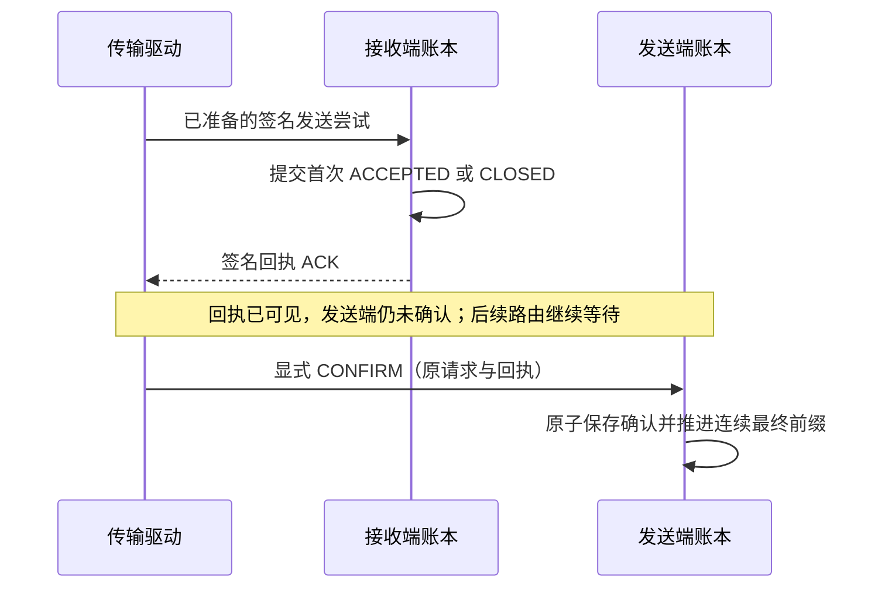

# 将逐步关系延伸到交付与最终前缀

此前的逐步检查覆盖 R1–R4：身份、预算、公开工作与发布。本轮在独立的测试侧检查器中增加 R5–R8 选定存储投影；既有协议和生成器不变，仍先生成报文、与真实观察逐字节比较，再读取真实数据库做诊断。

这次需要验证的核心区别是：**接收端已有首次事实、调用方看到 ACK、发送端提交确认是三个不同事件**。前两个事件都不能直接解锁后一条路由，也不能推进发送端最终前缀。



## 新增关系

| 关系 | 真实状态与模型的对应 |
|---|---|
| R5 准备与交接 | 原路由上下文、准入请求键、已存储 envelope/control 原字节及 handoff 标记一致；没有意外退休状态或退休 offer |
| R6 接收首次事实 | 可达接收实例、首次 ACCEPTED/CLOSED 的完整事实、原始签名证据、接收高水位与观察时钟一致；重试不能改写首次时间或证据 |
| R7 发送确认 | QUEUED/READY/ACCEPTED/CLOSED 状态、确认事实、原 request/ack 对、路由确认水位及累积根一致；只认显式 CONFIRM 事件 |
| R8 全局最终前缀 | 模型最大连续最终前缀与真实 final_events 的序号、结果和 delivery_id 一致；等待中的前项阻挡后续 ADMITTED 或 WITHHELD 项 |

R8 为已有 POLL/FINAL 报文构造比较提供实际存储关系。它没有额外穷举所有可能的 cursor/limit 或调用交错。R5–R8 与 R1–R4 组合使用，不能将这些投影称为覆盖每一个数据库字段的完整不变量。

新检查器会解密**已保存的传输证据**，用于逐字节比较。它不读取私有快照、工作累加器或原始 seed/result 存储；SQL 授权回调测试拒绝检查器写入数据库或读取这些计算表。读取这些证据的是测试侧诊断程序，生成器仍只接收公开命令、已批准机制输出和显式签名资源。

## 四条新增执行路径

1. **receipt_wait**：看到回执后执行 POLL、FINAL 和一个空闲逻辑槽，最终前缀仍为零；显式提交确认后才推进。
2. **cross_route_receipt_wait**：首项的回执已经可见，但发送端尚未确认，第二条路由仍被 DOMAIN_FINAL_ORDER 阻挡。
3. **receipt_then_terminal**：首次回执可见但尚未确认，随后原票据过期；终止请求返回原 ACCEPTED、原首次时间及原证据，不改成 CLOSED。
4. **withheld_behind_unconfirmed**：第二项执行前取消，已产生 WITHHELD，但它仍被第一项未确认交付挡住；确认第一项后，一次推进两个最终记录。

这些路径中的延迟确认使用当前最新的已生成回执。模型的 CONFIRM 命令尚不能选择任意早先回执；任意旧 ACK 与晚到报文的交错仍需扩展，而不是隐式宣称覆盖。

## 检查能力的负对照

新增测试故意改变合成数据库中的字段，确认关系检查能够发现问题：

- 重新签名并重新加密不同的封包输出，以及损坏封包密文。
- 删除已准备终止控制，或撤销已发生的交接标记。
- 将首次接受时间改为另一个格式有效的时间并重新封装。这个变体仍能通过接收端局部格式/证据审计，却不再对应原首次事件。
- 在未记录 CONFIRM 时提交发送端确认，替换已保存回执对应的发送尝试，或修改确认前缀根。
- 提前写入最终记录，或漏掉应当随前项确认一起推进的 WITHHELD 后缀。

这些是拥有测试密钥和存储写权限的主动变异，不是外部攻击或正常实现已发生故障的声明。其中部分变异仍通过原 R1–R4 投影检查，表明新关系补充了实际缺口；它们不代表旧检查曾承诺覆盖这些字段。

## 范围与下一步

检查点位于初始状态和已完成的公开事件边界。事务内部中断、见证提交/本地提交分离、恢复、退休与清理仍需单独引入。当前配置要求退休水位为零；发现未建模的退休状态时检查失败，不能忽略已删除事实后继续声称对应成功。

签名、证据解析和累积根算法复用现有公共组件；生成器也仍共享预测转换规则。通过这些检查不能替代一般归纳证明、独立实现互检、生产非回滚保证或物理观察分析。此前的持久化成本数据保持不变；这些新增断言可用于后续成本优化的语义回归，但恢复安全与成本测量仍必须各自验证。

## 本轮结果

- 29 组、232 个案例通过，包含此前的 200 个案例和四条新路径各 8 种输入，共检查 41,592 个初始/已完成事件边界。
- 每组 8 种合成私有输入的公开轨迹及 R1–R8 选定投影摘要一致，对应 696 个有向相邻比较；随机带按输出条件化，这仍不是独立随机试验或完整分布检验。
- 既有 200 个案例的报文摘要和 R1–R4 投影摘要与上一轮完全一致。归档核对也验证了检查点编号、事件种类、数量及逐项摘要。
- 最终隔离副本中 70 项仓库回归与 17 项既有公开轨迹测试通过。其中新增关系测试 13 项，另保存四类变异在旧/新投影中的检测差异。

证据见[清单](delivery-state-evidence-20261026/manifest.json)、[实验摘要](delivery-state-evidence-20261026/summary.json)、[运行记录](delivery-state-evidence-20261026/run.json)、[负对照](delivery-state-evidence-20261026/negative-controls.json)和[归档核对](delivery-state-evidence-20261026/comparison.json)。基线为 PR #5 的 `71b3fc71c8ddac0c120e1036f09ee8478bf50159`；其双环境 push/PR CI 均已成功。新增源码由本轮运行摘要分别绑定。

在仓库根目录复现（输出目录必须尚不存在）：

```sh
python3 outputs/agent-cryptography-design-20261025/prototype/delivery_relation_trace.py --output /tmp/agentsec-delivery-relations-new
python3 -m unittest discover -s tests -p test_delivery_state_relation.py -v
```
