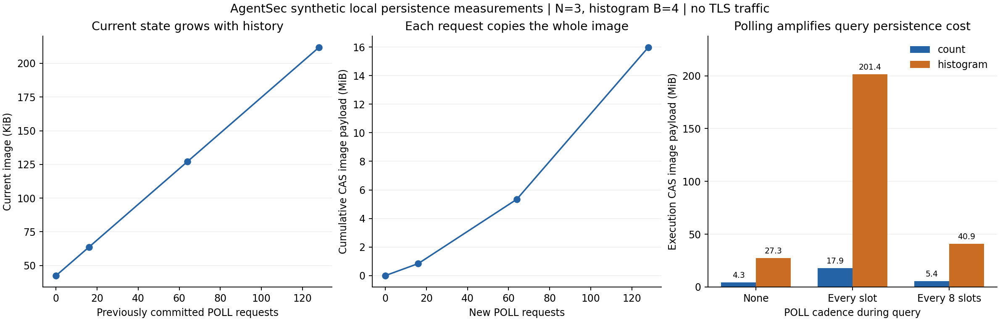

# 受限公开轨迹与持久化成本：2026-10-26

PR #1 最新提交的固定依赖和升级依赖 CI 均通过，已合并至 `main`，合并提交为 `f051ae2d747c595515552d28b57ab150076129c1`。合并后的 main CI 也通过。本轮以该提交为基础开展两项受限实验。

## 公开轨迹的对应范围

[受限契约](restricted-trace-contract.json) 冻结一个租户、一个共享预算域、N=3、直方图 B=4、K=40、最多两项成功操作。密钥、凭证和身份登记在轨迹期间保持不变；撤销仅包含已记录的公开根撤销。接口仍有五类公开方法，支持一条或两条接收路由。

实验驱动使用真实的签名请求、账本事务、见证和接收端凭据。校验器的状态与数据库独立，只接收公开配置、驱动事件、签名报文以及绑定操作的已批准输出。公开编码与验签函数仍和实现共用，所以这不是独立密码实现的互操作证明。

记录明确区分接收端 ACK 与发送端持久确认：只有后者允许推进域级最终前缀。每个逻辑槽由实验驱动记录，不能从轮询中反推计算进度。每次批准机制调用绑定 Action 摘要、L1 槽和完整账户成本，并与真实随机带创建调用及账本 allocated=reserved+spent 进行比较。

19 个计划覆盖正常完成、L1 前后取消/撤销、暂停、准入后撤销、发布后取消拒绝、包丢失、ACK 丢失、过期 CLOSED、曾接收后的过期 ACCEPTED、永久未确认、认证/输入/请求冲突拒绝及精确重试、同路由和跨路由混合机制、以及基于首项公开结果选择第二项机制。每个计划都比较固定三用户名册的八个子集。

固定有效随机带让各子集释放同一批准输出，再固定公开挑战与证明随机量后比较完整记录。这是条件轨迹对应，不是随机分布枚举。永久丢包仍返回 pending；没有把未完成伪造成 CLOSED。发布后的取消保留真实网关 REJECTED 语义，不强行套用旧抽象模型的成功取消响应。

负对照包括缺失/重复逻辑槽、未知管理事件、提前发布、签名但错误的最终状态、未持久确认、跨路由提前发送、改写重试响应、错误或缺失 oracle 输出、私有条件错误别名和连接关闭。前几项是对实际报文记录的故意修改，用来验证校验器能发现违反对应关系的记录；不代表正常实现已经存在这些分支。

校验签名报文也不等于构造一个能生成这些报文的模拟器。仅给公开验签密钥不能生成任意有效签名；后续理想世界必须明确签名 oracle 或密钥建立过程，以及独立于私有数据的服务随机量。当前实现是对应关系检查器，没有将这一缺口隐藏在“测试通过”中。

完整分布证明、任意自适应输入的归纳精化、崩溃恢复与清理事件、动态管理面、物理时间及可用性仍未完成。先前 N=2/B=2/K=1 的有限模型和本次事件驱动校验器之间也没有一般等价证明。OBS-4 仍为部分完成。

## 持久化成本的测量方法

使用本机 `ReferenceWitness` 和真实 SQLite 事务，测量每次操作的 CAS 次数、提交镜像字节、状态图像构造次数及编码字节、操作延迟、恢复时间和文件大小。镜像字节是传入 CAS 的实际 payload，不包含 TLS/网络帧；没有测量实际物理磁盘写放大。指标来自被观测函数外层，未改变事务边界、随机带或恢复协议。

轮询历史取 0、16、64、128 条，各自测量 8 次新 POLL、8 次精确重试、8 次持久拒绝；每个场景恢复至三个新副本。p50/p95 用最近秩计算，8 个样本时 p95 就是该组最大值，不能当作稳定的生产尾延迟估计。另对计数和四桶直方图分别测量无轮询、每槽轮询和每八槽轮询。启动和授权注册与执行阶段分别计量。

数据库位于系统默认临时目录，而非仓库所在的外接盘；硬件、缓存与其他后台负载未受控。操作延迟包含签名、编码和实验驱动开销，不能归因于纯磁盘耗时。

本轮不测跨主机网络、并发饱和吞吐、冷缓存、真实大数据或 16 MiB 上限附近容量。文件字节为采样时的逻辑文件大小，不代表文件系统分配量或安全擦除。测试时使用固定合成输入；计算服务吞吐只表示顺序调用观察到的服务率。

## 本轮结果

152 条真实运行轨迹（19 个计划 × 8 个输入）全部通过校验。每个计划的八条条件轨迹逐字节相同，因而覆盖这组输入中的 456 个有向邻接比较。保存的压缩记录再次逐条解码回放，也全部通过。25 项仓库回归通过，其中包括原审核回归 15 项、本轮轨迹回归 8 项和成本计量回归 2 项。

[证据清单](evidence-20261026/manifest.json)、[轨迹摘要](evidence-20261026/trace-summary.json)、[完整压缩轨迹](evidence-20261026/traces.json.gz)、[成本原始数据](evidence-20261026/persistence.json)、[测试日志](evidence-20261026/tests.log) 可独立核查，实验摘要绑定本轮全部原型源码 SHA-256。

| 机制 | 轮询频率 | 逻辑槽 | CAS 提交 | 复制镜像 MiB | 执行阶段秒 |
|---|---:|---:|---:|---:|---:|
| 计数 | 无 | 85 | 85 | 4.29 | 0.294 |
| 计数 | 每 1 槽 | 85 | 170 | 17.91 | 1.217 |
| 计数 | 每 8 槽 | 85 | 95 | 5.40 | 0.341 |
| 四桶直方图 | 无 | 337 | 337 | 27.34 | 1.890 |
| 四桶直方图 | 每 1 槽 | 337 | 674 | 201.37 | 7.482 |
| 四桶直方图 | 每 8 槽 | 337 | 379 | 40.88 | 2.438 |

上述复制量只包括执行槽和其中插入的轮询，不含引导、注册、交付和恢复。计数每查询 85 槽，四桶直方图每查询 337 槽。每槽两次构造状态镜像，一次 CAS；每次插入的轮询也执行一次 CAS。直方图每槽轮询将执行阶段镜像复制量从 27.34 MiB 提升到 201.37 MiB，约 7.37 倍，而不仅仅是提交次数翻倍。

轮询历史从 0 增至 128 条时，当前镜像由 43,545 字节增至 216,843 字节。累积构建这 128 条历史的 CAS 镜像量为 16,747,419 字节，约 15.97 MiB。它说明不断增长的状态会被反复复制；并不表示见证永久保存了每次完整镜像。平方阶累计工作的说法仍来自“每请求增加有界历史且每次复制全量”的结构分析，不能把这四个采样点当作一般复杂度证明。

同一轮采样中，新 POLL 的 p50 从约 3.15 ms 增至 6.07 ms。对应场景再增加 8 次采样请求之后，恢复三个新副本的中位时间约从 31.6 ms 增至 99.8 ms。精确重试保持网关行数不变，但八次重试仍产生八次 CAS，并继续增加见证提交元数据。

逻辑延迟实验也保持了安全语义：首项已接收但 ACK 未确认时，后一路由在公开时钟 100、130 和 170 均被 `DOMAIN_FINAL_ORDER` 阻止；随后首项保留原 ACCEPTED，未接收且已到期的第二项为 CLOSED。这是 70 个公开时间单位的计划，不是实际等待 70 秒的网络故障实验。

## 继续推进的依据

轨迹侧下一步是逐条建立状态转换的归纳义务，并把恢复和清理加入独立驱动事件；未知异常不能直接变成“安全的公开拒绝”。成本侧下一步比较固定大小工作分段和现有逐槽提交，但必须在相同公开调度、L1 随机带持久化及崩溃恢复语义下进行。当前没有通过放松提交或跳过最终确认来换取性能。
